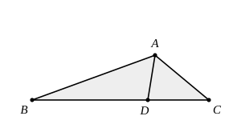
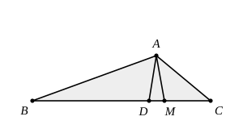

## Statement

Dans un triangle $ABC$, on donne

$$\widehat{ABC} = 20^\circ \qquad \text{et} \qquad \widehat{ACB} = 40^\circ.$$

La bissectrice de l'angle $\widehat{BAC}$ coupe le côté $[BC]$ en $D$, et l'on sait que $AD = 2$ cm.

Calculer la différence $BC - AB$.

## Hints

1. Commence par calculer tous les angles que tu peux : $\widehat{BAC}$, puis $\widehat{BAD}$ et $\widehat{DAC}$, puis les angles du triangle $ABD$.
2. On cherche une différence de deux longueurs. Une différence se voit bien quand on reporte la plus petite sur la plus grande : place sur le côté $[BC]$ le point $M$ tel que $BM = AB$. Que vaut alors $BC - AB$ ?
3. Trace le segment $[AM]$. Le triangle $ABM$ est isocèle : calcule ses angles, puis l'angle $\widehat{AMC}$.
4. Tu connais maintenant deux angles du triangle $AMC$. Que peux-tu dire de ce triangle ? Regarde ensuite le triangle $AMD$ : que valent ses angles en $D$ et en $M$ ?

## Solution

**Les angles du triangle.**

La somme des angles du triangle $ABC$ donne

$$\widehat{BAC} = 180^\circ - 20^\circ - 40^\circ = 120^\circ,$$

et comme $[AD)$ est la bissectrice de cet angle,

$$\widehat{BAD} = \widehat{DAC} = 60^\circ.$$

**L'idée : reporter le petit côté sur le grand.**

On nous demande une différence de longueurs. Le bon réflexe est de reporter la petite longueur sur la grande. Plaçons donc sur le côté $[BC]$ le point $M$ tel que

$$BM = AB,$$

et traçons le segment $[AM]$. Alors

$$BC - AB = BC - BM = MC.$$

Tout revient donc à calculer $MC$.

**Premier triangle isocèle : $ABM$.**

Par construction $BM = AB$, donc le triangle $ABM$ est isocèle de sommet principal $B$. Son angle au sommet est $\widehat{ABM} = \widehat{ABC} = 20^\circ$, donc ses angles à la base valent

$$\widehat{BAM} = \widehat{BMA} = \frac{180^\circ - 20^\circ}{2} = 80^\circ.$$

Au passage, comme $\widehat{BAD} = 60^\circ$ est plus petit que $\widehat{BAM} = 80^\circ$, la demi-droite $[AD)$ est à l'intérieur de l'angle $\widehat{BAM}$ : le point $D$ se trouve donc entre $B$ et $M$, comme sur la figure.

**Deuxième triangle isocèle : $AMC$.**

Les points $B$, $M$, $C$ sont alignés, donc

$$\widehat{AMC} = 180^\circ - \widehat{AMB} = 180^\circ - 80^\circ = 100^\circ.$$

Dans le triangle $AMC$, on connaît deux angles : $\widehat{AMC} = 100^\circ$ et $\widehat{MCA} = \widehat{BCA} = 40^\circ$. Donc

$$\widehat{MAC} = 180^\circ - 100^\circ - 40^\circ = 40^\circ = \widehat{MCA}.$$

Le triangle $AMC$ a deux angles égaux : il est isocèle, et les côtés opposés à ces deux angles sont égaux :

$$MA = MC.$$

**Troisième triangle isocèle : $AMD$.**

Dans le triangle $ABD$, on a $\widehat{ABD} = 20^\circ$ et $\widehat{BAD} = 60^\circ$, donc

$$\widehat{ADB} = 180^\circ - 20^\circ - 60^\circ = 100^\circ.$$

Le point $D$ est entre $B$ et $M$, donc les angles $\widehat{ADB}$ et $\widehat{ADM}$ sont supplémentaires :

$$\widehat{ADM} = 180^\circ - 100^\circ = 80^\circ.$$

Par ailleurs $D$ est du même côté que $B$ par rapport à $M$, donc $\widehat{AMD} = \widehat{AMB} = 80^\circ$.

Le triangle $AMD$ a lui aussi deux angles égaux, donc il est isocèle, et les côtés opposés à ces deux angles sont égaux :

$$AM = AD.$$

**On rassemble.**

$$BC - AB = MC = MA = AD = 2 \text{ cm}.$$

**Conclusion.** $BC - AB = 2$ cm. La différence des deux côtés est exactement la longueur de la bissectrice $AD$.

## Going further

1. Reprendre tout le calcul avec deux angles quelconques $\widehat{ABC} = \beta$ et $\widehat{ACB} = \gamma$. Montrer que le triangle $AMD$ est isocèle exactement lorsque $\gamma = 2\beta$, et que le triangle $AMC$ est isocèle exactement lorsque $2\gamma + \dfrac{\beta}{2} = 90^\circ$.
2. En déduire que $\beta = 20^\circ$ et $\gamma = 40^\circ$ sont les seules valeurs pour lesquelles cette démonstration fonctionne : les nombres de l'énoncé ne sont pas choisis au hasard.
