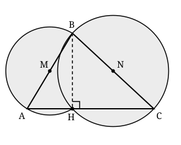

## Statement

Un pré est entouré d'une clôture en forme de triangle $ABC$.

À l'intérieur du pré, on plante un piquet au milieu $M$ du côté $[AB]$ et un autre piquet au milieu $N$ du côté $[BC]$. On attache une chèvre à chaque piquet :

- la corde de la chèvre attachée en $M$ mesure $\dfrac{AB}{2}$ ;
- la corde de la chèvre attachée en $N$ mesure $\dfrac{BC}{2}$.

Une chèvre broute toute l'herbe qu'elle peut atteindre.

Les deux chèvres peuvent-elles manger toute l'herbe du pré ?

## Hints

1. Quelle est la région atteinte par une chèvre attachée à un piquet par une corde de longueur $r$ ?
2. La chèvre attachée en $M$ atteint le disque de centre $M$ et de rayon $\frac{AB}{2}$, c'est-à-dire le disque de diamètre $[AB]$. Ce disque contient déjà les points $A$ et $B$ : que faut-il de plus ?
3. Trace la hauteur issue de $B$ et appelle $H$ son pied sur $(AC)$. Le triangle $ABH$ est rectangle : où se trouve $H$ par rapport au cercle de diamètre $[AB]$ ?
4. Rappel : si un triangle est rectangle, son hypoténuse est un diamètre de son cercle circonscrit.
5. Dernier point à ne pas oublier : un disque est *bombé*. Si deux points sont dans un disque, tout le segment qui les joint y est aussi. Comment en déduire que tout le triangle $ABH$ est dans le disque ?

## Solution

**Réponse : oui, les deux chèvres mangent toute l'herbe du pré.**

**Étape 1. Ce qu'atteint chaque chèvre.**

Une chèvre attachée en un point $P$ par une corde de longueur $r$ atteint exactement les points situés à une distance au plus $r$ de $P$ : c'est le disque de centre $P$ et de rayon $r$.

- La première chèvre atteint le disque de centre $M$ et de rayon $\frac{AB}{2}$. Comme $M$ est le milieu de $[AB]$, c'est le **disque de diamètre $[AB]$**. Appelons-le $\mathcal{D}_1$.
- La seconde atteint de même le **disque de diamètre $[BC]$**. Appelons-le $\mathcal{D}_2$.

**Étape 2. Couper le triangle en deux.**

Traçons la hauteur issue de $B$ et appelons $H$ son pied sur la droite $(AC)$. Sur la figure, $H$ est entre $A$ et $C$, et le triangle $ABC$ est alors réunion des deux triangles rectangles $ABH$ et $CBH$.

**Étape 3. Le triangle $ABH$ tient dans le disque $\mathcal{D}_1$.**

Le triangle $ABH$ est rectangle en $H$, et son hypoténuse est $[AB]$. Or, si un triangle est rectangle, son hypoténuse est un diamètre de son cercle circonscrit. Le cercle circonscrit au triangle $ABH$ est donc le cercle de diamètre $[AB]$, c'est-à-dire le bord de $\mathcal{D}_1$.

Autrement dit :

$$MH = MA = MB = \frac{AB}{2}$$

Les trois sommets $A$, $B$ et $H$ sont donc dans le disque $\mathcal{D}_1$.

Il reste à voir que tout le triangle $ABH$ y est aussi. Un disque est bombé : si deux points lui appartiennent, tout le segment qui les joint lui appartient également. Prenons un point $P$ du triangle $ABH$ et traçons la demi-droite $[AP)$ : elle coupe le côté $[BH]$ en un point $Q$.

- $B$ et $H$ sont dans $\mathcal{D}_1$, donc tout le segment $[BH]$ y est, et en particulier $Q$.
- $A$ et $Q$ sont dans $\mathcal{D}_1$, donc tout le segment $[AQ]$ y est, et en particulier $P$.

Tout le triangle $ABH$ est donc dans $\mathcal{D}_1$ : la première chèvre mange toute l'herbe de $ABH$.

**Étape 4. Le triangle $CBH$ tient dans le disque $\mathcal{D}_2$.**

C'est exactement le même raisonnement. Le triangle $CBH$ est rectangle en $H$, d'hypoténuse $[BC]$, donc

$$NH = NB = NC = \frac{BC}{2}$$

et le triangle $CBH$ tout entier est dans le disque $\mathcal{D}_2$. La seconde chèvre mange toute l'herbe de $CBH$.

**Conclusion.**

$$\text{triangle } ABC = \text{triangle } ABH \cup \text{triangle } CBH \subset \mathcal{D}_1 \cup \mathcal{D}_2$$

Les deux chèvres mangent donc toute l'herbe du pré.

**Remarque : le cas d'un triangle très aplati.**

Si l'angle en $A$ est obtus, le pied $H$ tombe en dehors du segment $[AC]$, de l'autre côté de $A$, et le découpage de l'étape 2 ne marche plus. Mais alors $A$ est entre $H$ et $C$, donc le triangle $ABC$ est contenu dans le triangle $HBC$. Ce dernier est rectangle en $H$, d'hypoténuse $[BC]$, donc il est contenu dans $\mathcal{D}_2$ par le raisonnement de l'étape 4. Cette fois, la seconde chèvre mange tout le pré à elle seule. Le cas où l'angle en $C$ est obtus se traite de la même façon avec la première chèvre.

La réponse est donc oui pour n'importe quel triangle.

## Going further

1. Le triangle est rectangle en $B$. Montrer qu'une seule chèvre suffit, attachée au milieu de l'hypoténuse $[AC]$ avec une corde de longueur $\frac{AC}{2}$.
2. Pour quels triangles une seule chèvre, attachée au milieu de $[AB]$ avec une corde de longueur $\frac{AB}{2}$, mange-t-elle déjà tout le pré ?
3. Le pré est maintenant un quadrilatère convexe, et on attache une chèvre au milieu de chacun des quatre côtés, chaque corde mesurant la moitié de son côté. Les quatre chèvres mangent-elles toute l'herbe ? *Indication : un point $P$ est dans le disque de diamètre $[AB]$ exactement lorsque l'angle $\widehat{APB}$ est droit ou obtus, et les quatre angles sous lesquels $P$ voit les côtés font en tout un tour complet.*
