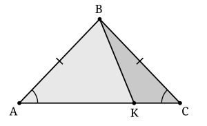

## Statement

Un cas d'égalité des triangles est une courte liste de données qui suffit à garantir que deux triangles sont superposables. Par exemple : deux côtés et l'angle compris entre ces deux côtés.

Simon croit en avoir trouvé un nouveau :

> « Prenons deux triangles. Si deux côtés du premier ont la même longueur que deux côtés du second, et si en plus un angle du premier a la même mesure qu'un angle du second, ces deux angles n'étant pas ceux compris entre les côtés choisis, alors les deux triangles sont superposables. »

Simon a-t-il raison ?

## Hints

1. Une règle générale est fausse dès qu'on trouve un seul contre-exemple. Cherche donc deux triangles qui vérifient tout ce que Simon demande, mais qui ne sont pas superposables.
2. Essaie de construire tes deux triangles dans une même figure, en leur faisant partager un côté. Cela donne déjà gratuitement une égalité de longueurs.
3. Pars d'un triangle $ABC$ isocèle en $B$, et place sur $[AC]$ un point $K$ qui n'est pas le milieu. Regarde les triangles $ABK$ et $CBK$ : quels côtés ont-ils de même longueur, et quels angles de même mesure ?

## Solution

**Non, Simon a tort.** Pour le montrer, il suffit d'un contre-exemple.

**Le contre-exemple.**

Traçons un triangle $ABC$ isocèle en $B$, c'est-à-dire avec $AB = CB$. Plaçons sur le segment $[AC]$ un point $K$ qui n'est **pas** le milieu de $[AC]$, et traçons $[BK]$.

Les deux triangles du contre-exemple sont $ABK$ et $CBK$.

**Ils vérifient bien les données de Simon.**

Dans le triangle $ABK$, choisissons les côtés $[AB]$ et $[BK]$. Dans le triangle $CBK$, choisissons les côtés $[CB]$ et $[BK]$.

- $AB = CB$, car le triangle $ABC$ est isocèle en $B$.
- $BK = BK$, c'est le même segment.

Les deux côtés du premier ont donc bien la même longueur que les deux côtés du second.

Passons à l'angle. Dans le triangle $ABK$, l'angle compris entre les côtés choisis $[AB]$ et $[BK]$ est l'angle $\widehat{ABK}$, celui de sommet $B$. Nous, nous prenons l'angle $\widehat{BAK}$, celui de sommet $A$ : ce n'est donc pas l'angle compris entre les deux côtés choisis, exactement comme Simon le demande. De même dans $CBK$ nous prenons l'angle $\widehat{BCK}$, de sommet $C$.

Ces deux angles ont la même mesure : ce sont les angles à la base du triangle isocèle $ABC$, et $K$ est sur $[AC]$, donc

$$\widehat{BAK} = \widehat{BAC} = \widehat{BCA} = \widehat{BCK}$$

Tout ce que demande Simon est donc vérifié.

**Mais les deux triangles ne sont pas superposables.**

Si $ABK$ et $CBK$ étaient superposables, les côtés qui se correspondent auraient la même longueur, et on aurait en particulier $AK = CK$. Cela voudrait dire que $K$ est le milieu de $[AC]$, ce que nous avons justement interdit.

On peut aussi le voir sur les aires : les triangles $ABK$ et $CBK$ ont la même hauteur issue de $B$, mais des bases $AK$ et $KC$ de longueurs différentes, donc des aires différentes. Deux figures superposables ont la même aire.

**Conclusion.**

Le « cas d'égalité » de Simon est faux : deux côtés et un angle non compris entre eux ne suffisent pas à garantir que deux triangles sont superposables.

*Remarque.* Simon n'est pas si loin du compte. On peut montrer que deux triangles qui vérifient ses données sont, au choix, superposables, ou bien se recollent exactement comme sur la figure pour former un triangle isocèle. Il n'y a jamais d'autre possibilité.

## Going further

1. Que se passe-t-il si $K$ est le milieu de $[AC]$ ? Pourquoi le contre-exemple ne fonctionne-t-il plus ?
2. Montrer que si l'angle égal dont parle Simon est un angle droit, alors Simon a raison. On retrouve ainsi le cas d'égalité des triangles rectangles : « même hypoténuse et même côté de l'angle droit ».
3. Sur la figure, les angles $\widehat{AKB}$ et $\widehat{CKB}$ sont supplémentaires, donc l'un des deux est obtus dès que $K$ n'est pas le milieu. En déduire que deux triangles qui vérifient les données de Simon sans être superposables ne peuvent pas avoir tous leurs angles aigus tous les deux.
