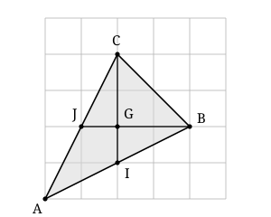

## Statement

Sur une feuille quadrillée, on appelle **nœud** un point où deux lignes du quadrillage se
croisent.

Dessiner un triangle dont les trois sommets sont des nœuds du quadrillage et dont deux
médianes sont perpendiculaires.

*On rappelle qu'une médiane d'un triangle est le segment qui joint un sommet au milieu du
côté opposé.*

## Hints

1. Pour que le milieu d'un côté tombe lui aussi sur un nœud, comment faut-il placer les deux
   sommets de ce côté l'un par rapport à l'autre ?
2. Deux droites sont à coup sûr perpendiculaires si l'une suit une ligne horizontale du
   quadrillage et l'autre une ligne verticale. Essaie donc de construire le triangle **à
   partir de ses médianes**, et non l'inverse.
3. Les trois médianes se coupent en un même point $G$, situé aux deux tiers de chaque médiane
   en partant du sommet. Place $G$ sur un nœud : des médianes longues de $3$ carreaux tombent
   alors parfaitement ($2$ carreaux d'un côté de $G$, $1$ de l'autre).

## Solution

**L'idée : on ne part pas du triangle, on part de ses médianes.**

Rien n'oblige à dessiner un triangle au hasard et à espérer. Deux droites sont sûrement
perpendiculaires si l'une suit une ligne horizontale du quadrillage et l'autre une ligne
verticale. On va donc fabriquer un triangle dont deux médianes soient portées par des lignes
du quadrillage.

**Une réponse.**

Repérons les nœuds à partir d'un nœud choisi comme origine, un carreau pour unité. On prend :

$$A(0\,;0) \qquad B(4\,;2) \qquad C(2\,;4)$$

autrement dit : $B$ est à $4$ carreaux à droite et $2$ carreaux au-dessus de $A$, et $C$ est à
$2$ carreaux à droite et $4$ carreaux au-dessus de $A$.

**Vérification.**

*Les milieux tombent bien sur des nœuds.* Pour aller de $A$ à $B$, on avance de $4$ carreaux
et on monte de $2$ carreaux ; la moitié de ce déplacement, c'est $2$ carreaux à droite et $1$
carreau en haut. Le milieu de $[AB]$ est donc le nœud $I(2\,;1)$. De la même façon, le milieu
de $[AC]$ est le nœud $J(1\,;2)$.

*La médiane issue de $C$ est verticale.* C'est le segment $[CI]$, avec $C(2\,;4)$ et
$I(2\,;1)$. Les deux points ont la même abscisse $2$ : le segment est porté par une ligne
verticale du quadrillage.

*La médiane issue de $B$ est horizontale.* C'est le segment $[BJ]$, avec $B(4\,;2)$ et
$J(1\,;2)$. Les deux points ont la même ordonnée $2$ : le segment est porté par une ligne
horizontale du quadrillage.

Une ligne verticale et une ligne horizontale du quadrillage sont perpendiculaires. Les
médianes issues de $B$ et de $C$ sont donc perpendiculaires.

**Comment on a trouvé ces nombres.**

Les trois médianes se coupent en un même point $G$, le centre de gravité, situé aux deux tiers
de chaque médiane en partant du sommet : il partage chaque médiane dans le rapport $2 : 1$.

Pour que tout tombe sur des nœuds, on place $G$ sur un nœud et on choisit des médianes de
$3$ carreaux de long : le sommet à $2$ carreaux de $G$, le milieu du côté opposé à $1$ carreau
de $G$, de l'autre côté. Ici $G(2\,;2)$ : en partant de $G$, on monte de $2$ pour trouver $C$
et on descend de $1$ pour trouver $I$ ; on avance de $2$ vers la droite pour trouver $B$ et on
recule de $1$ pour trouver $J$. Le troisième sommet $A$ est alors imposé : c'est le symétrique
de $B$ par rapport à $J$, c'est-à-dire le nœud $(0\,;0)$.

**Conclusion.**

Le triangle de sommets $A(0\,;0)$, $B(4\,;2)$ et $C(2\,;4)$ a ses trois sommets sur des nœuds
du quadrillage, et ses médianes issues de $B$ et de $C$ sont perpendiculaires.

## Going further

1. Quelle est l'aire, en carreaux, du triangle construit ci-dessus ?
2. Vérifier sur le dessin que la troisième médiane, issue de $A$, passe elle aussi par $G$.
3. Trouver un autre triangle qui convient et qui ne soit pas un agrandissement, une
   translation ou une symétrie de celui-ci. (Reprendre la recette, mais avec une médiane
   verticale de $3$ carreaux et une médiane horizontale de $6$ carreaux.)
