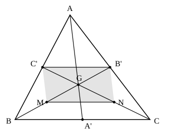

## Statement

$ABC$ est un triangle. On note $A'$ le milieu de $[BC]$, $B'$ le milieu de $[AC]$ et $C'$ le milieu de $[AB]$. Les segments $[AA']$, $[BB']$ et $[CC']$ sont les trois médianes du triangle.

Démontrer que les trois médianes passent par un même point $G$, appelé centre de gravité du triangle, et que

$$\frac{AG}{GA'} = \frac{BG}{GB'} = \frac{CG}{GC'} = 2.$$

## Hints

1. Ne traite d'abord que deux médianes : appelle $G$ le point où $[BB']$ et $[CC']$ se coupent.
2. Place les milieux $M$ de $[GB]$ et $N$ de $[GC]$. Tu as maintenant quatre points intéressants : $C'$, $B'$, $N$, $M$.
3. Applique le théorème des milieux deux fois : une fois dans le triangle $ABC$ pour le segment $[C'B']$, une fois dans le triangle $GBC$ pour le segment $[MN]$. Que remarques-tu ?
4. Un quadrilatère dont deux côtés opposés sont parallèles et de même longueur est un parallélogramme, et les diagonales d'un parallélogramme se coupent en leur milieu. Où sont les diagonales de $C'B'NM$ ?
5. Pour la troisième médiane : sur le segment $[BB']$, il n'existe qu'un seul point $X$ tel que $BX = 2 \times XB'$.

## Solution

**Deux médianes pour commencer.** Les segments $[BB']$ et $[CC']$ se coupent en un point que nous appelons $G$. Notons $M$ le milieu de $[GB]$ et $N$ le milieu de $[GC]$.

**Deux fois le théorème des milieux.**

- Dans le triangle $ABC$, les points $C'$ et $B'$ sont les milieux de $[AB]$ et $[AC]$, donc
  $$(C'B') \parallel (BC) \qquad \text{et} \qquad C'B' = \frac{BC}{2}.$$
- Dans le triangle $GBC$, les points $M$ et $N$ sont les milieux de $[GB]$ et $[GC]$, donc
  $$(MN) \parallel (BC) \qquad \text{et} \qquad MN = \frac{BC}{2}.$$

**Un parallélogramme.** Les segments $[C'B']$ et $[MN]$ sont donc tous les deux parallèles à $(BC)$ et tous les deux de longueur $\dfrac{BC}{2}$. Le quadrilatère $C'B'NM$ a deux côtés opposés parallèles et de même longueur : c'est un parallélogramme.

**Ses diagonales.** Les diagonales de ce parallélogramme sont $[C'N]$ et $[B'M]$.

- Le point $N$ est le milieu de $[GC]$, donc $N$ est sur la droite $(CC')$. La diagonale $[C'N]$ est donc portée par la médiane $(CC')$.
- De même, $M$ est le milieu de $[GB]$, donc $[B'M]$ est porté par la médiane $(BB')$.

Les deux diagonales se coupent au point commun des deux médianes, c'est-à-dire en $G$. Or les diagonales d'un parallélogramme se coupent en leur milieu : **$G$ est donc le milieu de $[B'M]$ et le milieu de $[C'N]$.**

**Les rapports.** De $G$ milieu de $[B'M]$ on tire $GB' = GM$. Et comme $M$ est le milieu de $[GB]$, on a $GM = MB = \dfrac{GB}{2}$. Donc

$$GB' = \frac{GB}{2}, \qquad \text{c'est-à-dire} \qquad \frac{BG}{GB'} = 2.$$

Le même raisonnement avec la diagonale $[C'N]$ donne

$$\frac{CG}{GC'} = 2.$$

**La troisième médiane.** Appelons $G_1$ le point où les médianes $[AA']$ et $[BB']$ se coupent. Tout ce que nous venons de faire avec le couple de médianes $([BB'], [CC'])$ se refait à l'identique avec le couple $([AA'], [BB'])$, et donne

$$\frac{BG_1}{G_1B'} = 2.$$

Mais sur le segment $[BB']$ il n'y a qu'un seul point qui le partage dans le rapport $2$ à partir de $B$ : celui qui est situé à la distance $\dfrac{2}{3} \times BB'$ du point $B$. Les points $G$ et $G_1$ sont donc confondus.

La médiane $[AA']$ passe donc elle aussi par $G$ : **les trois médianes sont concourantes en $G$**, et le même argument, appliqué une dernière fois, donne

$$\frac{AG}{GA'} = 2.$$

**Conclusion.** Les trois médianes se coupent en un même point $G$, et chacune est coupée par $G$ aux deux tiers en partant du sommet :

$$\frac{AG}{GA'} = \frac{BG}{GB'} = \frac{CG}{GC'} = 2.$$

## Going further

1. En déduire que $AG = \dfrac{2}{3} \times AA'$.
2. Montrer que les six petits triangles découpés dans $ABC$ par les trois médianes ont tous la même aire, égale au sixième de l'aire de $ABC$.
