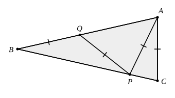

## Statement

$ABC$ est un triangle isocèle en $B$, c'est-à-dire $BA = BC$. Le point $P$ est sur le côté
$[BC]$ et le point $Q$ est sur le côté $[AB]$, de façon que

$$AC = AP = PQ = QB.$$

Calculer la mesure de l'angle $\widehat{ABC}$.

## Hints

1. Appelle $\beta$ la mesure de $\widehat{ABC}$ et exprime tous les angles de la figure en
   fonction de $\beta$, en partant du sommet $B$ et en remontant la chaîne
   $QB$, $PQ$, $AP$, $AC$.
2. Chacun des triangles $QBP$, $PQA$, $APC$ est isocèle : c'est ce que disent les égalités de
   l'énoncé.
3. Dans un triangle, un angle extérieur est égal à la somme des deux angles intérieurs qui ne
   le touchent pas. Chaque étape de la chaîne augmente l'angle de $\beta$.
4. À la fin, le triangle $ABC$ est lui aussi isocèle : écris que la somme de ses angles vaut
   $180^\circ$. Tu obtiendras une équation en $\beta$.

## Solution

**L'idée : chaque segment égal ajoute un $\beta$ à l'angle, et le triangle $ABC$ ferme la
chaîne.**

Posons $\beta = \widehat{ABC}$.

**Étape 1. Le triangle $QBP$** est isocèle en $Q$, car $QB = QP$. Ses angles à la base sont
égaux :

$$\widehat{QPB} = \widehat{QBP} = \widehat{ABC} = \beta.$$

**Étape 2.** L'angle $\widehat{AQP}$ est un angle extérieur du triangle $QBP$ en $Q$ (le point
$A$ est sur la demi-droite $[BQ)$, au-delà de $Q$). Il vaut donc la somme des deux angles
intérieurs non adjacents :

$$\widehat{AQP} = \widehat{QBP} + \widehat{QPB} = 2\beta.$$

**Étape 3. Le triangle $PQA$** est isocèle en $P$, car $PQ = PA$. Donc

$$\widehat{PAQ} = \widehat{AQP} = 2\beta.$$

**Étape 4.** L'angle $\widehat{APC}$ est un angle extérieur du triangle $ABP$ en $P$ (le point
$C$ est sur la demi-droite $[BP)$, au-delà de $P$) :

$$\widehat{APC} = \widehat{ABP} + \widehat{BAP} = \beta + 2\beta = 3\beta.$$

(On a bien $\widehat{BAP} = \widehat{QAP} = 2\beta$, car $Q$ est sur le côté $[AB]$.)

**Étape 5. Le triangle $APC$** est isocèle en $A$, car $AP = AC$. Donc

$$\widehat{ACP} = \widehat{APC} = 3\beta.$$

Comme $P$ est sur le côté $[BC]$, cet angle est l'angle $\widehat{ACB}$ du grand triangle :
$\widehat{ACB} = 3\beta$.

**Étape 6. On ferme.** Le triangle $ABC$ est isocèle en $B$, donc
$\widehat{BAC} = \widehat{BCA} = 3\beta$. La somme des angles du triangle $ABC$ donne

$$\beta + 3\beta + 3\beta = 180^\circ, \qquad 7\beta = 180^\circ, \qquad \beta = \frac{180^\circ}{7}.$$

**Conclusion.**

$$\widehat{ABC} = \frac{180^\circ}{7} \approx \text{25,7}^\circ.$$

C'est un angle que l'on ne peut pas construire à la règle et au compas, et dont la mesure en
degrés n'est pas un nombre entier : l'heptagone régulier n'est jamais loin.

## Going further

Vérifier que la figure existe vraiment : avec $\beta = \dfrac{180^\circ}{7}$, contrôler que
les angles trouvés sont tous positifs et que les points $P$ et $Q$ tombent bien à l'intérieur
des côtés $[BC]$ et $[AB]$.
