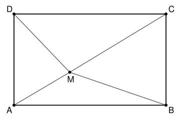

## Statement

$ABCD$ est un rectangle et $M$ un point à l'intérieur de ce rectangle.

Montrer que l'aire du rectangle est inférieure ou égale à
$$AM \times CM + BM \times DM .$$

## Hints

1. Note $a = AB$, $b = AD$, et $x$, $y$ les distances de $M$ aux côtés $[AD]$ et $[AB]$. Exprime $AM$, $BM$, $CM$, $DM$ avec le théorème de Pythagore.
2. Les parallèles aux côtés passant par $M$ découpent $ABCD$ en quatre petits rectangles. Écris l'aire $ab$ comme la somme de leurs quatre aires.
3. Développe $(p^2 + q^2)(r^2 + s^2) - (pr + qs)^2$. Qu'en déduis-tu pour $\sqrt{p^2 + q^2} \times \sqrt{r^2 + s^2}$ ?
4. Applique ce résultat à $AM \times CM$ et à $BM \times DM$, en choisissant bien quelles longueurs tu associes, pour faire apparaître les quatre petites aires.

## Solution

### Les longueurs

Notons $a = AB = CD$ et $b = AD = BC$. Notons $x$ la distance de $M$ au côté $[AD]$ et $y$ sa distance au côté $[AB]$. Comme $M$ est à l'intérieur du rectangle, sa distance à $[BC]$ vaut $a - x$ et sa distance à $[CD]$ vaut $b - y$, et ces quatre nombres sont positifs.

Traçons les parallèles aux côtés passant par $M$. Elles découpent $ABCD$ en quatre petits rectangles, un à chaque sommet, et $M$ est le sommet commun de ces quatre rectangles. Le segment $[AM]$ est la diagonale du petit rectangle situé en $A$, de côtés $x$ et $y$. Par le théorème de Pythagore :
$$AM = \sqrt{x^2 + y^2}, \qquad BM = \sqrt{(a-x)^2 + y^2},$$
$$CM = \sqrt{(a-x)^2 + (b-y)^2}, \qquad DM = \sqrt{x^2 + (b-y)^2} .$$

Les quatre petits rectangles ont pour aires $xy$ (en $A$), $(a-x)y$ (en $B$), $(a-x)(b-y)$ (en $C$) et $x(b-y)$ (en $D$). Leur somme est l'aire du grand rectangle :
$$ab = xy + (a-x)y + (a-x)(b-y) + x(b-y) .$$

### Une inégalité utile

Pour tous nombres réels $p$, $q$, $r$, $s$, on développe :
$$(p^2 + q^2)(r^2 + s^2) - (pr + qs)^2 = p^2 s^2 + q^2 r^2 - 2pqrs = (ps - qr)^2 \geqslant 0 .$$
Donc $(p^2 + q^2)(r^2 + s^2) \geqslant (pr + qs)^2$. En prenant les racines carrées (les deux membres sont positifs) :
$$\sqrt{p^2 + q^2} \times \sqrt{r^2 + s^2} \geqslant |pr + qs| \geqslant pr + qs .$$

### On l'applique deux fois

Pour $AM \times CM$, prenons $p = x$, $q = y$, $r = b - y$, $s = a - x$. On a bien $p^2 + q^2 = AM^2$ et $r^2 + s^2 = CM^2$, donc
$$AM \times CM \geqslant x(b-y) + y(a-x) .$$

Pour $BM \times DM$, prenons $p = a - x$, $q = y$, $r = b - y$, $s = x$. On a $p^2 + q^2 = BM^2$ et $r^2 + s^2 = DM^2$, donc
$$BM \times DM \geqslant (a-x)(b-y) + yx .$$

En ajoutant ces deux inégalités, on retrouve à droite exactement les aires des quatre petits rectangles :
$$AM \times CM + BM \times DM \geqslant x(b-y) + (a-x)y + (a-x)(b-y) + xy = ab .$$

**Conclusion.** L'aire $ab$ du rectangle est inférieure ou égale à $AM \times CM + BM \times DM$.

## Going further

Quand y a-t-il égalité ? D'après le calcul, il faut que $ps = qr$ dans les deux cas, c'est-à-dire $x(a-x) = y(b-y)$. Dans un carré, montrer que cela arrive exactement quand $M$ est sur l'une des deux diagonales.
