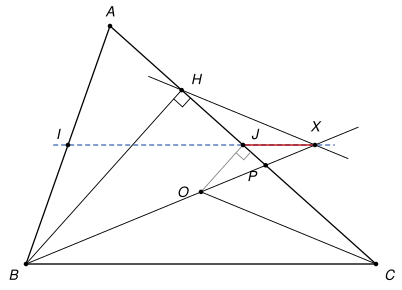

## Statement

Soit $ABC$ un triangle dont les trois angles sont aigus, avec $AB < BC$. On note $H$ le pied de la hauteur issue de $B$, $O$ le centre du cercle circonscrit au triangle $ABC$, $I$ le milieu du segment $[AB]$ et $J$ le milieu du segment $[AC]$.

La parallèle à la droite $(CO)$ qui passe par $H$ coupe la droite $(OB)$ en un point $X$.

Montrer que les points $I$, $J$ et $X$ sont alignés.

## Hints

1. La droite $(IJ)$ est parallèle à $(BC)$. Il suffit donc de montrer que $(JX)$ est parallèle à $(BC)$.
2. Appelez $P$ le point où la droite $(BO)$ coupe $(AC)$. Pour utiliser la réciproque du théorème de Thalès, il faut montrer que $\frac{PJ}{PC} = \frac{PX}{PB}$.
3. Les droites $(HX)$ et $(CO)$ sont parallèles, et les droites $(BH)$ et $(OJ)$ aussi (pourquoi ?). Appliquez deux fois le théorème de Thalès, puis multipliez.

## Solution

*Rappels.*

- *Théorème de Thalès.* Deux droites se coupent en un point $P$. Les points $U$ et $U'$ sont sur la première, $V$ et $V'$ sur la seconde, tous différents de $P$. Si $(UV) \parallel (U'V')$, alors $\frac{PU}{PU'} = \frac{PV}{PV'}$. C'est vrai que $U$ et $U'$ soient du même côté de $P$ ou de part et d'autre.
- *Réciproque.* Dans la même situation, si $\frac{PU}{PU'} = \frac{PV}{PV'}$ et si les points $P$, $U$, $U'$ et $P$, $V$, $V'$ sont dans le même ordre sur les deux droites, alors $(UV) \parallel (U'V')$.
- *Droite des milieux.* Dans un triangle, la droite qui passe par les milieux de deux côtés est parallèle au troisième côté.
- *Médiatrice.* Le centre du cercle circonscrit est sur la médiatrice de chaque côté. En particulier, la droite $(OJ)$ est perpendiculaire à $(AC)$.

On raisonne dans la disposition de la figure : la droite $(BO)$ coupe le segment $[AC]$ en un point $P$, sur la droite $(AC)$ les points sont dans l'ordre $A$, $H$, $J$, $P$, $C$, et sur la droite $(BO)$ ils sont dans l'ordre $B$, $O$, $P$, $X$.

**Étape 1 : ce qu'il faut montrer.** D'après la droite des milieux dans le triangle $ABC$, $(IJ) \parallel (BC)$. Si l'on montre que $(JX) \parallel (BC)$, les droites $(IJ)$ et $(JX)$ seront deux parallèles à $(BC)$ qui passent par le même point $J$ : elles seront confondues, et $X$ sera sur la droite $(IJ)$. On cherche donc à montrer que $\frac{PJ}{PC} = \frac{PX}{PB}$.

**Étape 2 : un premier Thalès.** Les droites $(AC)$ et $(BX)$ se coupent en $P$. Les points $H$ et $C$ sont sur la première, $X$ et $O$ sur la seconde, et $(HX) \parallel (CO)$ par construction. D'après le théorème de Thalès,

$$\frac{PH}{PC} = \frac{PX}{PO}.$$

**Étape 3 : un second Thalès.** Les droites $(BH)$ et $(OJ)$ sont toutes les deux perpendiculaires à $(AC)$ : la première parce que $H$ est le pied de la hauteur, la seconde d'après le rappel sur la médiatrice. Elles sont donc parallèles. Sur les mêmes droites sécantes en $P$, les points $J$ et $H$ sont sur $(AC)$, les points $O$ et $B$ sur $(BX)$, et $(JO) \parallel (HB)$. D'après le théorème de Thalès,

$$\frac{PJ}{PH} = \frac{PO}{PB}.$$

**Étape 4 : on multiplie.** En multipliant les deux égalités,

$$\frac{PJ}{PC} = \frac{PJ}{PH} \times \frac{PH}{PC} = \frac{PO}{PB} \times \frac{PX}{PO} = \frac{PX}{PB}.$$

**Étape 5 : conclusion.** Sur la droite $(AC)$, les points $J$ et $C$ sont de part et d'autre de $P$. Sur la droite $(BX)$, les points $X$ et $B$ sont de part et d'autre de $P$. Les points sont donc dans le même ordre, et la réciproque du théorème de Thalès donne $(JX) \parallel (CB)$. D'après l'étape 1, **les points $I$, $J$ et $X$ sont alignés.**

*Remarque.* L'hypothèse $AB < BC$ sert seulement à fixer la figure. Si $AB > BC$, l'ordre devient $A$, $P$, $J$, $H$, $C$ sur $(AC)$ et $B$, $O$, $X$, $P$ sur $(BO)$. Les étapes 1 à 4 ne changent pas, et dans l'étape 5 les points $J$ et $C$ sont du même côté de $P$, comme $X$ et $B$ : la réciproque de Thalès s'applique encore. Le corrigé propose aussi une preuve plus difficile, avec la symétrie d'axe $(IJ)$ et le cercle de diamètre $[AB]$.

## Going further

1. (Pour la 2de.) Montrer que les points $B$, $I$, $H$ et $X$ sont sur un même cercle. On pourra utiliser que $I$ est le centre du cercle de diamètre $[AB]$, qui passe par $H$.
2. Que devient la figure quand $AB = BC$ ?
