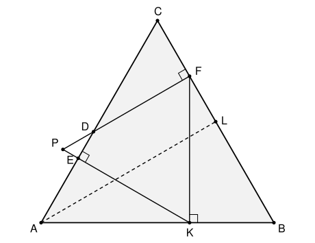

## Statement

$ABC$ est un triangle équilatéral et $D$ est un point du côté $[AC]$.

- $F$ est le projeté orthogonal de $D$ sur la droite $(BC)$ ;
- $K$ est le projeté orthogonal de $F$ sur la droite $(AB)$ ;
- $E$ est le projeté orthogonal de $K$ sur la droite $(CA)$.

On note $L$ le milieu de $[BC]$, et $P$ le point d'intersection des droites $(KE)$ et $(FD)$.

Montrer que la droite $(BP)$ passe par le milieu du segment $[AL]$.

## Hints

1. Regarde le triangle $PKF$ : chacun de ses côtés est perpendiculaire à un côté du triangle $ABC$. Que peux-tu dire de ses angles ?
2. Calcule l'angle $\widehat{BFK}$ dans le triangle rectangle $BKF$, puis déduis-en l'angle $\widehat{KFP}$. Fais de même au point $K$, avec le triangle rectangle $AKE$.
3. Prolonge la droite $(FD)$ jusqu'à ce qu'elle coupe la droite $(AB)$ en un point $Q$. Montre que le triangle $PKQ$ est isocèle, puis que $P$ est le milieu de $[QF]$.
4. Les droites $(QF)$ et $(AL)$ sont toutes les deux perpendiculaires à $(BC)$, donc parallèles. Utilise le théorème de Thalès avec les droites qui partent de $B$.

## Solution

Tous les angles du triangle équilatéral $ABC$ mesurent $60°$.

**Étape 1 : le triangle $PKF$ est équilatéral.**

- Dans le triangle $BKF$, rectangle en $K$, l'angle en $B$ mesure $60°$, donc $\widehat{BFK} = 90° - 60° = 30°$. Comme $(FD)$ est perpendiculaire à $(BC)$, on a $\widehat{BFP} = 90°$, et donc $\widehat{KFP} = 90° - 30° = 60°$.
- Dans le triangle $AKE$, rectangle en $E$, l'angle en $A$ mesure $60°$, donc $\widehat{AKE} = 30°$. Comme $(KF)$ est perpendiculaire à $(AB)$, on a $\widehat{AKF} = 90°$, et donc $\widehat{PKF} = 90° - 30° = 60°$.

Le triangle $PKF$ a deux angles de $60°$, donc son troisième angle mesure aussi $60°$ : il est équilatéral. En particulier

$$PK = PF.$$

**Étape 2 : $P$ est le milieu d'un segment parallèle à $(AL)$.** La droite $(FD)$ coupe la droite $(AB)$ en un point $Q$.

- Dans le triangle $BFQ$, rectangle en $F$, l'angle en $B$ mesure $60°$, donc $\widehat{BQF} = 30°$. Autrement dit $\widehat{PQK} = 30°$.
- On a vu à l'étape 1 que la droite $(KE)$ fait un angle de $30°$ avec $(AB)$ : $\widehat{PKQ} = 30°$.

Le triangle $PKQ$ a deux angles égaux, il est donc isocèle en $P$ : $PQ = PK$. Avec l'étape 1, on obtient

$$PQ = PK = PF,$$

et comme $P$ est sur le segment $[QF]$, c'est le milieu de $[QF]$.

**Étape 3 : on transporte ce milieu avec le théorème de Thalès.** Dans le triangle équilatéral $ABC$, la médiane $(AL)$ est aussi une hauteur, donc $(AL)$ est perpendiculaire à $(BC)$. La droite $(QF)$ est elle aussi perpendiculaire à $(BC)$. Ces deux droites sont donc parallèles.

Notons $M$ le point d'intersection de $(BP)$ et de $(AL)$. Les points $B$, $A$, $Q$ sont alignés, les points $B$, $M$, $P$ aussi, et les points $B$, $L$, $F$ aussi.

- Dans le triangle $BQP$, la droite $(AM)$ est parallèle au côté $(QP)$. Le théorème de Thalès donne $\dfrac{BM}{BP} = \dfrac{AM}{QP}$.
- Dans le triangle $BPF$, la droite $(ML)$ est parallèle au côté $(PF)$. Le théorème de Thalès donne $\dfrac{BM}{BP} = \dfrac{ML}{PF}$.

Donc $\dfrac{AM}{QP} = \dfrac{ML}{PF}$. Comme $QP = PF$, on obtient $AM = ML$.

**Conclusion : le point $M$ où la droite $(BP)$ coupe $[AL]$ vérifie $AM = ML$. La droite $(BP)$ passe donc bien par le milieu de $[AL]$.**

### Une autre fin, avec la trigonométrie

On peut aussi terminer sans le point $Q$. Dans le triangle $BKF$ rectangle en $K$, on a $KF = BF \times \sin 60°$. Comme $PF = KF$, et avec le théorème de Thalès dans le triangle $BPF$ :

$$ML = PF \times \frac{BL}{BF} = BF \times \sin 60° \times \frac{BL}{BF} = BL \times \sin 60°.$$

Dans le triangle $ABL$, rectangle en $L$, on a $AL = BL \times \tan 60°$. Or $\tan 60° = 2 \sin 60°$, puisque $\cos 60° = \frac{1}{2}$. Donc $AL = 2\,ML$, ce qui redonne le résultat.
