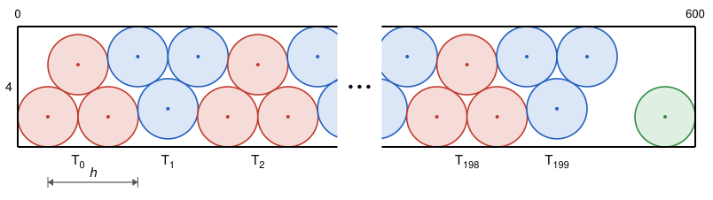

## Statement

Est-il possible de ranger $601$ disques de rayon $1$ dans une boîte rectangulaire de $4$ sur $600$, sans que deux disques se chevauchent ? Les disques ont le droit de se toucher, et de toucher les bords de la boîte.

## Hints

1. En rangeant les disques en deux rangées bien alignées, combien en met-on ? Pour en mettre un de plus, il faut perdre moins de place.
2. Trois disques qui se touchent deux à deux forment un petit « triangle » très serré. Pose un triangle sur le fond de la boîte, puis un triangle la tête en bas contre le couvercle, et ainsi de suite.
3. À quelle distance placer deux triangles qui se suivent ? Fais en sorte que le disque du haut d'un triangle posé au fond touche le premier disque du triangle suivant, et utilise le théorème de Pythagore.
4. Quelle longueur occupent $200$ triangles ainsi rangés ?

## Solution

**La réponse est oui.**

On place la boîte dans un repère : elle occupe les points $(x\,;\,y)$ avec $0 \leqslant x \leqslant 600$ et $0 \leqslant y \leqslant 4$. Deux faits servent tout le temps.

- Deux disques de rayon $1$ ne se chevauchent pas exactement quand leurs centres sont à une distance au moins égale à $2$. C'est le cas en particulier quand l'écart horizontal entre les deux centres est au moins $2$.
- Un disque de rayon $1$ est dans la boîte exactement quand son centre $(x\,;\,y)$ vérifie $1 \leqslant x \leqslant 599$ et $1 \leqslant y \leqslant 3$.

En deux rangées bien alignées, on met $300 + 300 = 600$ disques, et la boîte est pleine. Il faut donc trouver un rangement plus serré.

**Étape 1 : les triangles.** Trois disques de rayon $1$ qui se touchent deux à deux ont des centres qui forment un triangle équilatéral de côté $2$. Sa hauteur vaut $\sqrt{2^2 - 1^2} = \sqrt{3}$. Pour un réel $a$, on appelle :

- **triangle du fond** en $a$ les trois disques de centres $(a + 1\,;\,1)$, $(a + 2\,;\,1 + \sqrt{3})$ et $(a + 3\,;\,1)$ ;
- **triangle du haut** en $a$ les trois disques de centres $(a + 1\,;\,3)$, $(a + 2\,;\,3 - \sqrt{3})$ et $(a + 3\,;\,3)$.

Le triangle du haut est l'image du triangle du fond par la symétrie d'axe la droite $y = 2$, qui échange le fond et le couvercle. Comme $\sqrt{3} < 2$, les ordonnées de ces centres sont toutes entre $1$ et $3$.

**Étape 2 : l'écart entre deux triangles.** On pose

$$s = \sqrt{4\sqrt{3} - 3} \qquad \text{et} \qquad h = 1 + s.$$

Pour $k = 0, 1, \ldots, 199$, on appelle $T_k$ le triangle placé en $a = kh$, **du fond si $k$ est pair, du haut si $k$ est impair**. Cela fait $200 \times 3 = 600$ disques.

D'où vient ce nombre $s$ ? On veut que le disque du haut de $T_0$, de centre $(2\,;\,1 + \sqrt{3})$, touche le premier disque de $T_1$, de centre $(h + 1\,;\,3)$. L'écart horizontal entre les centres est $h - 1 = s$, l'écart vertical est $3 - (1 + \sqrt{3}) = 2 - \sqrt{3}$. Par le théorème de Pythagore, les deux disques se touchent quand

$$s^2 + (2 - \sqrt{3})^2 = 4.$$

Or $(2 - \sqrt{3})^2 = 4 - 4\sqrt{3} + 3 = 7 - 4\sqrt{3}$, donc cela donne $s^2 = 4\sqrt{3} - 3$, ce qui est bien notre choix.

Retenons deux encadrements. Comme $4\sqrt{3} > 4$, on a $s^2 > 1$, donc $s > 1$ et $h > 2$. Comme $\sqrt{3} < \frac{7}{4}$, on a $s^2 < 4$, donc $s < 2$.

**Étape 3 : deux disques ne se chevauchent jamais.**

*Dans un même triangle*, les centres sont à distance $2$ : les disques se touchent.

*Entre $T_k$ et $T_j$ avec $j \geqslant k + 2$.* Les centres de $T_k$ ont une abscisse au plus $kh + 3$, ceux de $T_j$ une abscisse au moins $jh + 1 \geqslant kh + 2h + 1$. L'écart horizontal est donc au moins $2h - 2 = 2s > 2$.

*Entre deux triangles qui se suivent, $T_k$ et $T_{k+1}$.* L'un est au fond, l'autre en haut. Quitte à appliquer la symétrie d'axe $y = 2$, qui ne change pas les distances, on peut supposer que $T_k$ est au fond. On pose $a = kh$. Les centres sont alors

- pour $T_k$ : $L(a + 1\,;\,1)$, $M(a + 2\,;\,1 + \sqrt{3})$, $R(a + 3\,;\,1)$ ;
- pour $T_{k+1}$ : $L'(a + h + 1\,;\,3)$, $M'(a + h + 2\,;\,3 - \sqrt{3})$, $R'(a + h + 3\,;\,3)$.

L'écart horizontal entre un centre de $T_{k+1}$ et un centre de $T_k$ vaut $h$ plus la différence de leurs rangs (gauche, milieu, droite). Il est donc au moins $h > 2$, sauf pour trois paires :

- $M$ et $L'$ : écart horizontal $h - 1 = s$, écart vertical $2 - \sqrt{3}$. La distance au carré vaut $s^2 + (2 - \sqrt{3})^2 = 4$ : les disques se touchent.
- $R$ et $M'$ : écart horizontal $(a + h + 2) - (a + 3) = s$, écart vertical $(3 - \sqrt{3}) - 1 = 2 - \sqrt{3}$. Même calcul : les disques se touchent.
- $R$ et $L'$ : écart vertical $3 - 1 = 2$, donc la distance est au moins $2$.

**Étape 4 : les $600$ disques tiennent dans la boîte.** Le plus petit centre en abscisse est $1$, celui de $T_0$. Le plus grand est $199h + 3$, celui de $T_{199}$. Il reste à l'estimer.

On a $\text{1,733}^2 = \text{3,003289} > 3$, donc $\sqrt{3} < \text{1,733}$. Ainsi

$$s^2 = 4\sqrt{3} - 3 < 4 \times \text{1,733} - 3 = \text{3,932} < \text{3,932289} = \text{1,983}^2,$$

donc $s < \text{1,983}$, puis $h < \text{2,983}$ et $199h < 199 \times \text{2,983} = \text{593,617}$. Tous les centres ont donc une abscisse inférieure à $\text{593,617} + 3 < 597$, et les $600$ disques sont dans la boîte. (À la calculatrice, $s \approx \text{1,982}$ et $h \approx \text{2,982}$.)

**Étape 5 : le $601^\text{e}$ disque.** On place un dernier disque de centre $(599\,;\,1)$, dans le coin en bas à droite. Il est dans la boîte. Son centre a pour abscisse $599$, et ceux des $600$ autres disques ont une abscisse inférieure à $597$ : l'écart horizontal est plus grand que $2$, donc il ne chevauche aucun autre disque.

**Conclusion : oui, on peut ranger $601$ disques de rayon $1$ dans une boîte de $4$ sur $600$.**

## Going further

D'où vient le gain ? En deux rangées alignées, $600$ disques occupent toute la longueur $600$ de la boîte, soit $3$ disques pour chaque longueur $3$. Avec les triangles, le premier triangle prend une longueur $4$, puis chaque nouveau triangle ajoute $3$ disques pour une longueur $h \approx \text{2,982}$ seulement, un tout petit peu moins que $3$. Les $200$ triangles occupent donc une longueur $4 + 199h \approx \text{597,4}$ : il reste un peu plus de $\text{2,5}$ unités au bout de la boîte, assez pour un disque de plus.

Avec une boîte de $4$ sur $100$, ce rangement ne fait pas mieux que les deux rangées : combien de triangles y tiennent ?
