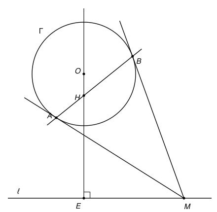

## Statement

Soit $\Gamma$ un cercle de centre $O$ et de rayon $r$, et soit $\ell$ une droite qui ne coupe
pas $\Gamma$. On note $E$ le point où la perpendiculaire à $\ell$ passant par $O$ coupe $\ell$.

Soit $M$ un point de $\ell$ différent de $E$. Les deux tangentes à $\Gamma$ passant par $M$
touchent $\Gamma$ en $A$ et en $B$. Enfin, soit $H$ le point d'intersection des droites $(AB)$
et $(OE)$.

Montrer que
$$OH = \frac{r^2}{OE}.$$

## Hints

1. Trace la droite $(OM)$. Que représente-t-elle pour le segment $[AB]$ ?
2. Appelle $I$ le point d'intersection de $(OM)$ et $(AB)$. Dans le triangle rectangle $OAM$,
   écris de deux façons le cosinus de l'angle $\widehat{AOM}$. Tu dois obtenir
   $OA^2 = OI \times OM$.
3. Les triangles $OIH$ et $OEM$ sont tous les deux rectangles. Ont-ils un angle en commun ?
4. Écris le cosinus de cet angle commun dans chacun des deux triangles.

## Solution

On note $\theta$ l'angle $\widehat{MOE}$. Le triangle $OEM$ est rectangle en $E$ (car $(OE)$ est
perpendiculaire à $\ell$), donc
$$\cos\theta = \frac{OE}{OM}. \qquad (1)$$

### Étape 1 : la droite $(OM)$ est la médiatrice de $[AB]$

Une tangente à un cercle est perpendiculaire au rayon au point de contact, donc les triangles
$OAM$ et $OBM$ sont rectangles en $A$ et en $B$. D'après le théorème de Pythagore,
$$MA^2 = OM^2 - r^2 = MB^2,$$
donc $MA = MB$. Comme on a aussi $OA = OB = r$, les points $O$ et $M$ sont tous les deux à égale
distance de $A$ et de $B$ : la droite $(OM)$ est la médiatrice de $[AB]$.

Appelons $I$ le milieu de $[AB]$. Il est sur $(OM)$, et la droite $(AB)$ est perpendiculaire à
$(OM)$ en $I$.

### Étape 2 : $OI \times OM = r^2$

Dans le triangle $OAM$ rectangle en $A$, le point $I$ est le pied de la hauteur issue de $A$. Il
est donc sur le segment $[OM]$, et le triangle $OIA$ est rectangle en $I$. On calcule le cosinus
de l'angle $\widehat{AOM}$ dans les deux triangles rectangles :
$$\cos\widehat{AOM} = \frac{OA}{OM} \quad \text{(dans } OAM\text{)}, \qquad \cos\widehat{AOM} = \frac{OI}{OA} \quad \text{(dans } OIA\text{)}.$$
En égalant, $OA^2 = OI \times OM$, c'est-à-dire
$$OI \times OM = r^2. \qquad (2)$$

### Étape 3 : le triangle $OIH$

Le point $H$ est sur $(AB)$, qui est perpendiculaire à $(OM)$ en $I$. Le point $H$ n'est pas $O$
(sinon $O$ serait sur $(AB)$, donc égal au pied $I$ de sa perpendiculaire, alors que
$OI = r^2/OM \neq 0$). Le triangle $OIH$ est donc rectangle en $I$.

Montrons que $H$ est sur la demi-droite $[OE)$. Le point $I$ est sur la demi-droite $[OM)$. Si
$H$ était de l'autre côté de $O$ par rapport à $E$, l'angle $\widehat{IOH}$ vaudrait
$180^\circ - \theta$. Or $\theta$ est un angle aigu du triangle rectangle $OEM$, donc
$180^\circ - \theta$ serait obtus. Un triangle rectangle n'a pas d'angle obtus : c'est
impossible.

Donc $H$ est sur $[OE)$, et l'angle $\widehat{IOH}$ est exactement l'angle $\theta$. Dans le
triangle $OIH$ rectangle en $I$,
$$\cos\theta = \frac{OI}{OH}. \qquad (3)$$

### Étape 4 : conclusion

En comparant (1) et (3), on obtient $\dfrac{OI}{OH} = \dfrac{OE}{OM}$, donc
$OH \times OE = OI \times OM$. Avec (2),
$$OH \times OE = r^2, \qquad \text{c'est-à-dire} \qquad OH = \frac{r^2}{OE}.$$

## Going further

Le résultat montre que la position de $H$ ne dépend pas du point $M$ choisi sur $\ell$. Quand
$M$ se déplace sur la droite $\ell$, la corde $[AB]$ change, mais la droite $(AB)$ passe
toujours par le même point $H$.
