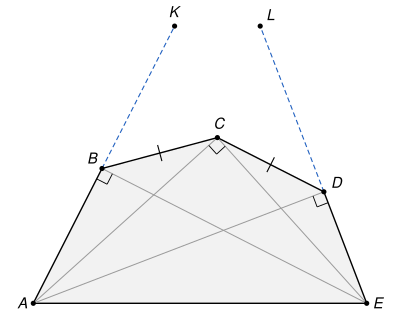

## Statement

Soit $ABCDE$ un pentagone convexe tel que
$$\widehat{ABE} = \widehat{ACE} = \widehat{ADE} = 90^\circ \qquad \text{et} \qquad BC = CD.$$
Soit $K$ le point de la demi-droite $[AB)$ tel que $AK = AD$, et soit $L$ le point de la demi-droite $[ED)$ tel que $EL = EB$.

Démontrer que les points $B$, $D$, $K$ et $L$ sont sur un même cercle de centre $C$.

## Hints

1. Les trois angles droits ont la même hypoténuse $[AE]$. Que peux-tu dire du milieu $O$ de $[AE]$ ?
2. Les points $B$, $C$ et $D$ sont sur le cercle de diamètre $[AE]$. Compare les triangles $OBC$ et $OCD$.
3. Le but est de montrer que la droite $(AC)$ coupe l'angle $\widehat{BAD}$ en deux angles égaux. Pour relier un angle en $A$ à un angle en $O$, regarde le triangle isocèle $OAB$ et l'angle $\widehat{BOE}$.
4. Compare enfin les triangles $AKC$ et $ADC$.

## Solution

On utilise deux résultats du collège.

- Dans un triangle rectangle, le milieu de l'hypoténuse est à la même distance des trois sommets.
- Si deux triangles ont leurs trois côtés égaux deux à deux, ou bien un angle égal compris entre deux côtés égaux deux à deux, alors ils sont égaux (superposables). Leurs autres côtés et leurs autres angles sont alors égaux eux aussi.

**Étape 1 : un cercle de diamètre $[AE]$.** Soit $O$ le milieu de $[AE]$. Les triangles $ABE$, $ACE$ et $ADE$ sont rectangles en $B$, $C$ et $D$, et ils ont tous l'hypoténuse $[AE]$. Donc
$$OA = OB = OC = OD = OE.$$
Les points $B$, $C$, $D$ sont sur le cercle de diamètre $[AE]$. Comme $[AE]$ est un côté du pentagone convexe, ils sont tous du même côté de la droite $(AE)$.

**Étape 2 : un angle en $A$ est la moitié d'un angle en $O$.** Le triangle $OAB$ est isocèle en $O$, donc $\widehat{OAB} = \widehat{OBA}$. Les points $A$, $O$, $E$ sont alignés, avec $O$ entre $A$ et $E$. Avec la somme des angles du triangle $OAB$, on obtient
$$\widehat{BOE} = 180^\circ - \widehat{AOB} = \widehat{OAB} + \widehat{OBA} = 2\,\widehat{OAB} = 2\,\widehat{EAB}.$$
De la même manière, $\widehat{COE} = 2\,\widehat{EAC}$ et $\widehat{DOE} = 2\,\widehat{EAD}$.

**Étape 3 : la droite $(AC)$ partage l'angle $\widehat{BAD}$ en deux angles égaux.** Les triangles $OBC$ et $OCD$ ont leurs trois côtés égaux deux à deux : $OB = OD$, $OC$ est commun, et $BC = CD$. Ils sont donc égaux, et
$$\widehat{BOC} = \widehat{COD}.$$
Le pentagone est convexe, donc depuis le sommet $A$ on voit les demi-droites $[AB)$, $[AC)$, $[AD)$, $[AE)$ dans cet ordre. Ainsi $\widehat{EAB} > \widehat{EAC} > \widehat{EAD}$, et par l'étape 2, $\widehat{EOB} > \widehat{EOC} > \widehat{EOD}$. Comme $B$, $C$, $D$ sont du même côté de $(AE)$, on en déduit
$$\widehat{BOC} = \widehat{BOE} - \widehat{COE} = 2\,(\widehat{EAB} - \widehat{EAC}) = 2\,\widehat{BAC},$$
et de même $\widehat{COD} = 2\,\widehat{CAD}$. Puisque $\widehat{BOC} = \widehat{COD}$, on obtient
$$\widehat{BAC} = \widehat{CAD}.$$

**Étape 4 : $CK = CD$.** Le point $K$ est sur la demi-droite $[AB)$, donc $\widehat{KAC} = \widehat{BAC} = \widehat{CAD}$. Les triangles $KAC$ et $DAC$ ont donc un angle égal en $A$, compris entre deux côtés égaux deux à deux : $AK = AD$ et $AC$ commun. Ils sont égaux, et $CK = CD$.

**Étape 5 : $CL = CB$.** On refait les étapes 2 à 4 en échangeant les rôles de $A$ et $E$, et ceux de $B$ et $D$. Le triangle $OED$ est isocèle en $O$, d'où $\widehat{DOA} = 2\,\widehat{AED}$, et de même $\widehat{COA} = 2\,\widehat{AEC}$ et $\widehat{BOA} = 2\,\widehat{AEB}$. L'égalité $\widehat{COD} = \widehat{BOC}$ donne alors $\widehat{DEC} = \widehat{CEB}$. Enfin, $L$ est sur la demi-droite $[ED)$ et $EL = EB$, donc les triangles $LEC$ et $BEC$ sont égaux, et $CL = CB$.

**Conclusion.** On a obtenu
$$CK = CD = CB = CL,$$
en utilisant $BC = CD$ au milieu. Les quatre points $B$, $D$, $K$ et $L$ sont donc à la même distance de $C$ : **ils sont sur le cercle de centre $C$ et de rayon $CB$.**

## Going further

- Au lycée, on apprend le théorème de l'angle inscrit. Avec lui, l'étape 3 devient immédiate : sur le cercle de diamètre $[AE]$, les cordes $[BC]$ et $[CD]$ ont la même longueur, donc on les voit depuis $A$ sous le même angle. On dit que $C$ est le milieu de l'arc $BD$. C'est une configuration qui revient très souvent en olympiade.
- Une erreur fréquente consiste à montrer seulement que $B$, $D$, $K$, $L$ sont sur un même cercle, puis à affirmer que son centre est $C$. Ici, la solution évite le problème : elle montre directement que les quatre points sont à la même distance de $C$.
