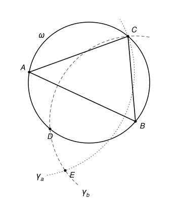

## Statement

Soit $ABC$ un triangle tel que $\widehat{CAB} < \widehat{ABC} < \widehat{BCA} < 90^\circ$. On note :

- $\omega$ le cercle circonscrit au triangle $ABC$ ;
- $\gamma_a$ le cercle de centre $A$ qui passe par $C$ ;
- $\gamma_b$ le cercle de centre $B$ qui passe par $C$ ;
- $D$ le second point d'intersection de $\omega$ et de $\gamma_b$ (autre que $C$) ;
- $E$ le second point d'intersection de $\gamma_a$ et de $\gamma_b$ (autre que $C$).

Démontrer que les points $A$, $D$ et $E$ sont alignés.

## Hints

1. On a $AE = AC$ et $BE = BC$. Que pouvez-vous en déduire pour la droite $(AB)$ et le segment $[CE]$ ?
2. Il suffit de montrer que $\widehat{BAD} = \widehat{BAE}$, à condition que $D$ et $E$ soient du même côté de la droite $(AB)$.
3. Le triangle $BCD$ est isocèle. Utilisez le théorème de l'angle inscrit deux fois dans le cercle $\omega$.
4. Pour savoir où se trouve $D$ sur $\omega$, notez $O$ le centre de $\omega$ et comparez les angles au centre $\widehat{BOD}$ et $\widehat{BOA}$.

## Solution

On note $\alpha = \widehat{CAB}$ et $\gamma = \widehat{BCA}$. Seules deux hypothèses serviront : le triangle a trois angles aigus, et $\alpha < \gamma$.

### Étape 1 : E est le symétrique de C par rapport à (AB)

Le point $E$ est sur $\gamma_a$ et sur $\gamma_b$, donc $AE = AC$ et $BE = BC$. Comme $E \neq C$, les points $A$ et $B$ sont tous les deux sur la médiatrice du segment $[CE]$. Cette médiatrice est donc la droite $(AB)$ : **$E$ est le symétrique de $C$ par rapport à $(AB)$.**

Deux conséquences :

- une symétrie conserve les angles, donc $\widehat{BAE} = \widehat{BAC} = \alpha$ ;
- $E$ et $C$ sont de part et d'autre de la droite $(AB)$.

### Étape 2 : où se trouve le point D ?

Notons $O$ le centre de $\omega$. On a $OD = OC$ et $BD = BC$ (car $D$ est sur $\gamma_b$), donc la droite $(OB)$ est la médiatrice de $[CD]$ : $D$ est le symétrique de $C$ par rapport à $(OB)$.

Le triangle a trois angles aigus, donc $O$ est à l'intérieur du triangle. La droite $(BO)$ coupe donc le côté $[AC]$, et $A$, $C$ sont de part et d'autre de $(OB)$. Le point $D$, symétrique de $C$, est donc du même côté de $(OB)$ que $A$.

D'après le théorème de l'angle au centre, $\widehat{BOC} = 2\alpha$ et $\widehat{BOA} = 2\gamma$. Par symétrie, $\widehat{BOD} = \widehat{BOC} = 2\alpha$. Comme $2\alpha < 2\gamma$, la demi-droite $[OD)$ est à l'intérieur de l'angle $\widehat{BOA}$ : **le point $D$ est sur le petit arc $AB$ de $\omega$, celui qui ne contient pas $C$**, et $D \neq A$.

En parcourant le cercle $\omega$, on rencontre donc les points dans l'ordre $C$, $A$, $D$, $B$. On en déduit :

- $D$ et $C$ sont de part et d'autre de la droite $(AB)$, donc **$D$ et $E$ sont du même côté de $(AB)$** ;
- $A$ et $D$ sont sur le même arc d'extrémités $B$ et $C$ ;
- $A$ et $C$ sont sur le même arc d'extrémités $B$ et $D$.

### Étape 3 : la chasse aux angles

- Les angles inscrits $\widehat{BDC}$ et $\widehat{BAC}$ interceptent le même arc $BC$, et $A$, $D$ sont du même côté de $(BC)$. Donc $\widehat{BDC} = \widehat{BAC} = \alpha$.
- Le triangle $BCD$ est isocèle en $B$, car $BC = BD$. Donc $\widehat{BCD} = \widehat{BDC} = \alpha$.
- Les angles inscrits $\widehat{BAD}$ et $\widehat{BCD}$ interceptent le même arc $BD$, et $A$, $C$ sont du même côté de $(BD)$. Donc $\widehat{BAD} = \widehat{BCD} = \alpha$.

Finalement $\widehat{BAD} = \alpha = \widehat{BAE}$.

### Conclusion

Les demi-droites $[AD)$ et $[AE)$ font le même angle $\alpha$ avec la demi-droite $[AB)$, et elles sont du même côté de la droite $(AB)$. Elles sont donc confondues. **Les points $A$, $D$ et $E$ sont alignés**, et $D$, $E$ sont du même côté de $A$.

## Going further

1. L'hypothèse $\widehat{CAB} < \widehat{ABC}$ n'a pas servi. Où a-t-on utilisé $\widehat{CAB} < \widehat{BCA}$ ? Que se passe-t-il si $\widehat{CAB} = \widehat{BCA}$ ?
2. Montrez que $D$ est entre $A$ et $E$. (On pourra comparer $AD$ et $AE = AC$. Notons $R$ le rayon de $\omega$. La hauteur issue de $O$ coupe le triangle isocèle $OAD$ en deux triangles rectangles : avec le sinus et l'angle au centre, montrer que $AD = 2R\sin\widehat{ACD}$. De même, $AC = 2R\sin\widehat{ABC}$.)
