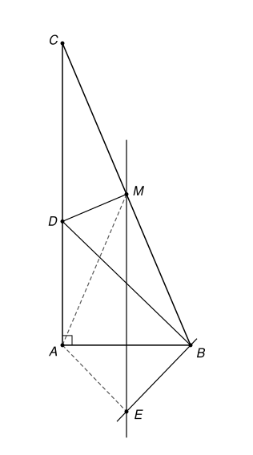

## Statement

Soit $ABC$ un triangle rectangle en $A$, avec $AB < AC$. On note $M$ le milieu de l'hypoténuse $[BC]$.

- La perpendiculaire à $(BC)$ passant par $M$ coupe le côté $[AC]$ en un point $D$.
- La parallèle à $(AC)$ passant par $M$ et la perpendiculaire à $(BD)$ passant par $B$ se coupent en un point $E$.

Montrer que les triangles $AEM$ et $MCA$ sont semblables **si et seulement si** $\widehat{ABC} = 60^\circ$.

## Hints

1. Note $\gamma$ l'angle $\widehat{ACB}$. Le but est d'exprimer les trois angles du triangle $AEM$ en fonction de $\gamma$.
2. Dans un triangle rectangle, où est le centre du cercle circonscrit ? Qu'en déduis-tu pour les triangles $MAB$ et $MAC$ ?
3. Le point $D$ est sur la médiatrice de $[BC]$. Que vaut l'angle $\widehat{DBC}$ ? Puis l'angle $\widehat{ADB}$ ?
4. La droite $(ME)$ est perpendiculaire à $(AB)$ et passe par le milieu de $[AB]$ : pourquoi ? Qu'en déduis-tu pour les longueurs $EA$ et $EB$ ?
5. Un des angles du triangle $AEM$ est obtus. Lequel des angles de $MCA$ peut lui correspondre ?

## Solution

Notons $\beta = \widehat{ABC}$ et $\gamma = \widehat{ACB}$. Le triangle est rectangle en $A$, donc $\beta + \gamma = 90^\circ$. Comme $AB < AC$, l'angle en $C$, opposé au plus petit côté de l'angle droit, est le plus petit : $\gamma < \beta$, donc $\gamma < 45^\circ$.

**Étape 1 : le triangle $MCA$.** Dans un triangle rectangle, le milieu de l'hypoténuse est le centre du cercle circonscrit, donc
$$MA = MB = MC.$$
Le triangle $MAC$ est isocèle en $M$ : $\widehat{MAC} = \widehat{MCA} = \gamma$, et son troisième angle vaut $180^\circ - 2\gamma$. De même $MAB$ est isocèle en $M$, donc $\widehat{MAB} = \widehat{MBA} = \beta$.

Les angles du triangle $MCA$ sont donc $\gamma$, $\gamma$ et $180^\circ - 2\gamma$.

**Étape 2 : l'angle $\widehat{ABD}$.** La perpendiculaire à $(BC)$ en son milieu $M$ est la médiatrice de $[BC]$. Le point $D$ est dessus, donc $DB = DC$ et le triangle $DBC$ est isocèle en $D$ :
$$\widehat{DBC} = \widehat{DCB} = \gamma.$$
Dans le triangle $DBC$, l'angle en $D$ vaut $180^\circ - 2\gamma$. Comme $D$ est entre $A$ et $C$, l'angle $\widehat{ADB}$ est son supplémentaire :
$$\widehat{ADB} = 180^\circ - (180^\circ - 2\gamma) = 2\gamma.$$
Le triangle $ABD$ est rectangle en $A$, donc
$$\widehat{ABD} = 90^\circ - 2\gamma.$$

**Étape 3 : le point $E$.** La droite $(AC)$ est perpendiculaire à $(AB)$, donc la parallèle à $(AC)$ passant par $M$ est aussi perpendiculaire à $(AB)$. Elle coupe $[AB]$ en un point $H$. Dans le triangle $ABC$, cette droite passe par le milieu $M$ de $[BC]$ et est parallèle à $(AC)$ : par le théorème de la droite des milieux, $H$ est le milieu de $[AB]$.

Cette droite est donc la **médiatrice de $[AB]$**. Le point $E$ est dessus, donc $EA = EB$.

L'angle $\widehat{DBE}$ est droit, et $\widehat{ABD} = 90^\circ - 2\gamma$ est plus petit qu'un angle droit : la demi-droite $[BA)$ est donc à l'intérieur de l'angle $\widehat{DBE}$, et $E$ est de l'autre côté de $(AB)$ par rapport à $D$, comme sur la figure. Ainsi
$$\widehat{ABE} = 90^\circ - \widehat{ABD} = 90^\circ - (90^\circ - 2\gamma) = 2\gamma.$$
Le triangle $EAB$ est isocèle en $E$, donc $\widehat{BAE} = \widehat{ABE} = 2\gamma$.

**Étape 4 : les angles du triangle $AEM$.**

- En $A$ : les points $M$ et $E$ sont de part et d'autre de $(AB)$, donc $\widehat{MAE} = \widehat{MAB} + \widehat{BAE} = \beta + 2\gamma = (\beta + \gamma) + \gamma = 90^\circ + \gamma$.
- En $M$ : les droites $(ME)$ et $(AC)$ sont parallèles, coupées par la sécante $(AM)$, et $E$, $C$ sont de part et d'autre de cette sécante. Les angles alternes-internes sont égaux : $\widehat{AME} = \widehat{MAC} = \gamma$.
- En $E$ : la somme des angles vaut $180^\circ$, donc $\widehat{AEM} = 180^\circ - (90^\circ + \gamma) - \gamma = 90^\circ - 2\gamma$.

Les angles du triangle $AEM$ sont donc $90^\circ + \gamma$, $\gamma$ et $90^\circ - 2\gamma$.

**Étape 5 : la comparaison.** Deux triangles sont semblables exactement quand ils ont les mêmes angles.

*Si $\widehat{ABC} = 60^\circ$*, alors $\gamma = 30^\circ$. Les angles de $MCA$ sont $30^\circ$, $30^\circ$, $120^\circ$ ; ceux de $AEM$ sont $120^\circ$, $30^\circ$, $30^\circ$. Ce sont les mêmes : les triangles sont semblables.

*Réciproquement, supposons les triangles semblables.* Le triangle $AEM$ a un angle obtus, $90^\circ + \gamma$. Le triangle $MCA$ doit donc avoir le même angle obtus. Ses deux angles égaux à $\gamma$ sont plus petits que $45^\circ$, donc ce ne peut être que le troisième :
$$90^\circ + \gamma = 180^\circ - 2\gamma, \qquad \text{soit} \qquad 3\gamma = 90^\circ, \qquad \gamma = 30^\circ.$$
Alors $\widehat{ABC} = 90^\circ - 30^\circ = 60^\circ$.

**Conclusion.** Les triangles $AEM$ et $MCA$ sont semblables si et seulement si $\widehat{ABC} = 60^\circ$. Dans ce cas, les deux triangles sont isocèles, avec un angle de $120^\circ$ au sommet principal.

## Going further

1. Dans le cas $\widehat{ABC} = 60^\circ$, montrer que $E$ est le symétrique de $M$ par rapport à la droite $(AB)$, et que $AEBM$ est un losange.
2. Que se passe-t-il si $AB > AC$ ? Le point $D$ est-il encore sur le segment $[AC]$ ?
