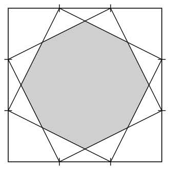
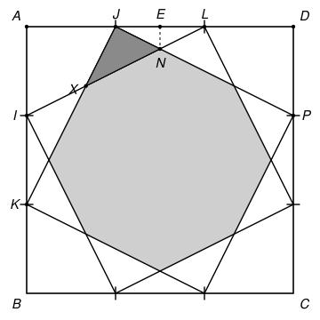

## Statement

Chaque côté d'un carré de côté $1$ est partagé en trois segments égaux. En reliant les points de partage comme sur la figure, on trace deux quadrilatères penchés qui se croisent.

Quelle est l'aire de l'octogone grisé ?

## Hints

1. Commence par un seul des deux quadrilatères penchés. Les quatre triangles qui restent dans les coins du grand carré se ressemblent beaucoup : montre que ce quadrilatère est un carré et calcule son aire.
2. L'octogone grisé, c'est ce carré penché auquel on enlève quatre petits triangles, un à chaque coin. Pourquoi ces quatre triangles ont-ils la même aire ?
3. Pour un de ces petits triangles, cherche quelle fraction du côté du carré penché représente chacun de ses deux côtés de l'angle droit. Le théorème de Thalès est utile, avec deux droites parallèles bien choisies.
4. La figure a un axe de symétrie vertical. Le sommet de l'octogone qui est tout en haut est sur cet axe.

## Solution

Nommons les points comme sur la figure ci-dessous. Le grand carré est $ABCD$, avec $A$ en haut à gauche et $D$ en haut à droite. Sur le côté $[AD]$, les points de partage sont $J$ et $L$, avec $AJ = \dfrac{1}{3}$ et $AL = \dfrac{2}{3}$. Sur le côté $[AB]$, ce sont $I$ et $K$, avec $AI = \dfrac{1}{3}$ et $AK = \dfrac{2}{3}$. Sur le côté $[DC]$, $P$ est le point tel que $DP = \dfrac{1}{3}$. Enfin $E$ est le milieu de $[AD]$.

Le premier quadrilatère penché a pour sommet $J$ et pour côtés issus de $J$ les segments $[JK]$ et $[JP]$. Le second a pour sommet $L$, et l'un de ses côtés est $[LI]$.

**Le premier quadrilatère est un carré d'aire $\dfrac{5}{9}$.** Dans chaque coin du grand carré, il reste un triangle rectangle dont les côtés de l'angle droit mesurent $\dfrac{1}{3}$ et $\dfrac{2}{3}$. Par exemple $AJK$, avec $AJ = \dfrac{1}{3}$ et $AK = \dfrac{2}{3}$, et $DPJ$, avec $DP = \dfrac{1}{3}$ et $DJ = \dfrac{2}{3}$. Ces quatre triangles sont superposables. Donc les quatre côtés du quadrilatère sont égaux, et d'après le théorème de Pythagore,
$$JK^2 = \left(\frac{1}{3}\right)^2 + \left(\frac{2}{3}\right)^2 = \frac{5}{9} .$$
L'angle en $J$ est droit. En effet, les triangles $AJK$ et $DPJ$ étant superposables, $\widehat{AJK} = \widehat{DPJ}$ (ces deux angles font face à un côté de longueur $\dfrac{2}{3}$). Dans le triangle $DPJ$, rectangle en $D$, on a $\widehat{DPJ} + \widehat{DJP} = 90^\circ$. Comme $A$, $J$, $D$ sont alignés,
$$\widehat{KJP} = 180^\circ - \widehat{AJK} - \widehat{DJP} = 180^\circ - 90^\circ = 90^\circ .$$
Un quadrilatère qui a quatre côtés égaux et un angle droit est un carré. Son aire vaut
$$JK^2 = \frac{5}{9}$$
(on peut aussi la trouver en retirant au grand carré les quatre triangles : $1 - 4 \times \dfrac{1}{2} \times \dfrac{1}{3} \times \dfrac{2}{3} = 1 - \dfrac{4}{9}$).

**Les symétries de la figure.** La symétrie par rapport à la médiatrice de $[AD]$, qui est la droite verticale passant par $E$, conserve le grand carré et échange les deux carrés penchés : elle échange $J$ et $L$, $I$ et $P$. D'autre part, le quart de tour autour du centre du grand carré envoie chaque carré penché sur lui-même.

L'octogone grisé est la partie commune aux deux carrés penchés. On l'obtient en enlevant au premier carré penché quatre petits triangles, un à chacun de ses coins. Le quart de tour envoie ces quatre triangles les uns sur les autres, donc ils ont la même aire. Celui du coin $J$ est le triangle $JXN$, où $X$ est le point commun à $[JK]$ et $[LI]$, et $N$ le point commun à $[JP]$ et $[LI]$. Il est rectangle en $J$.

**Le côté $JX$.** On a $\dfrac{AI}{AK} = \dfrac{1}{2}$ et $\dfrac{AJ}{AL} = \dfrac{1}{2}$, donc d'après la réciproque du théorème de Thalès, les droites $(IJ)$ et $(KL)$ sont parallèles, et $IJ = \dfrac{1}{2}\,KL$. Les droites $(JK)$ et $(IL)$ se coupent en $X$, et le théorème de Thalès dans cette configuration en « papillon » donne
$$\frac{XJ}{XK} = \frac{IJ}{KL} = \frac{1}{2} .$$
Donc $XK = 2\,XJ$, et comme $JK = XJ + XK = 3\,XJ$,
$$JX = \frac{1}{3}\,JK .$$

**Le côté $JN$.** La symétrie d'axe vertical échange les segments $[JP]$ et $[LI]$. Leur point commun $N$ est donc envoyé sur lui-même : $N$ est sur l'axe $(EN)$. Cet axe est perpendiculaire à $(AD)$, comme $(DP)$, donc $(EN)$ et $(DP)$ sont parallèles. On a $JE = \dfrac{1}{2} - \dfrac{1}{3} = \dfrac{1}{6}$ et $JD = \dfrac{2}{3}$. Dans le triangle $JDP$, le théorème de Thalès donne
$$\frac{JN}{JP} = \frac{JE}{JD} = \frac{1}{6} \times \frac{3}{2} = \frac{1}{4} .$$
Donc $JN = \dfrac{1}{4}\,JP = \dfrac{1}{4}\,JK$.

**L'aire du petit triangle.** Le triangle $JXN$ est rectangle en $J$, donc son aire vaut
$$\frac{JX \times JN}{2} = \frac{1}{2} \times \frac{JK}{3} \times \frac{JK}{4} = \frac{JK^2}{24} = \frac{5}{9 \times 24} = \frac{5}{216} .$$

**Conclusion.** L'aire de l'octogone vaut
$$\frac{5}{9} - 4 \times \frac{5}{216} = \frac{120}{216} - \frac{20}{216} = \frac{100}{216} = \frac{25}{54} .$$

## Going further

1. Montrer que les huit côtés de l'octogone ont la même longueur. L'octogone est-il régulier ? (On pourra comparer ses angles en $X$ et en $N$.)
2. Quelle est l'aire de la partie du grand carré qui n'est recouverte par aucun des deux carrés penchés ?
