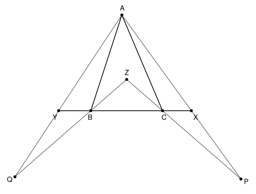

## Statement

Soit $ABC$ un triangle dont les trois angles sont aigus, et tel que $AB > BC$ et $AC > BC$.

- Soit $X$ le point de la demi-droite $[BC)$ tel que $BX = AB$.
- Soit $Y$ le point de la demi-droite $[CB)$ tel que $CY = AC$.
- Soit $P$ le point de la demi-droite $[AX)$, autre que $A$, tel que $CP = CA$.
- Soit $Q$ le point de la demi-droite $[AY)$, autre que $A$, tel que $BQ = BA$.

Les droites $(BQ)$ et $(CP)$ se coupent en un point $Z$.

Montrer que le point $Z$ est sur la médiatrice du segment $[BC]$.

## Hints

1. Un point est sur la médiatrice de $[BC]$ quand il est à la même distance de $B$ et de $C$. Pour montrer que $ZB = ZC$, il suffit de montrer que le triangle $ZBC$ a deux angles égaux.
2. L'énoncé donne quatre égalités de longueurs. Chacune fournit un triangle isocèle, donc deux angles égaux. Repère ces quatre triangles.
3. L'angle $\widehat{BCZ}$ est opposé par le sommet à un angle du triangle $CXP$. Lequel ?
4. Calcule cet angle avec la somme des angles du triangle $CXP$, puis remplace chaque angle par un angle égal grâce aux triangles isocèles $ABX$ et $ACP$. Exprime tout avec les angles du triangle $ABC$.

## Solution

**Ce qu'il faut montrer.** Un point est sur la médiatrice de $[BC]$ exactement quand il est à égale distance de $B$ et de $C$. Il suffit donc de montrer que le triangle $ZBC$ est isocèle en $Z$, c'est-à-dire que

$$\widehat{BCZ} = \widehat{CBZ}.$$

On va montrer que ces deux angles sont égaux à l'angle $\widehat{BAC}$.

**Les triangles isocèles.**

- $BX = BA$ : le triangle $ABX$ est isocèle en $B$, donc $\widehat{BXA} = \widehat{BAX}$.
- $CP = CA$ : le triangle $ACP$ est isocèle en $C$, donc $\widehat{CPA} = \widehat{CAP}$.

**Calcul de l'angle $\widehat{BCZ}$.**

Comme sur la figure, $C$ est entre $B$ et $X$ (car $BX = AB > BC$), et $C$ est entre $P$ et $Z$. Les angles $\widehat{BCZ}$ et $\widehat{XCP}$ sont donc opposés par le sommet :

$$\widehat{BCZ} = \widehat{XCP}.$$

Dans le triangle $CXP$, la somme des angles vaut $180^\circ$ :

$$\widehat{XCP} = 180^\circ - \widehat{CXP} - \widehat{CPX}.$$

Regardons chacun de ces deux angles.

- Les points $A$, $X$, $P$ sont alignés dans cet ordre, donc les angles $\widehat{CXP}$ et $\widehat{CXA}$ sont supplémentaires : $\widehat{CXP} = 180^\circ - \widehat{CXA}$. Et comme $C$ est sur $[XB]$, $\widehat{CXA} = \widehat{BXA}$.
- Comme $X$ est sur $[PA]$, $\widehat{CPX} = \widehat{CPA}$.

On obtient

$$\widehat{XCP} = 180^\circ - (180^\circ - \widehat{BXA}) - \widehat{CPA} = \widehat{BXA} - \widehat{CPA}.$$

On utilise maintenant les deux triangles isocèles :

$$\widehat{XCP} = \widehat{BAX} - \widehat{CAP}.$$

Enfin, $P$ est sur la demi-droite $[AX)$, donc $\widehat{CAP} = \widehat{CAX}$. Et comme $C$ est entre $B$ et $X$, la demi-droite $[AC)$ partage l'angle $\widehat{BAX}$ en deux angles : $\widehat{BAX} = \widehat{BAC} + \widehat{CAX}$. Donc

$$\widehat{BCZ} = \widehat{XCP} = \widehat{BAC} + \widehat{CAX} - \widehat{CAX} = \widehat{BAC}.$$

**Calcul de l'angle $\widehat{CBZ}$.**

La figure est construite de la même façon des deux côtés, en échangeant les rôles de $B$ et $C$, de $X$ et $Y$, de $P$ et $Q$. Le même calcul, avec les triangles isocèles $ACY$ (car $CY = CA$) et $ABQ$ (car $BQ = BA$), donne

$$\widehat{CBZ} = \widehat{YBQ} = \widehat{CYA} - \widehat{BQA} = \widehat{CAY} - \widehat{BAY} = \widehat{BAC}.$$

**Conclusion.** Les angles $\widehat{BCZ}$ et $\widehat{CBZ}$ sont tous les deux égaux à $\widehat{BAC}$. Le triangle $ZBC$ est donc isocèle en $Z$, d'où $ZB = ZC$ : le point $Z$ est sur la médiatrice de $[BC]$.

*Pourquoi $X$ est entre $A$ et $P$.* La droite $(AX)$ coupe le cercle de centre $C$ et de rayon $CA$ en $A$ et en $P$. Le point $X$ est à l'intérieur de ce cercle, car $CX = BX - BC = AB - BC$ et $AB - BC < AC$ d'après l'inégalité triangulaire. Un point intérieur au cercle situé sur la corde $(AP)$ est entre $A$ et $P$.

## Going further

Montrer que l'angle $\widehat{BZC}$ vaut $180^\circ - 2 \times \widehat{BAC}$. Pourquoi l'énoncé demande-t-il que l'angle $\widehat{BAC}$ soit aigu ?
