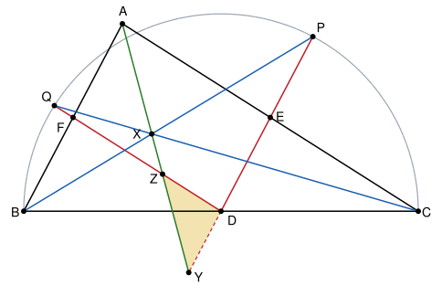

## Statement

Soit $ABC$ un triangle qui n'est pas isocèle en $A$. On note $D$, $E$ et $F$ les milieux respectifs des côtés $[BC]$, $[AC]$ et $[AB]$.

Le cercle de diamètre $[BC]$ coupe la demi-droite $[DE)$ au point $P$, et la demi-droite $[DF)$ au point $Q$.

Les droites $(BP)$ et $(CQ)$ se coupent en $X$. La droite $(AX)$ coupe la droite $(DE)$ en $Y$, et la droite $(DF)$ en $Z$.

Montrer que le triangle $DYZ$ est isocèle.

## Hints

1. Fais une figure soignée. Le point $X$ te rappelle-t-il un point connu du triangle $ABC$ ?
2. Le point $D$ est le centre du cercle. Que dire du triangle $DBP$ ? Et des droites $(DE)$ et $(AB)$ ?
3. Montre que la droite $(BP)$ coupe l'angle $\widehat{ABC}$ en deux angles égaux. Fais de même pour $(CQ)$ et l'angle $\widehat{ACB}$. Qu'en déduis-tu pour la droite $(AX)$ ?
4. Compare l'angle $\widehat{DYZ}$ à l'angle $\widehat{BAX}$, et l'angle $\widehat{DZY}$ à l'angle $\widehat{XAC}$, en utilisant les parallèles.

## Solution

**Étape 1 : deux paires de droites parallèles.** Dans le triangle $ABC$, la droite $(DE)$ passe par les milieux des côtés $[BC]$ et $[AC]$. D'après le théorème des milieux, elle est parallèle au troisième côté : $(DE) \parallel (AB)$. De même, $(DF) \parallel (AC)$.

**Étape 2 : la droite $(BP)$ coupe l'angle $\widehat{ABC}$ en deux.** Le point $D$ est le milieu du diamètre $[BC]$, c'est donc le centre du cercle. Les points $B$ et $P$ sont sur le cercle, donc $DB = DP$ : le triangle $DBP$ est isocèle en $D$, et

$$\widehat{DBP} = \widehat{DPB}.$$

D'autre part, la droite $(BP)$ coupe les deux parallèles $(DP)$ et $(AB)$. Les angles $\widehat{DPB}$ et $\widehat{PBA}$ sont alternes-internes, donc égaux. Ainsi

$$\widehat{CBP} = \widehat{DBP} = \widehat{DPB} = \widehat{PBA}.$$

La droite $(BP)$ partage l'angle $\widehat{ABC}$ en deux angles égaux : c'est la bissectrice de cet angle.

De la même façon, avec le triangle $DCQ$ isocèle en $D$ et les parallèles $(DQ)$ et $(AC)$, la droite $(CQ)$ est la bissectrice de l'angle $\widehat{ACB}$.

**Étape 3 : $(AX)$ est la bissectrice de l'angle $\widehat{BAC}$.** Le point $X$ est sur la bissectrice de l'angle $\widehat{ABC}$, donc il est à la même distance des droites $(BA)$ et $(BC)$. Il est aussi sur la bissectrice de l'angle $\widehat{ACB}$, donc à la même distance des droites $(CA)$ et $(CB)$. Il est donc à la même distance des droites $(AB)$ et $(AC)$, et comme il est à l'intérieur du triangle, il est sur la bissectrice de l'angle $\widehat{BAC}$. (Le point $X$ est le centre du cercle inscrit dans le triangle $ABC$.)

On note $\alpha$ la moitié de l'angle $\widehat{BAC}$ :

$$\widehat{BAX} = \widehat{XAC} = \alpha.$$

Comme $\widehat{BAC} < 180^\circ$, on a $\alpha < 90^\circ$.

**Étape 4 : les angles du triangle $DYZ$.** La droite $(AX)$ coupe les parallèles $(DE)$ et $(AB)$, en $Y$ et en $A$. Les angles qu'elle fait avec $(DE)$ en $Y$ sont donc les mêmes que ceux qu'elle fait avec $(AB)$ en $A$, à savoir $\alpha$ et $180^\circ - \alpha$. L'angle $\widehat{DYZ}$ du triangle vaut donc $\alpha$ ou $180^\circ - \alpha$. Sur la figure, $\widehat{DYZ}$ et $\widehat{BAY}$ sont alternes-internes, et $\widehat{DYZ} = \alpha$.

De même, avec les parallèles $(DF)$ et $(AC)$, l'angle $\widehat{DZY}$ vaut $\alpha$ ou $180^\circ - \alpha$. Sur la figure, $\widehat{DZY}$ et $\widehat{CAY}$ sont correspondants, et $\widehat{DZY} = \alpha$.

Pour être sûr que c'est toujours le cas, quelle que soit la forme du triangle, on utilise la somme des angles. Dans le triangle $DYZ$, la somme de deux angles est strictement inférieure à $180^\circ$. Or, si l'un des deux angles $\widehat{DYZ}$ ou $\widehat{DZY}$ valait $180^\circ - \alpha$, la somme des deux serait au moins $(180^\circ - \alpha) + \alpha = 180^\circ$. C'est impossible. Donc

$$\widehat{DYZ} = \widehat{DZY} = \alpha.$$

**Conclusion.** Le triangle $DYZ$ a deux angles égaux, en $Y$ et en $Z$ : il est isocèle en $D$.

*Pourquoi le triangle ne doit pas être isocèle en $A$.* Les droites $(DE)$ et $(DF)$ se coupent seulement en $D$. Si l'on avait $Y = Z$, ce point serait donc $D$, et la bissectrice issue de $A$ passerait par $D$. Alors $D$ serait à la même distance $h$ des droites $(AB)$ et $(AC)$. Or les triangles $ABD$ et $ACD$ ont la même aire, car ils ont des bases $BD$ et $DC$ égales et la même hauteur issue de $A$. Leurs aires valent aussi $AB \times h / 2$ et $AC \times h / 2$, donc $AB = AC$. Comme le triangle n'est pas isocèle en $A$, cela n'arrive pas, et $D$, $Y$, $Z$ forment un vrai triangle.

## Going further

Montrer que $DY = DZ = |AB - AC| / 2$. On pourra montrer que le triangle $FAZ$ est isocèle en $F$.
