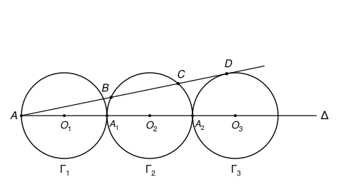
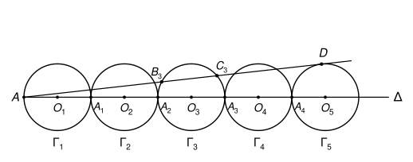

## Statement

Dans le plan, soit $A$ un point et $\Delta$ une demi-droite d'origine $A$.

1. On considère trois cercles $\Gamma_1$, $\Gamma_2$, $\Gamma_3$ de même rayon $r > 0$, de centres
   $O_1$, $O_2$, $O_3$ distincts et alignés dans cet ordre sur $\Delta$. Le cercle $\Gamma_1$ passe
   par $A$, et le cercle $\Gamma_2$ est tangent aux cercles $\Gamma_1$ et $\Gamma_3$. On note
   $[AA_1]$, $[A_1A_2]$ et $[A_2A_3]$ les diamètres de $\Gamma_1$, $\Gamma_2$ et $\Gamma_3$ portés
   par $\Delta$. Par le point $A$, on trace la droite tangente au cercle $\Gamma_3$ en un point $D$
   (figure 1).

   a) Montrer que la droite $(AD)$ coupe le cercle $\Gamma_2$ en deux points distincts $B$ et $C$
   ($B$ étant le plus proche de $A$), et calculer la longueur $BC$.

   b) Montrer que les droites $(BA_1)$ et $(CA_2)$ se coupent ; on note $P$ leur point
   d'intersection. Montrer de même que les droites $(CA_1)$ et $(BA_2)$ se coupent ; on note $Q$
   leur point d'intersection. Que peut-on dire de la direction de la droite $(PQ)$ ?

2. Plus généralement, soit $n \geq 2$ un entier et $n$ cercles $\Gamma_1$, $\Gamma_2$, …,
   $\Gamma_n$ de même rayon $r > 0$, de centres $O_1$, $O_2$, …, $O_n$ distincts et alignés dans cet
   ordre sur $\Delta$. Le cercle $\Gamma_1$ passe par $A$ et, pour tout $k$ de $2$ à $n$, le cercle
   $\Gamma_k$ est tangent au cercle $\Gamma_{k-1}$. On note $[AA_1]$, $[A_1A_2]$, …,
   $[A_{n-1}A_n]$ les diamètres de ces cercles portés par $\Delta$. Par $A$, on trace la droite
   tangente au cercle $\Gamma_n$ en un point $D$ (figure 2).

   a) Montrer que, pour tout entier $k$ tel que $1 \leq k \leq n - 1$, la droite $(AD)$ coupe le
   cercle $\Gamma_k$ en deux points distincts, que l'on note $B_k$ et $C_k$, $B_k$ étant le plus
   proche de $A$. (On remarquera que $B_1 = A$.)

   b) Calculer la longueur $B_kC_k$ en fonction de $n$, de $k$ et de $r$.

   c) Dans cette question, $r = 1$ et l'on note $L(n, k) = B_kC_k$. Montrer que $L(n, k)$ est un
   nombre rationnel si et seulement si la condition suivante est vérifiée :
   $$(\mathcal{C}_1) \qquad \text{il existe un entier naturel } a \text{ tel que } n(n-1) - k(k-1) = 4a^2.$$

## Hints

1. **Question 1 a).** Quelle est la distance $AO_3$ ? Que dire des droites $(O_3D)$ et $(AD)$ ?
2. **Question 1 a).** Soit $H$ le pied de la perpendiculaire à $(AD)$ issue de $O_2$. Les droites
   $(O_2H)$ et $(O_3D)$ sont parallèles : le théorème de Thalès donne $O_2H$.
3. **Question 1 a).** Un point $M$ de la droite $(AD)$ est sur $\Gamma_2$ quand $O_2M = r$.
   Appliquer le théorème de Pythagore dans le triangle $O_2HM$.
4. **Question 1 b).** Les points $B$ et $C$ sont sur le cercle de diamètre $[A_1A_2]$ : que
   valent les angles $\widehat{A_1BA_2}$ et $\widehat{A_1CA_2}$ ?
5. **Question 1 b).** Si $(BA_1)$ était parallèle à $(CA_2)$, l'angle $\widehat{BA_1C}$ serait
   droit. Que dire alors de la corde $[BC]$ ?
6. **Question 1 b).** Dans le triangle $PA_1A_2$, que représentent les droites $(A_2B)$ et
   $(A_1C)$ ?
7. **Question 2 b).** Refaire le calcul de la question 1 a) avec $AO_k = (2k-1)r$ et
   $AO_n = (2n-1)r$.
8. **Question 2 c).** On trouve $L(n, k) = \frac{4}{2n-1}\sqrt{N}$ avec
   $N = n(n-1) - k(k-1)$. Il s'agit de savoir quand la racine carrée d'un entier est un nombre
   rationnel. Écrire $\sqrt{N} = \frac{p}{q}$, puis $p^2 = Nq^2$, et regarder la décomposition en
   facteurs premiers des deux membres.
9. **Question 2 c).** Pourquoi l'entier $N$ est-il pair ? Si $N = m^2$, que dire de $m$ ?

## Solution

**Mise en place.** Deux cercles de même rayon $r$, tangents, de centres distincts, ont leurs
centres à la distance $2r$. Comme $\Gamma_1$ passe par $A$ et a son centre sur $\Delta$, on a
$AO_1 = r$, puis $AO_2 = 3r$, $AO_3 = 5r$, et plus généralement $AO_k = (2k-1)r$. Les points
$A_k$ sont à la distance $AA_k = 2kr$ de $A$.

**1. a)** La tangente en $D$ au cercle $\Gamma_3$ est perpendiculaire au rayon $[O_3D]$, et
$O_3D = r$. Soit $H$ le pied de la perpendiculaire à $(AD)$ issue de $O_2$. Les droites $(O_2H)$
et $(O_3D)$ sont toutes deux perpendiculaires à $(AD)$, donc parallèles. Les points $A$, $H$, $D$
sont alignés, ainsi que $A$, $O_2$, $O_3$. D'après le théorème de Thalès,
$$\frac{O_2H}{O_3D} = \frac{AO_2}{AO_3} = \frac{3r}{5r}, \qquad \text{donc} \qquad O_2H = \frac{3r}{5}.$$

Un point $M$ de la droite $(AD)$ est sur $\Gamma_2$ si et seulement si $O_2M = r$. Le triangle
$O_2HM$ est rectangle en $H$ (ou aplati si $M = H$), donc
$O_2M^2 = O_2H^2 + HM^2$. La condition devient
$$HM^2 = r^2 - \frac{9r^2}{25} = \frac{16r^2}{25}, \qquad \text{soit} \qquad HM = \frac{4r}{5}.$$
Il y a exactement deux tels points sur la droite, de part et d'autre de $H$ : ce sont $B$ et $C$,
et $H$ est le milieu de $[BC]$.

**Conclusion :** $BC = 2 \times \frac{4r}{5} = \frac{8r}{5}$.

**1. b)** La droite $(AD)$ ne coupe la droite $\Delta$ qu'en $A$, et $A$ n'est pas sur $\Gamma_2$.
Donc $B$ et $C$ ne sont pas sur $\Delta$ ; en particulier ils sont distincts de $A_1$ et $A_2$.
Comme $B$ et $C$ sont sur le cercle $\Gamma_2$ de diamètre $[A_1A_2]$, les triangles $A_1BA_2$ et
$A_1CA_2$ sont rectangles en $B$ et en $C$ :
$$(BA_1) \perp (BA_2) \qquad \text{et} \qquad (CA_1) \perp (CA_2).$$

*Les droites se coupent.* Supposons $(BA_1)$ parallèle à $(CA_2)$. Comme $(CA_2) \perp (CA_1)$,
on aurait $(BA_1) \perp (CA_1)$ : le triangle $BA_1C$, inscrit dans le cercle $\Gamma_2$, serait
rectangle en $A_1$, et son hypoténuse $[BC]$ serait un diamètre de $\Gamma_2$. On aurait
$BC = 2r$, alors que $BC = \frac{8r}{5}$. Donc $(BA_1)$ et $(CA_2)$ se coupent en un point $P$. Le
même raisonnement, en échangeant les rôles de $B$ et $C$, montre que $(CA_1)$ et $(BA_2)$ se
coupent en un point $Q$.

*Le triangle $PA_1A_2$.* Le point $P$ n'est pas sur $\Delta$ : la droite $(BA_1)$ ne coupe
$\Delta$ qu'en $A_1$, et si l'on avait $P = A_1$, la droite $(CA_2)$ passerait par $A_1$ et $A_2$,
donc serait $\Delta$, et $C$ serait sur $\Delta$. Ainsi $P$, $A_1$, $A_2$ forment un vrai
triangle.

- La droite $(A_2B)$ passe par $A_2$ et elle est perpendiculaire à $(BA_1)$, c'est-à-dire à
  $(PA_1)$ : c'est la hauteur issue de $A_2$ dans le triangle $PA_1A_2$.
- La droite $(A_1C)$ passe par $A_1$ et elle est perpendiculaire à $(CA_2)$, c'est-à-dire à
  $(PA_2)$ : c'est la hauteur issue de $A_1$.

Ces deux hauteurs se coupent en $Q$, qui est donc l'orthocentre du triangle $PA_1A_2$. La troisième
hauteur, issue de $P$, passe aussi par $Q$. De plus $P \neq Q$ : sinon ce point serait sur
$(BA_1)$ et $(BA_2)$, donc égal à $B$, et aussi sur $(CA_1)$ et $(CA_2)$, donc égal à $C$, alors
que $B \neq C$. La droite $(PQ)$ est donc la hauteur issue de $P$.

**Conclusion :** la droite $(PQ)$ est perpendiculaire à la droite $(A_1A_2)$, c'est-à-dire à
$\Delta$.

**2. a)** On reprend le raisonnement de la question 1 a). La tangente en $D$ est perpendiculaire
à $(O_nD)$ et $O_nD = r$, $AO_n = (2n-1)r$. Pour $1 \leq k \leq n - 1$, soit $H_k$ le pied de la
perpendiculaire à $(AD)$ issue de $O_k$. Les droites $(O_kH_k)$ et $(O_nD)$ sont parallèles et le
théorème de Thalès donne
$$O_kH_k = r \times \frac{AO_k}{AO_n} = \frac{(2k-1)\,r}{2n-1}.$$
Comme $2k - 1 < 2n - 1$, on a $O_kH_k < r$. Comme en 1 a), les points $M$ de $(AD)$ situés sur
$\Gamma_k$ sont ceux qui vérifient $H_kM^2 = r^2 - O_kH_k^2$, et ce nombre est strictement positif :
il y a deux points distincts $B_k$ et $C_k$, symétriques par rapport à $H_k$. Pour $k = 1$, le
point $A$ est à la fois sur $\Gamma_1$ et sur $(AD)$, c'est donc l'un d'eux, le plus proche de $A$ :
$B_1 = A$.

**2. b)** On a
$$B_kC_k = 2\sqrt{r^2 - \frac{(2k-1)^2 r^2}{(2n-1)^2}} = \frac{2r}{2n-1}\sqrt{(2n-1)^2 - (2k-1)^2}.$$
Or $(2n-1)^2 - (2k-1)^2 = 4n^2 - 4n - 4k^2 + 4k = 4(n(n-1) - k(k-1))$, d'où
$$B_kC_k = \frac{4r}{2n-1}\sqrt{n(n-1) - k(k-1)}.$$
Pour $n = 3$ et $k = 2$, on retrouve $\frac{4r}{5}\sqrt{6 - 2} = \frac{8r}{5}$.

**2. c)** Avec $r = 1$, on a $L(n, k) = \frac{4}{2n-1}\sqrt{N}$, où $N = n(n-1) - k(k-1)$ est un
entier strictement positif (car $k < n$). Comme $\frac{4}{2n-1}$ est un rationnel non nul,
$L(n, k)$ est rationnel si et seulement si $\sqrt{N}$ l'est.

*Un lemme : la racine carrée d'un entier $N \geq 1$ est rationnelle seulement si $N$ est un carré
parfait.* Supposons $\sqrt{N} = \frac{p}{q}$ avec $p$ et $q$ entiers strictement positifs. Alors
$p^2 = N q^2$. Prenons un nombre premier $\ell$ quelconque. Dans la décomposition en facteurs
premiers, $\ell$ apparaît dans $p^2$ avec un exposant pair (le double de son exposant dans $p$), et
de même dans $q^2$. Par unicité de la décomposition, l'exposant de $\ell$ dans $p^2$ est la somme
de ses exposants dans $N$ et dans $q^2$. L'exposant de $\ell$ dans $N$ est donc la différence de
deux nombres pairs : il est pair. Tous les exposants de la décomposition de $N$ étant pairs, $N$
est le carré d'un entier.

*Parité de $N$.* Les nombres $n(n-1)$ et $k(k-1)$ sont des produits de deux entiers consécutifs,
dont l'un est pair : ils sont pairs, et leur différence $N$ aussi.

*Conclusion.* Si $L(n, k)$ est rationnel, alors $N = m^2$ pour un entier $m \geq 1$. Comme $N$ est
pair, $m$ est pair (le carré d'un impair est impair) : $m = 2a$, et $N = 4a^2$, ce qui est la
condition $(\mathcal{C}_1)$. Réciproquement, si $N = 4a^2$, alors $\sqrt{N} = 2a$ et
$L(n, k) = \frac{8a}{2n-1}$ est rationnel.

**Conclusion :** $L(n, k)$ est rationnel si et seulement si $(\mathcal{C}_1)$ est vérifiée.

**Bilan.** La tangente menée de $A$ au dernier cercle d'une file de $n$ cercles égaux découpe dans
le $k$-ième cercle une corde de longueur $\frac{4r}{2n-1}\sqrt{n(n-1) - k(k-1)}$. Avec $r = 1$,
cette longueur est rationnelle exactement quand $n(n-1) - k(k-1)$ est de la forme $4a^2$. En
chemin, on a vu que les points $P$ et $Q$ construits sur le cercle du milieu sont toujours sur une
même perpendiculaire à $\Delta$.

## Going further

- Vérifier que $L(13, 4) = \frac{48}{25}$ et $L(13, 8) = \frac{8}{5}$ sont rationnels. Pour
  $n = 2$, $3$, …, $12$, existe-t-il un $k$ qui convient ?
- Dans la question 1 b), le résultat sur $(PQ)$ ne dépend pas de la position de la droite : pour
  toute droite qui coupe un cercle de diamètre $[A_1A_2]$ en deux points $B$ et $C$ qui ne forment
  pas un diamètre, $(PQ)$ est perpendiculaire à $(A_1A_2)$.
- Dans la suite du sujet, on étudiait la proportion de $[AD]$ située à l'intérieur des cercles
  quand $n$ devient grand (exercice 40083), puis la condition $(\mathcal{C}_1)$ (exercices 40082
  et 40084), et l'on montrait à la fin qu'il y a une infinité de couples $(n, k)$ pour lesquels
  $L(n, k)$ est rationnel (exercice 40087).
