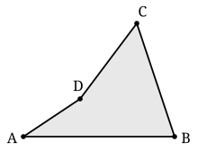
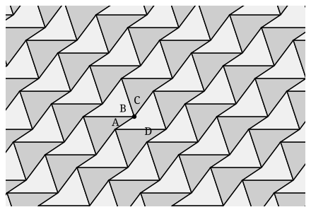

## Statement

On sait paver le plan avec des carrés, avec des triangles équilatéraux, avec des hexagones
réguliers. Mais avec une tuile tordue ?

Voici un quadrilatère $ABCD$ choisi exprès mal fichu : il est **non convexe**, son angle en
$D$ dépasse $180°$, et ses quatre côtés ont des longueurs toutes différentes.

Montre que l'on peut recouvrir le plan tout entier, sans trou et sans chevauchement, avec des
copies de ce quadrilatère. Les copies peuvent être déplacées et tournées, mais pas déformées
ni agrandies.

Ton raisonnement doit marcher pour **n'importe quel** quadrilatère, convexe ou non, et pas
seulement pour celui du dessin.

## Hints

1. Autour d'un point du pavage, les angles des tuiles qui s'y rejoignent doivent faire
   exactement un tour, soit $360°$. As-tu, dans un quadrilatère, quatre angles dont la somme
   vaut $360°$ ?
2. Il faudrait donc réussir à faire se rencontrer en un même point les quatre angles
   $\widehat{A}$, $\widehat{B}$, $\widehat{C}$ et $\widehat{D}$, un de chaque.
3. Cherche une transformation qui envoie le quadrilatère sur une copie **collée le long d'un
   de ses côtés**. Essaie le demi-tour (la symétrie de centre un point) autour du **milieu**
   d'un côté : que devient ce côté ?
4. Fais-le avec le milieu du côté $[BC]$ : la copie obtenue recolle exactement le long de
   $[BC]$. Les deux quadrilatères forment ensemble une figure à six côtés. Que remarques-tu
   sur ses côtés opposés ?
5. Un hexagone dont les côtés opposés sont parallèles et de même longueur pave le plan par
   simples glissements. Tu n'as plus qu'à recopier cet hexagone en le décalant.

## Solution

**Étape 1 : la somme des quatre angles vaut $360°$.**

Traçons la diagonale $[BD]$ : comme $D$ est le sommet rentrant, cette diagonale reste à
l'intérieur du quadrilatère et le coupe en deux triangles $ABD$ et $BCD$. La somme des angles
de chaque triangle vaut $180°$, et les angles des deux triangles se recollent exactement en
les quatre angles du quadrilatère. Donc

$$\widehat{A} + \widehat{B} + \widehat{C} + \widehat{D} = 2 \times 180° = 360° .$$

C'est vrai pour tout quadrilatère, convexe ou non : dans un quadrilatère non convexe, c'est la
diagonale issue du sommet rentrant qui est intérieure, et le découpage marche pareil.

Voilà qui est encourageant : $360°$, c'est exactement un tour. Si l'on arrive à faire se
rejoindre en un point les quatre angles, un de chaque, ça tombera juste.

**Étape 2 : le demi-tour autour du milieu d'un côté.**

Appelons $M$ le milieu de $[BC]$ et faisons subir au quadrilatère le **demi-tour de centre
$M$**, c'est-à-dire la symétrie centrale de centre $M$. Ce demi-tour échange $B$ et $C$, donc
il transforme le segment $[BC]$ en lui-même. La copie obtenue vient donc se coller **exactement
le long de $[BC]$**, du côté opposé. Deux tuiles, aucun trou, aucun chevauchement.

Notons $A'$, $B'$, $C'$, $D'$ les images de $A$, $B$, $C$, $D$. On a $B' = C$ et $C' = B$.

**Étape 3 : l'hexagone.**

La réunion des deux quadrilatères est une figure à six côtés, dont le contour est

$$A \to B \to D' \to A' \to C \to D \to A .$$

Le segment $[BC]$ a disparu du contour : il est devenu intérieur.

Regardons ses côtés opposés. Le demi-tour transforme $[AB]$ en $[A'B']$, $[CD]$ en $[C'D']$ et
$[DA]$ en $[D'A']$. Or un demi-tour transforme un segment en un segment **parallèle et de même
longueur**. Donc dans l'hexagone :

| côté | son opposé | pourquoi ils sont parallèles et égaux |
| --- | --- | --- |
| $[AB]$ | $[A'B']$ | images l'un de l'autre par le demi-tour |
| $[C'D']$ | $[CD]$ | images l'un de l'autre par le demi-tour |
| $[D'A']$ | $[DA]$ | images l'un de l'autre par le demi-tour |

**Les trois paires de côtés opposés de cet hexagone sont parallèles et de même longueur.**

**Étape 4 : un tel hexagone pave le plan par glissements.**

Prenons deux côtés opposés de l'hexagone : ils sont parallèles et de même longueur. Le
glissement (la translation) qui amène le premier sur le second amène l'hexagone sur une copie
collée le long de ce côté, sans trou ni chevauchement. En répétant ce glissement dans les deux
sens on obtient une bande d'hexagones, puis, avec une deuxième paire de côtés opposés, on
empile les bandes. Le plan est couvert.

**Étape 5 : la vérification au point de rencontre.**

Il reste à s'assurer qu'en chaque sommet du pavage tout tombe juste. Le point noir du dessin
est un tel sommet : quatre tuiles s'y rejoignent, et elles y présentent respectivement les
angles $\widehat{A}$, $\widehat{B}$, $\widehat{C}$ et $\widehat{D}$, un de chaque. Leur somme
vaut $360°$ d'après l'étape 1 : le tour est bouclé exactement, sans trou et sans
recouvrement. Le sommet rentrant $D$ ne gêne pas : son angle de plus de $180°$ occupe
simplement une grosse part du tour, et les trois autres se partagent le reste.

$$\boxed{\text{Tout quadrilatère, même non convexe, pave le plan.}}$$

**Ce qu'on retient.** La démonstration n'a utilisé aucune propriété particulière du
quadrilatère : ni angle droit, ni côtés égaux, ni convexité. Le seul ingrédient est que la
somme de ses angles vaut $360°$, ce qui est vrai pour tous. C'est justement ce pavage par demi-tours
qu'Escher utilise comme squelette de plusieurs de ses gravures : il déforme ensuite les côtés
de la tuile en gardant les demi-tours, et la tuile devient un oiseau ou un lézard.

## Going further

1. Le même raisonnement marche-t-il pour un triangle quelconque ? Combien de copies faut-il
   alors autour d'un sommet ?
2. Et pour un pentagone quelconque ? Calcule d'abord la somme de ses angles ; tu verras tout
   de suite pourquoi l'argument tombe en panne. *(La question de savoir quels pentagones
   pavent le plan est restée ouverte jusqu'en 2017.)*
3. Modifie le côté $[AB]$ du quadrilatère en une ligne quelconque, et applique-lui le même
   demi-tour pour modifier $[A'B']$. Le pavage tient-il encore ? C'est la recette d'Escher.
