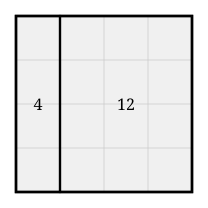
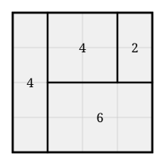

## Statement

Le peintre Piet Mondrian couvrait ses toiles de rectangles. On lui impose ici des règles.

La toile est un carré de $4$ carreaux sur $4$. Mondrian doit la découper entièrement en
rectangles, avec ces trois contraintes :

- les côtés des rectangles suivent les lignes du quadrillage ;
- il y a **au moins deux** rectangles ;
- **deux rectangles ne peuvent pas avoir les mêmes dimensions** : s'il a déjà peint un
  rectangle de $2$ sur $3$, il n'a plus le droit ni à un autre $2 \times 3$, ni à un
  $3 \times 2$, qui est le même rectangle tourné.

Le **score** d'un tableau est l'aire du plus grand rectangle moins l'aire du plus petit.
Mondrian cherche le score **le plus bas possible**.

Voici un tableau autorisé, de score $12 - 4 = 8$ :

Quel est le score minimal, et pourquoi ne peut-on pas faire mieux ?

## Hints

1. Commence par dresser la liste complète des rectangles qui tiennent dans le carré, avec leur
   aire. Il n'y en a pas beaucoup.
2. Quelle est la somme des aires des rectangles d'un tableau, quel qu'il soit ?
3. Cherche d'abord un bon tableau à la main. Peux-tu descendre à $5$ ? à $4$ ?
4. Pour prouver qu'on ne peut pas faire mieux, raisonne par l'absurde : suppose un score
   inférieur ou égal à $3$, et appelle $m$ l'aire du plus petit rectangle du tableau. Dans
   quel intervalle se trouvent alors toutes les aires ?
5. Pour chaque valeur possible de $m$, la liste des rectangles utilisables est très courte.
   Il suffit de regarder si l'on peut en choisir quelques-uns dont les aires font $16$ en tout.
   Souvent la somme de **tous** les rectangles disponibles ne suffit même pas.

## Solution

**La liste des rectangles disponibles.**

Un rectangle qui tient dans le carré a ses deux dimensions entre $1$ et $4$. En comptant
$a \times b$ et $b \times a$ comme un seul rectangle, il y en a dix :

| rectangle | $1 \times 1$ | $1 \times 2$ | $1 \times 3$ | $1 \times 4$ | $2 \times 2$ | $2 \times 3$ | $2 \times 4$ | $3 \times 3$ | $3 \times 4$ | $4 \times 4$ |
| --- | --- | --- | --- | --- | --- | --- | --- | --- | --- | --- |
| aire | $1$ | $2$ | $3$ | $4$ | $4$ | $6$ | $8$ | $9$ | $12$ | $16$ |

Chacun ne peut servir qu'une fois. Remarque utile : deux rectangles différents peuvent avoir
la même aire, le $1 \times 4$ et le $2 \times 2$ valent tous les deux $4$, et il est permis
de les utiliser tous les deux.

Dans tout tableau, la somme des aires des rectangles vaut $4 \times 4 = 16$.

**Un tableau de score $4$.**

Ce tableau utilise un $1 \times 4$ (aire $4$), un $2 \times 3$ (aire $6$), un $2 \times 2$
(aire $4$) et un $1 \times 2$ (aire $2$). Les quatre dimensions sont bien différentes deux à
deux, et

$$4 + 6 + 4 + 2 = 16 .$$

Son score vaut $6 - 2 = 4$.

**On ne peut pas descendre en dessous de $4$.**

Supposons qu'un tableau ait un score inférieur ou égal à $3$, et notons $m$ l'aire de son plus
petit rectangle. Toutes les aires utilisées sont alors comprises entre $m$ et $m + 3$.

Pour chaque valeur de $m$, on regarde quels rectangles de la liste ont une aire dans
l'intervalle $[m ; m+3]$, et on se demande si l'on peut en choisir dont les aires totalisent
$16$.

| $m$ | aires disponibles dans $[m ; m+3]$ | toutes ensemble | peut-on faire $16$ ? |
| --- | --- | --- | --- |
| $1$ | $1, 2, 3, 4, 4$ | $14$ | non, $14 < 16$ |
| $2$ | $2, 3, 4, 4$ | $13$ | non, $13 < 16$ |
| $3$ | $3, 4, 4, 6$ | $17$ | non, voir ci-dessous |
| $4$ | $4, 4, 6$ | $14$ | non, $14 < 16$ |
| $5$ | $6, 8$ | $14$ | non, $14 < 16$ |
| $6$ | $6, 8, 9$ | $23$ | non, voir ci-dessous |
| $7$ ou $8$ | $8, 9$ | $17$ | non, ni $8$, ni $9$, ni $17$ |
| $9$ | $9, 12$ | $21$ | non, ni $9$, ni $12$, ni $21$ |
| $10$, $11$, $12$ | $12$ | $12$ | non |
| $13$ et plus | $16$ | $16$ | non : un seul rectangle, interdit |

*Le cas $m = 3$ en détail.* Les aires disponibles sont $3$, $4$, $4$ et $6$. Toutes ensemble
elles font $17$ ; pour tomber sur $16$ il faudrait en retirer exactement $1$, et aucun
rectangle de la liste n'a l'aire $1$ dans cet intervalle. Les autres sommes possibles sont
$3$, $4$, $6$, $7$, $8$, $9$, $10$, $11$, $13$, $14$ : jamais $16$.

*Le cas $m = 6$ en détail.* Les aires disponibles sont $6$, $8$ et $9$. Les sommes possibles
sont $6$, $8$, $9$, $14$, $15$, $17$ et $23$ : jamais $16$.

Aucune valeur de $m$ ne convient. Un score inférieur ou égal à $3$ est donc impossible.

$$\boxed{\text{Le score minimal sur une toile } 4 \times 4 \text{ vaut } 4 .}$$

**Pourquoi le raisonnement est complet.** On n'a pas eu besoin d'examiner les découpages un
par un, ce qui aurait été très long. On s'est contenté des **aires** : quel que soit le
dessin, les aires doivent faire $16$ et tenir dans une fenêtre de largeur $3$. Cette seule
condition, purement numérique, est déjà impossible à satisfaire. Un découpage de score $3$ ne
peut donc pas exister, même en cherchant très longtemps.

## Going further

1. Cherche le meilleur score sur une toile $5 \times 5$. *(La réponse est $4$ là aussi, mais
   la démonstration d'impossibilité est bien plus longue.)*
2. Sur une toile $3 \times 3$, quel est le score minimal ?
3. Trouver le meilleur score pour une toile $n \times n$ quelconque est un **problème
   ouvert** : personne ne connaît de formule, et les valeurs connues ont été obtenues par
   ordinateur. Essaie le $6 \times 6$ à la main et vois jusqu'où tu descends.
4. La règle complète du jeu demande en plus de colorier les rectangles avec le moins de
   couleurs possible, deux rectangles qui se touchent devant être de couleurs différentes.
   Combien de couleurs faut-il pour le tableau de score $4$ ci-dessus ?
