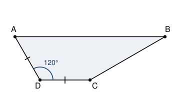

## Statement

$ABCD$ est un trapèze tel que $(AB)$ soit parallèle à $(CD)$, avec

$$AB = 3\,CD = 3\,DA \qquad \text{et} \qquad \widehat{ADC} = 120^\circ.$$

Déterminer la mesure de l'angle $\widehat{CBA}$, en degrés.

## Hints

1. Seules les proportions comptent : tu peux décider que $CD = DA = 1$, et donc $AB = 3$.
2. Place sur $[AB]$ les deux points $M$ et $N$ qui le découpent en trois morceaux de longueur
   $1$. Reconnais-tu un parallélogramme ?
3. Une fois que tu connais $MC$ et l'angle $\widehat{CMB}$, regarde le triangle $MNC$ : il a
   deux côtés égaux et un angle de $60^\circ$.
4. Il ne reste plus qu'un triangle isocèle, celui de sommet $N$.

## Solution

**On fixe une échelle.** L'angle cherché ne dépend que de la forme du trapèze, pas de sa
taille. On peut donc supposer

$$CD = DA = 1 \qquad \text{et} \qquad AB = 3.$$

**Un premier angle.** Les droites $(AB)$ et $(DC)$ sont parallèles, et $(AD)$ les coupe toutes
les deux. Les angles $\widehat{ADC}$ et $\widehat{DAB}$ sont donc des angles situés du même
côté de la sécante, à l'intérieur : leur somme vaut $180^\circ$. Comme
$\widehat{ADC} = 120^\circ$, on obtient

$$\widehat{DAB} = 60^\circ.$$

**On découpe le grand côté.** Plaçons sur $[AB]$ les points $M$ et $N$ tels que

$$AM = MN = NB = 1,$$

dans cet ordre en partant de $A$.

**Le quadrilatère $AMCD$ est un parallélogramme.** Le segment $[AM]$ est porté par $(AB)$, le
segment $[DC]$ est porté par $(DC)$ : ils sont parallèles. Ils ont la même longueur $1$, et
comme $ABCD$ est un trapèze non croisé, on va de $A$ vers $M$ dans le même sens que de $D$
vers $C$. Donc $AMCD$ est un parallélogramme.

On en déduit deux choses :

- $MC = AD = 1$ (les côtés opposés d'un parallélogramme ont la même longueur) ;
- $\widehat{AMC} = 180^\circ - \widehat{MAD} = 180^\circ - 60^\circ = 120^\circ$ (deux angles
  consécutifs d'un parallélogramme sont supplémentaires).

**L'angle en $M$ de l'autre côté.** Les points $A$, $M$, $B$ sont alignés dans cet ordre, donc

$$\widehat{CMB} = 180^\circ - \widehat{AMC} = 180^\circ - 120^\circ = 60^\circ.$$

**Le triangle $MNC$ est équilatéral.** Comme $N$ est sur $[MB]$, on a
$\widehat{CMN} = \widehat{CMB} = 60^\circ$. De plus $MN = 1$ et $MC = 1$ : le triangle $MNC$
est isocèle en $M$ avec un angle de $60^\circ$ au sommet, donc il est équilatéral. En
particulier

$$NC = 1 \qquad \text{et} \qquad \widehat{MNC} = 60^\circ.$$

**Le dernier triangle.** On a $NB = 1 = NC$, donc le triangle $NBC$ est isocèle en $N$. Comme
$M$, $N$, $B$ sont alignés dans cet ordre,

$$\widehat{BNC} = 180^\circ - \widehat{MNC} = 180^\circ - 60^\circ = 120^\circ.$$

Les deux angles à la base d'un triangle isocèle sont égaux, et la somme des angles d'un
triangle vaut $180^\circ$, donc

$$\widehat{NBC} = \frac{180^\circ - 120^\circ}{2} = 30^\circ.$$

**Conclusion.** Le point $N$ est sur le segment $[AB]$, donc les demi-droites $[BN)$ et $[BA)$
sont la même, et $\widehat{CBA} = \widehat{CBN} = 30^\circ$.

**L'angle $\widehat{CBA}$ mesure $30^\circ$.**

## Going further

Le triangle $MBC$ que l'on a coupé en deux a des angles de $60^\circ$, $90^\circ$ et
$30^\circ$ : c'est la moitié d'un triangle équilatéral. On peut le voir autrement : $N$ est à
égale distance de $M$, de $B$ et de $C$, donc $C$ est sur le cercle de diamètre $[MB]$ et
l'angle $\widehat{MCB}$ est droit.
