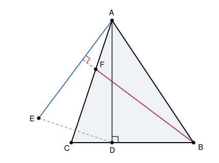

## Statement

$ABC$ est un triangle dont les trois angles sont aigus.

- $D$ est le pied de la hauteur issue de $A$, autrement dit le point de $(BC)$ tel que $(AD)$ soit perpendiculaire à $(BC)$ ;
- $E$ est le symétrique de $D$ par rapport à la droite $(AC)$ ;
- la perpendiculaire à la droite $(AE)$ passant par $B$ coupe la droite $(AC)$ en un point $F$.

Démontrer que le triangle $FBC$ est isocèle en $B$.

## Hints

1. « Isocèle en $B$ » veut dire $BF = BC$. Mais les longueurs sont difficiles ici : passe par les angles. Le triangle $FBC$ est isocèle en $B$ si et seulement si ses deux angles à la base sont égaux, c'est-à-dire si $\widehat{BFC} = \widehat{FCB}$.
2. Regarde les deux droites $(BF)$ et $(CE)$. La première est perpendiculaire à $(AE)$ par construction. Et la seconde ?
3. La symétrie par rapport à $(AC)$ envoie $D$ sur $E$. Elle envoie aussi la droite $(CD)$ sur la droite $(CE)$, et elle conserve les angles. Que devient l'angle droit $\widehat{ADC}$ ?
4. Deux droites perpendiculaires à une même troisième droite sont parallèles entre elles.
5. Une fois $(BF)$ et $(CE)$ parallèles, les angles alternes-internes te donnent $\widehat{BFC}$. Et la symétrie te donne $\widehat{ECA} = \widehat{DCA}$.

## Solution

On va montrer que les deux angles à la base du triangle $FBC$ sont égaux :

$$\widehat{BFC} = \widehat{FCB} .$$

Cela suffira, car un triangle dont deux angles sont égaux est isocèle, et les côtés égaux sont
alors ceux qui partent du troisième sommet, ici $B$.

**Étape 1 : la droite $(CE)$ est perpendiculaire à $(AE)$.**

Le point $D$ est le pied de la hauteur issue de $A$, donc

$$\widehat{ADC} = 90° .$$

Le point $E$ est le symétrique de $D$ par rapport à la droite $(AC)$. Une symétrie axiale conserve
les longueurs et les angles. Comme $A$ et $C$ sont sur l'axe $(AC)$, ils sont leurs propres
symétriques. Le triangle $ADC$ a donc pour image le triangle $AEC$, et en particulier

$$\widehat{AEC} = \widehat{ADC} = 90° .$$

Autrement dit, les droites $(CE)$ et $(AE)$ sont perpendiculaires.

**Étape 2 : les droites $(CE)$ et $(BF)$ sont parallèles.**

Par construction, la droite $(BF)$ est perpendiculaire à $(AE)$.

On vient de voir que $(CE)$ est elle aussi perpendiculaire à $(AE)$.

Deux droites perpendiculaires à une même droite sont parallèles :

$$(CE) \parallel (BF) .$$

**Étape 3 : on transporte l'angle.**

La droite $(AC)$ contient à la fois $C$ et $F$ : c'est donc une sécante aux deux parallèles
$(CE)$ et $(BF)$. Les angles $\widehat{ECF}$ et $\widehat{CFB}$ sont alternes-internes pour ces
deux parallèles et cette sécante, donc ils sont égaux :

$$\widehat{BFC} = \widehat{ECA} .$$

**Étape 4 : on utilise la symétrie une seconde fois.**

Toujours parce que la symétrie d'axe $(AC)$ envoie $D$ sur $E$ et fixe $A$ et $C$ :

$$\widehat{ECA} = \widehat{DCA} .$$

Or $D$ est un point de la droite $(BC)$ et $F$ un point de la droite $(AC)$, donc l'angle
$\widehat{DCA}$ est exactement l'angle $\widehat{BCF}$ du triangle $FBC$.

**On assemble.**

$$\widehat{BFC} = \widehat{ECA} = \widehat{DCA} = \widehat{FCB} .$$

Les deux angles à la base du triangle $FBC$ sont donc égaux : ce triangle est isocèle en $B$,
ce qu'il fallait démontrer.

## Going further

La démonstration montre en passant un fait utile : la droite $(AC)$ est la bissectrice de
l'angle $\widehat{DCE}$, puisque la symétrie échange les deux demi-angles. Ce genre de remarque,
« une symétrie axiale crée une bissectrice », revient très souvent en géométrie de concours.
