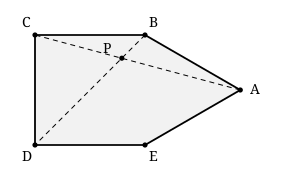

## Statement

$ABCDE$ est un pentagone dont les cinq côtés ont la même longueur. Les angles $\widehat{BCD}$ et $\widehat{CDE}$ sont droits, et le point $A$ n'est pas à l'intérieur du quadrilatère $BCDE$.

On appelle $P$ le point d'intersection des droites $(AC)$ et $(BD)$.

Montrer que $AP = PD$.

## Hints

1. Occupe-toi d'abord du quadrilatère $BCDE$ tout seul, en oubliant $A$. Les deux angles droits sont côte à côte : que peux-tu en déduire sur les droites $(CB)$ et $(DE)$ ?
2. Deux côtés opposés parallèles **et** de même longueur : quel quadrilatère est-ce ? Puis ajoute l'angle droit, puis l'égalité de deux côtés voisins.
3. Une fois que tu sais ce qu'est $BCDE$, regarde le triangle $ABE$. Ses trois côtés sont-ils égaux ?
4. À partir de là tout est une chasse aux angles. Calcule d'abord $\widehat{ABC}$, puis $\widehat{BAC}$ en utilisant que $ABC$ est isocèle.
5. Pour conclure, il suffit de montrer que le triangle $APD$ a deux angles égaux. Calcule $\widehat{PAD}$ et $\widehat{PDA}$.

## Solution

Notons $c$ la longueur commune des cinq côtés du pentagone.

**Étape 1 : $BCDE$ est un carré.**

Les angles $\widehat{BCD}$ et $\widehat{CDE}$ sont droits, donc les droites $(CB)$ et $(DE)$ sont toutes les deux perpendiculaires à $(CD)$ : elles sont donc parallèles entre elles.

De plus $CB = DE = c$. Dans le quadrilatère $BCDE$, les deux côtés opposés $[BC]$ et $[DE]$ sont parallèles et de même longueur : $BCDE$ est donc un **parallélogramme**.

Un parallélogramme qui possède un angle droit est un **rectangle** (ici l'angle $\widehat{BCD}$). Et un rectangle dont deux côtés voisins sont égaux, ici $CB = CD = c$, est un **carré**.

Donc $BCDE$ est un carré de côté $c$.

**Étape 2 : $ABE$ est équilatéral.**

Dans le carré $BCDE$, le segment $[EB]$ est un côté, donc $EB = c$. Comme par ailleurs $AB = AE = c$, le triangle $ABE$ a ses trois côtés égaux à $c$ : il est **équilatéral**. Ses trois angles valent donc $60^\circ$.

**Étape 3 : l'angle $\widehat{BAC}$.**

Le point $A$ est à l'extérieur du carré, du côté de $[BE]$. L'angle $\widehat{ABC}$ se décompose donc en

$$\widehat{ABC} = \widehat{ABE} + \widehat{EBC} = 60^\circ + 90^\circ = 150^\circ ,$$

puisque $\widehat{EBC}$ est un angle du carré.

Or $AB = BC = c$ : le triangle $ABC$ est isocèle en $B$. Ses deux angles à la base sont égaux, et leur somme vaut $180^\circ - 150^\circ = 30^\circ$. Donc

$$\widehat{BAC} = \frac{30^\circ}{2} = 15^\circ .$$

**Étape 4 : l'angle $\widehat{EAD}$.**

Exactement le même calcul de l'autre côté. On a $\widehat{AED} = \widehat{AEB} + \widehat{BED} = 60^\circ + 90^\circ = 150^\circ$, et le triangle $AED$ est isocèle en $E$ car $AE = ED = c$. Donc

$$\widehat{EAD} = \frac{180^\circ - 150^\circ}{2} = 15^\circ .$$

**Étape 5 : l'angle $\widehat{PAD}$.**

Les demi-droites $[AB)$, $[AC)$, $[AD)$ et $[AE)$ se présentent dans cet ordre en tournant autour de $A$. L'angle $\widehat{BAE} = 60^\circ$ se découpe donc en trois morceaux :

$$\widehat{BAE} = \widehat{BAC} + \widehat{CAD} + \widehat{DAE} ,$$

d'où

$$\widehat{CAD} = 60^\circ - 15^\circ - 15^\circ = 30^\circ .$$

Comme $P$ est sur la droite $(AC)$, entre $A$ et $C$, l'angle $\widehat{PAD}$ est le même que $\widehat{CAD}$ :

$$\widehat{PAD} = 30^\circ .$$

**Étape 6 : l'angle $\widehat{PDA}$.**

La droite $(BD)$ est une diagonale du carré $BCDE$, donc elle coupe l'angle droit $\widehat{CDE}$ en deux :

$$\widehat{BDE} = 45^\circ .$$

Par ailleurs, l'étape 4 donne aussi $\widehat{ADE} = 15^\circ$ (le triangle $AED$ est isocèle en $E$, donc $\widehat{EDA} = \widehat{EAD} = 15^\circ$). Comme la demi-droite $[DA)$ est à l'intérieur de l'angle $\widehat{BDE}$,

$$\widehat{ADB} = \widehat{BDE} - \widehat{ADE} = 45^\circ - 15^\circ = 30^\circ .$$

Et comme $P$ est sur la droite $(BD)$, cet angle est $\widehat{ADP} = 30^\circ$.

**Étape 7 : conclusion.**

Dans le triangle $APD$, les deux angles $\widehat{PAD}$ et $\widehat{PDA}$ valent tous les deux $30^\circ$. Le triangle est donc isocèle en $P$, et les deux côtés issus de $P$ sont égaux :

$$\boxed{AP = PD} .$$

## Going further

Les correcteurs signalent que beaucoup d'élèves ont perdu des points en écrivant simplement : « $BCDE$ a deux angles droits consécutifs et trois côtés égaux, donc c'est un carré ». Ce n'est pas une justification, c'est une reformulation de l'énoncé. L'étape 1 ci-dessus dit *pourquoi*, en trois temps : parallélogramme, puis rectangle, puis carré.

Il y a aussi une subtilité que la figure cache. Rien dans l'énoncé n'interdit *a priori* que le quadrilatère $BCDE$ soit croisé, c'est-à-dire que $B$ et $E$ soient de part et d'autre de la droite $(CD)$. On peut écarter ce cas : si $B'$ désigne le symétrique de $B$ par rapport à $C$, alors $B'CDE$ serait le carré, le triangle $EBB'$ serait rectangle en $B'$, et on aurait $EB > BB' = 2c$. Mais l'inégalité triangulaire dans $ABE$ donne $EB < EA + AB = 2c$. Contradiction.
