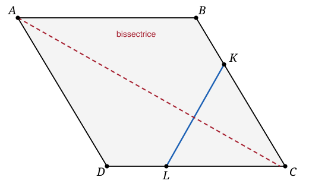

## Statement

$ABCD$ est un parallélogramme. On place un point $K$ sur le segment $[BC]$ et un point $L$ sur le segment $[CD]$ de façon que

$$CK = CL .$$

Montrer que la bissectrice de l'angle $\widehat{DAB}$ et la droite $(KL)$ sont perpendiculaires.

## Hints

1. L'hypothèse $CK = CL$ dit une seule chose : le triangle $CKL$ est isocèle en $C$. Qu'est-ce qui, dans un triangle isocèle, est perpendiculaire à la base ?
2. Dans un triangle isocèle, la bissectrice de l'angle au sommet, la médiane issue de ce sommet et la médiatrice de la base sont une seule et même droite. Ici, cette droite passe par $C$ et elle est perpendiculaire à $(KL)$.
3. Il suffit donc de montrer que la bissectrice issue de $A$ est **parallèle** à la bissectrice issue de $C$ dans le parallélogramme.
4. Pour cela, prolonge la bissectrice issue de $A$ jusqu'à la droite $(CD)$, et sers-toi du fait que $(AB)$ et $(CD)$ sont parallèles, puis du fait que $\widehat{DAB} = \widehat{BCD}$.

## Solution

L'idée est de ne jamais s'occuper directement de la bissectrice issue de $A$ et de la droite $(KL)$ en même temps. On passe par une troisième droite : la bissectrice issue de $C$.

**Étape 1. La bissectrice issue de $C$ est perpendiculaire à $(KL)$.**

Comme $CK = CL$, le triangle $CKL$ est isocèle en $C$. Notons $M$ le milieu de $[KL]$.

Dans un triangle isocèle, la droite qui joint le sommet au milieu de la base est à la fois médiane, hauteur et bissectrice. Donc la droite $(CM)$ :

- est perpendiculaire à $(KL)$ ;
- est la bissectrice de l'angle $\widehat{KCL}$.

Or $K$ est sur $[BC]$ et $L$ est sur $[CD]$, donc l'angle $\widehat{KCL}$ est exactement l'angle $\widehat{BCD}$ du parallélogramme. Autrement dit :

$$(CM) \text{ est la bissectrice de } \widehat{BCD}, \qquad \text{et} \qquad (CM) \perp (KL) .$$

**Étape 2. Les deux bissectrices, celle issue de $A$ et celle issue de $C$, sont parallèles.**

Appelons $X$ le point où la bissectrice issue de $A$ coupe la droite $(CD)$.

Les droites $(AB)$ et $(CD)$ sont parallèles, et la droite $(AX)$ les coupe toutes les deux. Les angles $\widehat{XAB}$ et $\widehat{AXD}$ sont alternes-internes, donc égaux :

$$\widehat{AXD} = \widehat{XAB} = \frac{1}{2}\,\widehat{DAB} .$$

De l'autre côté, la droite $(CM)$ est la bissectrice de $\widehat{BCD}$, donc l'angle qu'elle fait avec $(CD)$ vaut

$$\widehat{MCL} = \frac{1}{2}\,\widehat{BCD} .$$

Dans un parallélogramme, deux angles opposés sont égaux, donc $\widehat{BCD} = \widehat{DAB}$, et par conséquent

$$\widehat{AXD} = \widehat{MCL} .$$

Ces deux angles sont formés avec la **même** droite $(CD)$, du même côté et dans le même sens : ce sont des angles correspondants. Comme ils sont égaux, les droites $(AX)$ et $(CM)$ sont parallèles.

**Étape 3. On conclut.**

On a d'une part $(AX) \parallel (CM)$, d'autre part $(CM) \perp (KL)$.

Une droite perpendiculaire à l'une de deux droites parallèles est perpendiculaire à l'autre. Donc

$$(AX) \perp (KL) .$$

Et $(AX)$ est justement la bissectrice de $\widehat{DAB}$. **La bissectrice de $\widehat{DAB}$ et la droite $(KL)$ sont donc bien perpendiculaires.**

## Going further

1. Où se trouve exactement le point d'intersection de la bissectrice et de $(KL)$ ? Fais varier la longueur commune $CK = CL$ sur ta figure et observe : ce point décrit une droite. Laquelle ?
2. La démonstration n'utilise jamais la position précise de $K$ sur $[BC]$ ni celle de $L$ sur $[CD]$, seulement l'égalité $CK = CL$. Que se passe-t-il si on autorise $K$ et $L$ à sortir des segments, c'est-à-dire à se promener sur les droites $(BC)$ et $(CD)$ tout en gardant $CK = CL$ ? La conclusion tient-elle encore ?
3. Un piège signalé par les correcteurs : dans un parallélogramme, la bissectrice d'un angle ne passe **pas** par le sommet opposé. La diagonale $(AC)$ n'est donc en général pas la bissectrice de $\widehat{DAB}$. Dans quel cas particulier l'est-elle ?
