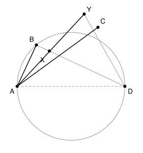

## Statement

Soient $A$ et $D$ deux points distincts, et $\Omega$ le cercle de diamètre $[AD]$.

On place sur $\Omega$ deux points $B$ et $C$, de façon que $A$, $B$, $C$ et $D$ soient quatre points distincts placés dans cet ordre sur le cercle.

On trace la bissectrice de l'angle $\widehat{BAC}$. Elle coupe la droite $(BD)$ en un point $X$ et la droite $(CD)$ en un point $Y$.

Montrer que $DX = DY$.

## Hints

1. Pour montrer que deux longueurs issues d'un même point sont égales, le réflexe est de chercher un **triangle isocèle**. Lequel, ici ?
2. Un triangle est isocèle dès que deux de ses angles sont égaux. Quels angles du triangle $DXY$ faut-il donc comparer ?
3. Le segment $[AD]$ est un diamètre. Que vaut alors l'angle $\widehat{ABD}$ ? Et l'angle $\widehat{ACD}$ ?
4. Le triangle $ABX$ est rectangle en $B$. La somme de ses angles vaut $180^\circ$ : exprimez $\widehat{AXB}$ en fonction de $\widehat{BAX}$.
5. Notez $\alpha$ la moitié de l'angle $\widehat{BAC}$. Les angles $\widehat{BAX}$ et $\widehat{CAY}$ valent tous les deux $\alpha$ : c'est exactement ce que dit « bissectrice ».
6. Il reste à ramener les deux angles calculés à l'intérieur du triangle $DXY$. Pensez aux angles opposés par le sommet.

## Solution

**L'idée : montrer que le triangle $DXY$ est isocèle en $D$.**

Notons $\alpha$ la moitié de l'angle $\widehat{BAC}$. Puisque $X$ et $Y$ sont tous les deux sur la bissectrice de $\widehat{BAC}$,

$$\widehat{BAX} = \alpha \qquad \text{et} \qquad \widehat{CAY} = \alpha.$$

### Étape 1 : deux angles droits

Le segment $[AD]$ est un diamètre du cercle $\Omega$, et $B$ est sur $\Omega$. Or un triangle inscrit dans un cercle dont un côté est un diamètre est rectangle. Donc

$$\widehat{ABD} = 90^\circ.$$

Pour la même raison, avec le point $C$ :

$$\widehat{ACD} = 90^\circ.$$

### Étape 2 : deux angles égaux

Le point $X$ est sur la droite $(BD)$, donc $\widehat{ABX} = \widehat{ABD} = 90^\circ$ : le triangle $ABX$ est rectangle en $B$. La somme de ses angles vaut $180^\circ$, donc

$$\widehat{AXB} = 180^\circ - 90^\circ - \widehat{BAX} = 90^\circ - \alpha.$$

De la même façon, le point $Y$ est sur la droite $(CD)$, donc le triangle $ACY$ est rectangle en $C$, et

$$\widehat{AYC} = 180^\circ - 90^\circ - \widehat{CAY} = 90^\circ - \alpha.$$

Les deux angles $\widehat{AXB}$ et $\widehat{AYC}$ sont donc égaux, et valent tous les deux $90^\circ - \alpha$.

### Étape 3 : on rapatrie ces angles dans le triangle $DXY$

Regardons d'abord le sommet $X$. Les points $B$, $X$, $D$ sont alignés, et les points $A$, $X$, $Y$ sont alignés. Les angles $\widehat{AXB}$ et $\widehat{YXD}$ sont donc **opposés par le sommet**, d'où

$$\widehat{YXD} = \widehat{AXB} = 90^\circ - \alpha.$$

Regardons maintenant le sommet $Y$. Sur la figure, $X$ est entre $A$ et $Y$, donc les demi-droites $[YA)$ et $[YX)$ sont la même ; et $C$ est entre $Y$ et $D$, donc les demi-droites $[YC)$ et $[YD)$ sont la même. Les angles $\widehat{AYC}$ et $\widehat{XYD}$ sont donc tout simplement le même angle :

$$\widehat{XYD} = \widehat{AYC} = 90^\circ - \alpha.$$

### Conclusion

Dans le triangle $DXY$, les deux angles à la base $\widehat{YXD}$ et $\widehat{XYD}$ sont égaux. Ce triangle est donc isocèle, et son sommet est le troisième, c'est-à-dire $D$. Les deux côtés issus de $D$ sont donc de même longueur :

$$\boxed{DX = DY.}$$

*Une deuxième solution, plus rapide si l'on connaît le théorème de l'angle inscrit.* Prolongeons la bissectrice jusqu'à recouper le cercle $\Omega$ en un point $S$. Comme $\widehat{BAS} = \widehat{SAC}$, les arcs $BS$ et $SC$ sont égaux, donc $S$ est le milieu de l'arc $BC$ ; du coup $\widehat{BDS} = \widehat{SDC}$, c'est-à-dire que $(DS)$ est la bissectrice de l'angle $\widehat{XDY}$. Par ailleurs $[AD]$ est un diamètre et $S$ est sur le cercle, donc $\widehat{ASD} = 90^\circ$ : la droite $(DS)$ est perpendiculaire à $(XY)$, c'est donc aussi la hauteur issue de $D$ dans le triangle $DXY$. Dans un triangle, si la bissectrice issue d'un sommet est aussi la hauteur issue de ce sommet, le triangle est isocèle en ce sommet. Donc $DX = DY$.

## Going further

1. Où se trouve le point $S$ de la deuxième solution par rapport au segment $[XY]$ ? Que représente-t-il pour ce segment ?
2. Que devient le résultat si $B$ et $C$ sont de part et d'autre de la droite $(AD)$ au lieu d'être du même côté ? Faites la figure.
