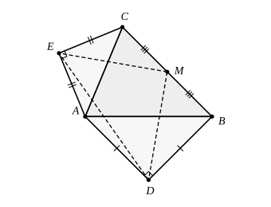

## Statement

À l'extérieur du triangle $ABC$ nous construisons les triangles rectangles isocèles $ABD$ et $ACE$, avec

$$DA = DB, \quad \widehat{ADB} = 90° \qquad \text{et} \qquad EA = EC, \quad \widehat{AEC} = 90°.$$

Démontrez que le triangle $MDE$ est rectangle isocèle en $M$, où $M$ est le milieu de $[BC]$.

## Hints

1. Beaucoup de milieux traînent dans cette figure. Ajoute $P$, le milieu de $[AB]$, et $Q$, le milieu de $[AC]$, et relie-les à tout le monde.
2. Dans le triangle rectangle isocèle $ADB$, que vaut $DP$ ? Et quel angle $(DP)$ fait-elle avec $(AB)$ ?
3. Le théorème des milieux dans le triangle $ABC$ donne $PM$ et $QM$. Compare les quatre longueurs $DP$, $PM$, $QM$, $QE$ : tu vas trouver deux paires égales.
4. Montre que $\widehat{DPM} = \widehat{EQM}$, puis compare les triangles $DPM$ et $MQE$.
5. Pour l'angle droit, remarque que $APMQ$ est un parallélogramme, donc $\widehat{PMQ} = \widehat{BAC}$, et découpe $\widehat{DME}$ en trois morceaux.

## Solution

Notons $\widehat{A} = \widehat{BAC}$, puis $P$ le milieu de $[AB]$ et $Q$ le milieu de $[AC]$.

**Ce que vaut $DP$.** Le triangle $ADB$ est isocèle en $D$, donc la médiane $[DP]$ issue de $D$ est aussi la hauteur et la médiatrice de $[AB]$ : $(DP) \perp (AB)$. De plus le triangle $ADB$ est rectangle en $D$, donc la médiane issue de l'angle droit vaut la moitié de l'hypoténuse :

$$DP = \frac{AB}{2}.$$

Pour les mêmes raisons, dans le triangle $AEC$ :

$$(EQ) \perp (AC) \qquad \text{et} \qquad EQ = \frac{AC}{2}.$$

**Ce que vaut $PM$.** Dans le triangle $ABC$, $P$ et $M$ sont les milieux de $[AB]$ et de $[BC]$, donc par le théorème des milieux

$$PM = \frac{AC}{2} \qquad \text{et} \qquad (PM) \parallel (AC).$$

De même, $Q$ et $M$ sont les milieux de $[AC]$ et $[BC]$, donc

$$QM = \frac{AB}{2} \qquad \text{et} \qquad (QM) \parallel (AB).$$

**Les deux triangles $DPM$ et $MQE$ sont égaux.** Rassemblons les longueurs :

$$DP = \frac{AB}{2} = QM \qquad \text{et} \qquad PM = \frac{AC}{2} = QE.$$

Pour les angles compris entre ces côtés, décomposons-les en passant par le côté du triangle :

- en $P$ : $\widehat{DPB} = 90°$ (car $(DP) \perp (AB)$), et $\widehat{BPM} = \widehat{A}$ car $(PM) \parallel (AC)$ et $[PB)$ est portée par $(AB)$ dans le même sens que $[AB)$ (angles correspondants) ;
- en $Q$ : $\widehat{EQC} = 90°$ (car $(EQ) \perp (AC)$), et $\widehat{CQM} = \widehat{A}$ car $(QM) \parallel (AB)$, pour la même raison.

Comme $D$ est à l'extérieur du triangle, $D$ et $M$ sont de part et d'autre de la droite $(AB)$, et l'angle $\widehat{DPM}$ se recolle à partir des deux morceaux $\widehat{DPB}$ et $\widehat{BPM}$ ; de même $\widehat{EQM}$ se recolle à partir de $\widehat{EQC}$ et $\widehat{CQM}$. Les deux angles sont donc faits des deux mêmes morceaux, $90°$ et $\widehat{A}$, et

$$\widehat{DPM} = \widehat{EQM}.$$

Les triangles $DPM$ et $MQE$ ont donc deux côtés égaux deux à deux et l'angle compris entre eux égal : d'après le deuxième cas d'égalité ($CAC$), ils sont égaux. On en déduit

$$MD = EM \qquad \text{et} \qquad \widehat{PDM} = \widehat{QME}, \qquad \widehat{PMD} = \widehat{QEM}.$$

Le triangle $MDE$ est donc déjà **isocèle en $M$**.

**L'angle droit.** Le quadrilatère $APMQ$ a ses côtés opposés parallèles : $(PM) \parallel (AQ)$ et $(QM) \parallel (AP)$. C'est un parallélogramme, donc ses angles opposés sont égaux :

$$\widehat{PMQ} = \widehat{PAQ} = \widehat{A}.$$

Supposons $\widehat{A}$ aigu, comme sur la figure. En tournant autour de $M$, les demi-droites se succèdent alors dans l'ordre $[MD)$, $[MP)$, $[MQ)$, $[ME)$, donc

$$\widehat{DME} = \widehat{DMP} + \widehat{PMQ} + \widehat{QME}.$$

Or $\widehat{QME} = \widehat{PDM}$ d'après l'égalité des deux triangles, et dans le triangle $DPM$ la somme des angles donne

$$\widehat{DMP} + \widehat{PDM} = 180° - \widehat{DPM} = 180° - (90° + \widehat{A}) = 90° - \widehat{A}.$$

Donc

$$\widehat{DME} = (\widehat{DMP} + \widehat{PDM}) + \widehat{PMQ} = (90° - \widehat{A}) + \widehat{A} = 90°.$$

**Le triangle $MDE$ est donc rectangle et isocèle en $M$.**

## Going further

Le cas d'un angle $\widehat{A}$ obtus demande un mot de plus. Les angles $\widehat{DPM}$ et $\widehat{EQM}$ valent alors chacun $270° - \widehat{A}$ au lieu de $90° + \widehat{A}$ (les deux morceaux se recollent de l'autre côté), mais ils restent égaux entre eux, donc les triangles $DPM$ et $MQE$ sont encore égaux et $MD = ME$.

Pour l'angle, l'ordre des demi-droites autour de $M$ devient $[MP)$, $[MD)$, $[ME)$, $[MQ)$, et le découpage se fait par soustraction :

$$\widehat{DME} = \widehat{PMQ} - \widehat{DMP} - \widehat{QME} = \widehat{A} - (\widehat{DMP} + \widehat{PDM}) = \widehat{A} - (180° - (270° - \widehat{A})) = 90°.$$

Le résultat vaut donc pour tous les triangles $ABC$, et l'on peut le vérifier sur un dessin très aplati.
