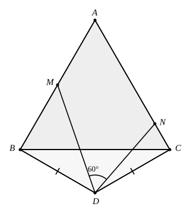

## Statement

$ABC$ est un triangle équilatéral de côté $1$. De l'autre côté de la droite $(BC)$ par rapport
à $A$, on construit le triangle $BDC$ isocèle en $D$, avec

$$DB = DC \qquad \text{et} \qquad \widehat{BDC} = 120^\circ.$$

Le point $M$ est sur le côté $[AB]$ et le point $N$ est sur le côté $[AC]$, de façon que

$$\widehat{MDN} = 60^\circ.$$

Calculer le périmètre du triangle $AMN$.

## Hints

1. Fais l'expérience : dessine la figure avec deux positions différentes de $M$, mesure le
   périmètre de $AMN$ à chaque fois, et compare.
2. Le périmètre vaut $AM + AN + MN$. Si l'on arrivait à montrer que $MN = MB + NC$, la somme
   se replierait sur les deux côtés du triangle équilatéral.
3. Commence par calculer les angles $\widehat{DBC}$, $\widehat{DCB}$, puis $\widehat{ABD}$ et
   $\widehat{ACD}$. Tu trouveras deux angles droits.
4. Pour fabriquer la longueur $MB + NC$ d'un seul tenant, prolonge $[AB]$ au-delà de $B$
   jusqu'au point $K$ tel que $BK = CN$. Compare alors les triangles $DBK$ et $DCN$.
5. Il reste à comparer les triangles $DKM$ et $DNM$. L'angle de $60^\circ$, moitié de
   $120^\circ$, sert exactement à cela.

## Solution

**L'idée : faire basculer le morceau $NC$ de l'autre côté, en $BK$, pour que $MB + NC$ devienne
une seule longueur $MK$, puis montrer que $MK = MN$.**

**Étape 1. Deux angles droits.**

Le triangle $BDC$ est isocèle en $D$ avec $\widehat{BDC} = 120^\circ$, donc ses angles à la
base valent

$$\widehat{DBC} = \widehat{DCB} = \frac{180^\circ - 120^\circ}{2} = 30^\circ.$$

Le triangle $ABC$ est équilatéral, donc $\widehat{ABC} = \widehat{ACB} = 60^\circ$. Comme $A$
et $D$ sont de part et d'autre de $(BC)$, les angles s'ajoutent :

$$\widehat{ABD} = 60^\circ + 30^\circ = 90^\circ, \qquad \widehat{ACD} = 90^\circ.$$

**Étape 2. La construction.** Prolongeons le côté $[AB]$ au-delà de $B$ jusqu'au point $K$ tel
que

$$BK = CN.$$

Comme $\widehat{ABD} = 90^\circ$ et que $K$ est sur la demi-droite $[AB)$ au-delà de $B$,

$$\widehat{DBK} = 180^\circ - 90^\circ = 90^\circ.$$

**Étape 3. Les triangles $DBK$ et $DCN$ sont superposables.** En effet :

- $DB = DC$, par hypothèse ;
- $\widehat{DBK} = \widehat{DCN} = 90^\circ$ (pour le second : $N$ est sur $[AC]$, donc
  $\widehat{DCN} = \widehat{DCA} = 90^\circ$) ;
- $BK = CN$, par construction.

Deux côtés et l'angle compris : les triangles sont superposables. Donc

$$DK = DN \qquad \text{et} \qquad \widehat{BDK} = \widehat{CDN}.$$

**Étape 4. L'angle de $60^\circ$ se retrouve deux fois.** Les demi-droites $[DM)$ et $[DN)$
sont à l'intérieur de l'angle $\widehat{BDC}$, et elles le découpent en trois :

$$\widehat{BDM} + \widehat{MDN} + \widehat{NDC} = 120^\circ,$$

donc

$$\widehat{BDM} + \widehat{NDC} = 120^\circ - 60^\circ = 60^\circ.$$

Par conséquent

$$\widehat{KDM} = \widehat{KDB} + \widehat{BDM} = \widehat{NDC} + \widehat{BDM} = 60^\circ = \widehat{NDM}.$$

**Étape 5. Les triangles $KDM$ et $NDM$ sont superposables.** En effet :

- $DK = DN$, d'après l'étape 3 ;
- le côté $[DM]$ est commun ;
- $\widehat{KDM} = \widehat{NDM} = 60^\circ$, d'après l'étape 4.

Donc

$$MN = MK = MB + BK = MB + NC.$$

**Étape 6. Le périmètre.**

$$\text{périmètre de } AMN = AM + AN + MN = AM + AN + MB + NC = (AM + MB) + (AN + NC),$$

c'est-à-dire

$$\text{périmètre de } AMN = AB + AC = 1 + 1 = 2.$$

**Conclusion.** Le périmètre du triangle $AMN$ vaut $2$, quelle que soit la position de $M$ sur
$[AB]$ : il ne dépend pas du tout de la figure choisie, seulement de la condition
$\widehat{MDN} = 60^\circ$.

## Going further

1. Calculer $DB$, $DC$ et $DA$. Montrer que $D$ est le symétrique, par rapport à la droite
   $(BC)$, du centre du cercle circonscrit au triangle $ABC$, et que $DA = 2 \times DB$.
2. La démonstration n'utilise l'angle de $120^\circ$ que par l'intermédiaire du couple
   « $120^\circ$ en $D$, moitié $60^\circ$ pour $\widehat{MDN}$ ». Énoncer le résultat général
   correspondant.
