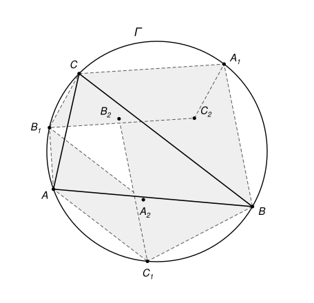

## Statement

Soit $ABC$ un triangle et $\Gamma$ son cercle circonscrit, de centre $O$. On note

- $A_1$ le milieu de l'arc $BC$ qui ne contient pas $A$,
- $B_1$ le milieu de l'arc $CA$ qui ne contient pas $B$,
- $C_1$ le milieu de l'arc $AB$ qui ne contient pas $C$.

Soit enfin $A_2$ le point tel que $AB_1A_2C_1$ soit un parallélogramme, $B_2$ le point tel que $BC_1B_2A_1$ soit un parallélogramme, et $C_2$ le point tel que $CA_1C_2B_1$ soit un parallélogramme.

Démontrer que le cercle circonscrit au triangle $A_2B_2C_2$ a lui aussi pour centre $O$.

## Hints

1. Que sont les droites $(AA_1)$, $(BB_1)$ et $(CC_1)$ pour le triangle $ABC$ ? Notez $I$ leur point commun.
2. Montrez que $C_1A = C_1I$, en comparant deux angles du triangle $AC_1I$. Faites de même avec $B_1$.
3. Que représente la droite $(B_1C_1)$ pour le segment $[AI]$ ? Et le milieu de $[B_1C_1]$ pour le parallélogramme $AB_1A_2C_1$ ?
4. Soit $J$ le milieu de $[AI]$ et $K$ celui de $[B_1C_1]$. Avec le théorème des milieux dans le triangle $AIA_2$, montrez que $(IA_2)$ est parallèle à $(B_1C_1)$, puis que la médiatrice de $[B_1C_1]$ est aussi celle de $[IA_2]$.

## Solution

**Rappel.** On mesure un arc de cercle par l'angle au centre qui l'intercepte. Le théorème de l'angle inscrit dit qu'un angle inscrit vaut la moitié de l'arc qu'il intercepte. Par exemple, l'arc $BC$ qui ne contient pas $A$ mesure $2\,\widehat{BAC}$.

Notons $\alpha = \widehat{BAC}$, $\beta = \widehat{CBA}$ et $\gamma = \widehat{ACB}$. On va montrer que les trois points $A_2$, $B_2$, $C_2$ sont à la même distance de $O$.

### Étape 1 : les bissectrices

L'arc $BC$ qui ne contient pas $A$ mesure $2\alpha$, et $A_1$ le partage en deux arcs $BA_1$ et $A_1C$ de mesure $\alpha$ chacun. Les angles inscrits $\widehat{BAA_1}$ et $\widehat{A_1AC}$ interceptent ces deux arcs, donc ils valent tous les deux $\frac{\alpha}{2}$ : la droite $(AA_1)$ est la bissectrice de l'angle $\widehat{BAC}$.

De même, $(BB_1)$ et $(CC_1)$ sont les bissectrices des angles en $B$ et en $C$. Les trois bissectrices d'un triangle se coupent en un point $I$, le centre du cercle inscrit, situé à l'intérieur du triangle. Le point $I$ est donc sur les segments $[AA_1]$, $[BB_1]$ et $[CC_1]$. De même, les arcs $AC_1$ et $C_1B$ mesurent $\gamma$, et les arcs $CB_1$ et $B_1A$ mesurent $\beta$.

### Étape 2 : C₁A = C₁I et B₁A = B₁I

Regardons le triangle $AC_1I$.

- L'angle $\widehat{C_1AI} = \widehat{C_1AA_1}$ est inscrit et intercepte l'arc $C_1A_1$ qui passe par $B$. Cet arc est formé de l'arc $C_1B$, qui mesure $\gamma$, et de l'arc $BA_1$, qui mesure $\alpha$. Donc $\widehat{C_1AI} = \frac{\alpha + \gamma}{2}$.
- Comme $I$ est sur le segment $[CC_1]$, l'angle $\widehat{AIC_1}$ est l'angle extérieur en $I$ du triangle $AIC$. Il vaut donc la somme des deux autres angles de ce triangle : $\widehat{AIC_1} = \widehat{IAC} + \widehat{ICA} = \frac{\alpha}{2} + \frac{\gamma}{2}$.

Le triangle $AC_1I$ a deux angles égaux, en $A$ et en $I$ : il est isocèle en $C_1$, et $C_1A = C_1I$.

Le même raisonnement dans le triangle $AB_1I$ donne $\widehat{B_1AI} = \frac{\alpha + \beta}{2} = \widehat{AIB_1}$, donc $B_1A = B_1I$.

### Étape 3 : une symétrie

Les points $B_1$ et $C_1$ sont tous les deux à égale distance de $A$ et de $I$ : ils sont sur la médiatrice de $[AI]$. Comme ils sont distincts, **la droite $(B_1C_1)$ est la médiatrice de $[AI]$**. Autrement dit, $I$ est le symétrique de $A$ par rapport à la droite $(B_1C_1)$.

### Étape 4 : OA₂ = OI

Les diagonales du parallélogramme $AB_1A_2C_1$ ont le même milieu : le milieu $K$ de $[B_1C_1]$ est aussi le milieu de $[AA_2]$. Soit $J$ le milieu de $[AI]$. D'après l'étape 3, $J$ est sur la droite $(B_1C_1)$, et cette droite est perpendiculaire à $(AI)$ en $J$.

Si $K = J$, les segments $[AA_2]$ et $[AI]$ ont le même milieu, donc $A_2 = I$ et $OA_2 = OI$.

Supposons maintenant $K \neq J$. Alors $K$ n'est pas sur la droite $(AI)$, qui ne coupe $(B_1C_1)$ qu'en $J$. Les points $A$, $I$, $A_2$ ne sont donc pas alignés.

- **La droite $(IA_2)$ est parallèle à $(B_1C_1)$.** Dans le triangle $AIA_2$, la droite $(JK)$ passe par les milieux des côtés $[AI]$ et $[AA_2]$. D'après le théorème des milieux, elle est parallèle au troisième côté, $[IA_2]$. Or $J$ et $K$ sont deux points distincts de $(B_1C_1)$, donc $(JK) = (B_1C_1)$.
- **La médiatrice de $[B_1C_1]$ est aussi celle de $[IA_2]$.** Notons $\Delta$ la médiatrice de $[B_1C_1]$. Elle passe par $K$ et elle est perpendiculaire à $(B_1C_1)$, comme $(AI)$ : elle est donc parallèle à $(AI)$. Dans le triangle $AIA_2$, la droite $\Delta$ passe par le milieu $K$ du côté $[AA_2]$ et elle est parallèle au côté $[AI]$. D'après le théorème des milieux, elle passe par le milieu du troisième côté, $[IA_2]$. De plus, elle est perpendiculaire à $(IA_2)$, puisque $(IA_2)$ est parallèle à $(B_1C_1)$. C'est donc la médiatrice de $[IA_2]$.

Comme $OB_1 = OC_1$, le point $O$ est sur la médiatrice $\Delta$ de $[B_1C_1]$. Il est donc à la même distance de $I$ et de $A_2$ : $OA_2 = OI$.

### Conclusion

Le même raisonnement, avec les sommets $B$ et $C$ à la place de $A$, donne $OB_2 = OI$ et $OC_2 = OI$. Les trois points $A_2$, $B_2$, $C_2$ sont donc sur le cercle de centre $O$ et de rayon $OI$. Ce cercle est le cercle circonscrit au triangle $A_2B_2C_2$.

**Le cercle circonscrit à $A_2B_2C_2$ a donc le même centre $O$ que $\Gamma$ : les deux cercles sont concentriques.**

*Remarque.* Si $ABC$ est équilatéral, alors $I = O$, et les trois points $A_2$, $B_2$, $C_2$ sont confondus avec $O$ : il n'y a pas de triangle $A_2B_2C_2$. L'énoncé suppose implicitement que ce n'est pas le cas.
