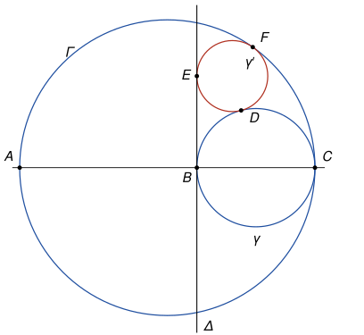

## Statement

Dans le plan, soit $A$, $B$, $C$ trois points distincts tels que $B$ soit sur le segment
$[AC]$. On note $\Gamma$ le cercle de diamètre $[AC]$ et $R$ son rayon, $\gamma$ le cercle de
diamètre $[BC]$ et $r$ son rayon, et $\Delta$ la tangente en $B$ au cercle $\gamma$.

On suppose donné un cercle $\gamma'$, de rayon $r'$, situé du même côté de $\Delta$ que le point
$C$, qui est tangent extérieurement à $\gamma$ en $D$, tangent à $\Delta$ en $E$, et tangent
intérieurement à $\Gamma$ en $F$.

On pourra utiliser librement les faits suivants.

- La tangente en un point $M$ d'un cercle de centre $\Omega$ est la perpendiculaire à
  $(\Omega M)$ passant par $M$.
- Quand deux cercles sont tangents en un point, ce point est aligné avec les deux centres.
- Une homothétie de rapport $k$ transforme un cercle de centre $\omega$ et de rayon $\rho$ en le
  cercle dont le centre est l'image de $\omega$ et dont le rayon est $|k|\,\rho$. Elle
  transforme une droite en une droite parallèle.

1. Justifier que les droites $\Delta$ et $(CF)$ ne sont pas parallèles. On note $G$ leur point
   d'intersection.
2. Montrer qu'il existe une homothétie de centre $C$ qui transforme $\gamma$ en $\Gamma$, et
   une homothétie de centre $F$ qui transforme $\Gamma$ en $\gamma'$.
3. Déterminer les centres des homothéties qui transforment $\gamma$ en $\gamma'$.
4. Soit $I$ le milieu de $[BE]$. Montrer que les points $A$, $I$, $D$ sont alignés sur une
   droite perpendiculaire à $(GD)$.
5. Montrer que $AB = GD$.
6. Exprimer le rayon $r'$ de $\gamma'$ en fonction de $R$ et de $r$.

## Hints

1. **Question 1.** Si les deux droites étaient parallèles, la droite $(CF)$ serait
   perpendiculaire à $(AC)$ en $C$. Que serait-elle alors pour le cercle $\Gamma$ ?
2. **Question 1.** Il faut aussi vérifier que $F \neq C$. Si $F = C$, où serait le centre de
   $\gamma'$, et en quel point $\gamma'$ toucherait-il $\Delta$ ?
3. **Question 2.** Appeler $O$ le centre de $\Gamma$ et $\omega$ celui de $\gamma$. Où sont-ils
   par rapport à $C$ ? Comparer $C\omega$ et $CO$.
4. **Question 3.** Une homothétie qui transforme $\gamma$ en $\gamma'$ envoie le centre
   $\omega$ sur le centre $O'$ de $\gamma'$, et son rapport $k$ vérifie $|k| = r'/r$. Il n'y a
   donc que deux candidats : $k = -r'/r$ et $k = r'/r$.
5. **Question 3.** Pour le rapport négatif, regarder où est $D$ sur le segment $[\omega O']$.
   Pour le rapport positif, chercher l'image de $B$, puis celle de $C$, et comparer cette
   dernière avec l'image de $C$ par l'homothétie de centre $F$ de la question 2.
6. **Question 4.** Montrer que $F$, $A$, $E$ sont alignés, puis que $D$, $C$, $E$ sont alignés,
   en cherchant les images de $A$ et de $C$ par des homothéties bien choisies.
7. **Question 4.** Le point $E$ est sur deux hauteurs du triangle $AGC$. Qu'en déduit-on pour
   la droite $(CE)$ ? Puis pour les droites $(BD)$ et $(AG)$ ?
8. **Question 4.** Appliquer le théorème de Thalès dans le triangle $\omega A G$ : il est
   isocèle. Utiliser ensuite son axe de symétrie.
9. **Question 4.** Pour le point $I$ : la tangente commune à $\gamma$ et $\gamma'$ en $D$ coupe
   $\Delta$ en un point $J$. Comparer $JB$, $JD$ et $JE$.
10. **Question 6.** Le rapport de l'homothétie de centre $G$ se lit sur la droite $(G\omega)$,
    où l'on connaît maintenant $GD$.

## Solution

On note $O$, $\omega$, $O'$ les centres de $\Gamma$, $\gamma$, $\gamma'$. Les points $O$
(milieu de $[AC]$) et $\omega$ (milieu de $[BC]$) sont sur la droite $(AC)$. Comme $\Delta$ est
la tangente en $B$ à $\gamma$, elle est perpendiculaire à $(\omega B) = (AC)$ en $B$. Le cercle
$\gamma$ est entièrement du côté de $\Delta$ où se trouve $C$, et il ne touche $\Delta$ qu'en
$B$ ; le cercle $\gamma'$ est du même côté. Le point $A$, lui, est strictement de l'autre côté.

**1.** Montrons d'abord que $F \neq C$. Si l'on avait $F = C$, le centre $O'$ serait aligné
avec $O$ et $C$, donc sur la droite $(AC)$. Le point de contact $E$ de $\gamma'$ avec $\Delta$
est le pied de la perpendiculaire à $\Delta$ issue de $O'$ ; comme $(AC)$ est perpendiculaire à
$\Delta$ en $B$, ce serait $B$. Le cercle $\gamma'$ passerait par $B$ et par $C$ et aurait son
centre sur la droite $(BC)$ : ce serait le cercle de diamètre $[BC]$, c'est-à-dire $\gamma$
lui-même. C'est impossible, puisque $\gamma'$ est tangent extérieurement à $\gamma$. Donc
$F \neq C$, et $(CF)$ est bien une droite.

Si $(CF)$ était parallèle à $\Delta$, elle serait perpendiculaire à $(AC) = (OC)$ au point
$C$, donc ce serait la tangente à $\Gamma$ en $C$. Or cette tangente ne rencontre $\Gamma$ qu'en $C$,
alors que $F$ est un point de $\Gamma$ distinct de $C$. Donc $\Delta$ et $(CF)$ ne sont pas
parallèles : elles se coupent en un point $G$.

**2.** Les points $\omega$ et $O$ sont sur la même demi-droite issue de $C$ (celle qui va
vers $A$), avec $C\omega = r$ et $CO = R$. L'homothétie de centre $C$ et de rapport $R/r$
envoie donc $\omega$ sur $O$, et elle transforme $\gamma$ en le cercle de centre $O$ et de
rayon $\frac{R}{r} \times r = R$, c'est-à-dire $\Gamma$.

Comme $\gamma'$ est tangent intérieurement à $\Gamma$ en $F$, les points $F$, $O'$, $O$ sont
alignés, et $O'$ est sur le segment $[FO]$, avec $FO' = r'$ et $FO = R$. L'homothétie de centre
$F$ et de rapport $r'/R$ envoie donc $O$ sur $O'$, et elle transforme $\Gamma$ en le cercle de
centre $O'$ et de rayon $r'$, c'est-à-dire $\gamma'$.

**3.** *Ce que doit vérifier une telle homothétie.* Si une homothétie de rapport $k$ transforme
$\gamma$ en $\gamma'$, elle envoie le centre $\omega$ sur le centre $O'$ et multiplie le rayon
par $|k|$. Donc $|k| = r'/r$, et son centre est sur la droite $(\omega O')$. Il y a au plus deux
telles homothéties, une de rapport $-r'/r$ et une de rapport $r'/r$.

*On a $r' < r$.* Le cercle $\gamma'$ est à l'intérieur du disque $\Gamma$, du côté de $C$. Les
points de ce disque situés de ce côté de $\Delta$ sont à une distance de $\Delta$ au plus égale
à $BC = 2r$, et seul $C$ est à cette distance. Le point de $\gamma'$ diamétralement opposé à $E$
est à la distance $2r'$ de $\Delta$. Donc $2r' \leq 2r$, et l'égalité forcerait ce point à être
$C$ : alors $C$ serait sur $\gamma'$ et sur $\Gamma$, donc $C = F$, ce qui est exclu.

*Rapport négatif.* Le centre doit être entre $\omega$ et $O'$, à des distances de $\omega$ et
de $O'$ dans le rapport $r$ à $r'$. Le point de contact $D$ convient : il est sur le segment
$[\omega O']$ avec $D\omega = r$ et $DO' = r'$. L'homothétie de centre $D$ et de rapport
$-r'/r$ transforme $\gamma$ en $\gamma'$.

*Rapport positif.* Comme $r' < r$, il existe un point $P$ de la droite $(\omega O')$, situé
au-delà de $O'$ quand on part de $\omega$, tel que $PO' = \frac{r'}{r}\,P\omega$. L'homothétie
$h$ de centre $P$ et de rapport $r'/r$ envoie $\omega$ sur $O'$, donc $\gamma$ sur $\gamma'$.
Montrons que $P = G$.

- Une homothétie de rapport positif transforme un rayon de $\gamma$ en un rayon de $\gamma'$
  parallèle et de même sens. Le rayon $[\omega B]$ est perpendiculaire à $\Delta$ et va vers
  $\Delta$. Comme $\gamma'$ est du même côté de $\Delta$ que $\gamma$, le rayon de $\gamma'$ qui
  a cette direction et ce sens est $[O'E]$. Donc $h(B) = E$, et $P$, $B$, $E$ sont alignés. De
  plus $E \neq B$ : sinon $B$ serait un point commun à $\gamma$ et $\gamma'$, donc le point de
  contact, et les deux cercles, tous deux tangents à $\Delta$ en $B$ et du même côté, seraient
  tangents intérieurement. Donc $P$ est sur la droite $(BE) = \Delta$.
- Le rayon $[\omega C]$ est parallèle à $(AC)$ et va dans le sens de $A$ vers $C$. Son image par
  $h$ est le rayon $[O'C']$ de $\gamma'$ qui a la même direction et le même sens. Le rayon
  $[OC]$ de $\Gamma$ a lui aussi cette direction et ce sens, donc l'homothétie de centre $F$ et de
  rapport $r'/R$ de la question 2 envoie aussi $C$ sur $C'$. Ainsi $P$, $C$, $C'$ sont alignés,
  et $F$, $C$, $C'$ aussi. Enfin $C' \neq C$, car $C$ n'est pas sur $\gamma'$ (sinon on aurait
  $C = F$). Donc $P$ est sur la droite $(CC') = (CF)$.

Le point $P$ est donc sur $\Delta$ et sur $(CF)$ : $P = G$.

**Conclusion :** les homothéties qui transforment $\gamma$ en $\gamma'$ sont celle de centre
$D$ et de rapport $-r'/r$, et celle de centre $G$ et de rapport $r'/r$. En particulier, les
points $\omega$, $D$, $O'$, $G$ sont alignés dans cet ordre.

**4.** On procède en plusieurs étapes.

*a) $F$, $A$, $E$ sont alignés.* L'homothétie de centre $F$ et de rapport $r'/R$ (positif)
envoie le rayon $[OA]$ de $\Gamma$ sur le rayon de $\gamma'$ de même direction et de même sens.
Le rayon $[OA]$ est perpendiculaire à $\Delta$ et va du côté de $A$ ; pour $\gamma'$, c'est le
rayon $[O'E]$. Donc l'image de $A$ est $E$, et $F$, $A$, $E$ sont alignés.

*b) $E$ est l'orthocentre du triangle $AGC$.* Ce triangle n'est pas aplati : $G$ est sur
$\Delta$ et différent de $B$ (sinon $F$ serait sur $(AC)$, donc égal à $A$ ou à $C$, ce qui
n'est pas le cas). Le point $F$ est sur le cercle de diamètre $[AC]$ et distinct de $A$ et de
$C$, donc l'angle $\widehat{AFC}$ est droit : la droite $(AF) = (AE)$ est perpendiculaire à
$(CF) = (CG)$, c'est la hauteur issue de $A$. La droite $(GB) = \Delta$ est perpendiculaire à
$(AC)$, c'est la hauteur issue de $G$. Ces deux hauteurs se coupent en $E$, donc $E$ est
l'orthocentre et la troisième hauteur passe par $E$ : $(CE) \perp (AG)$.

*c) $D$, $C$, $E$ sont alignés.* L'homothétie de centre $D$ et de rapport $-r'/r$ envoie le
rayon $[\omega C]$ sur le rayon de $\gamma'$ parallèle et de sens contraire. Le rayon
$[\omega C]$ s'éloigne de $\Delta$ perpendiculairement ; le rayon de sens contraire va vers
$\Delta$ : c'est $[O'E]$. Donc l'image de $C$ est $E$, et $D$, $C$, $E$ sont alignés.

*d) $(BD) \parallel (AG)$.* Le point $D$ est sur le cercle de diamètre $[BC]$ et distinct de $B$
et de $C$, donc $(BD) \perp (DC) = (CE)$. Avec b), les droites $(BD)$ et $(AG)$ sont toutes deux
perpendiculaires à $(CE)$, donc parallèles.

*e) Le triangle $\omega A G$ est isocèle en $\omega$.* Le point $B$ est sur le segment
$[\omega A]$ et $D$ sur le segment $[\omega G]$, avec $(BD) \parallel (AG)$. Par le théorème de
Thalès,
$$\frac{\omega B}{\omega A} = \frac{\omega D}{\omega G} .$$
Comme $\omega B = \omega D = r$, on obtient $\omega A = \omega G$.

*f) $(AD) \perp (GD)$.* La bissectrice de l'angle $\widehat{A \omega G}$ est un axe de
symétrie du triangle isocèle $\omega A G$. Cette symétrie échange $A$ et $G$, ainsi que les
droites $(\omega A)$ et $(\omega G)$. La hauteur issue de $G$ est $(GB)$, de pied $B$ sur
$(\omega A)$, avec $\omega B = r$. Son image est la hauteur issue de $A$, dont le pied est le
point de $[\omega G]$ à la distance $r$ de $\omega$, c'est-à-dire $D$. Donc
$(AD) \perp (\omega G) = (GD)$.

*g) $I$ est sur $(AD)$.* La tangente à $\gamma$ en $D$ est la perpendiculaire à $(\omega D)$ en
$D$. Comme $(\omega D) = (GD)$, d'après f) c'est la droite $(AD)$. C'est aussi la tangente à
$\gamma'$ en $D$, puisque $O'$ est sur la même droite. Elle coupe $\Delta$ en un point $J$ (elle
n'est pas parallèle à $\Delta$, puisque $(\omega O')$ n'est pas parallèle à $(AC)$). Depuis $J$,
les deux tangentes à $\gamma$ ont la même longueur, donc $JB = JD$. (Les triangles $JB\omega$ et
$JD\omega$ sont rectangles en $B$ et en $D$, de même hypoténuse $[J\omega]$, et
$\omega B = \omega D = r$ ; le théorème de Pythagore donne $JB^2 = J\omega^2 - r^2 = JD^2$.) De
même pour $\gamma'$, $JD = JE$. Ainsi $JB = JE$ avec $J$ sur la droite $(BE)$ : $J$ est le milieu $I$ de $[BE]$.

**Conclusion :** $A$, $I$, $D$ sont alignés sur la droite $(AD)$, qui est perpendiculaire à
$(GD)$.

**5.** Comme $B$ est entre $\omega$ et $A$, et $D$ entre $\omega$ et $G$,
$$AB = \omega A - \omega B = \omega G - \omega D = GD .$$

**6.** On a $GD = AB = AC - BC = 2R - 2r$. Sur la droite $(G\omega)$, les points sont dans
l'ordre $G$, $O'$, $D$, $\omega$, donc
$$G\omega = GD + D\omega = 2R - r, \qquad GO' = GD - DO' = 2R - 2r - r' .$$
L'homothétie de centre $G$ et de rapport $r'/r$ envoie $\omega$ sur $O'$, donc
$GO' = \frac{r'}{r}\,G\omega$ :
$$r\,(2R - 2r - r') = r'\,(2R - r) ,$$
soit $2Rr - 2r^2 = 2Rr'$. **Conclusion :**
$$r' = \frac{r\,(R - r)}{R} .$$

**Bilan.** Le cercle coincé entre $\Gamma$, $\gamma$ et la tangente $\Delta$ a pour rayon
$r(R-r)/R$. Pour le trouver, on a repéré les deux centres d'homothétie qui envoient $\gamma$ sur
$\gamma'$ : le point de contact $D$ et le point $G$. Le triangle $\omega A G$ est isocèle, ce qui
donne à la fois l'alignement de $A$, $I$, $D$ et l'égalité $AB = GD$.

## Going further

Le cercle de diamètre $[AB]$ a pour rayon $r_1 = R - r$, et la formule s'écrit
$$r' = \frac{r\,r_1}{r + r_1} ,$$
qui ne change pas quand on échange $r$ et $r_1$. Que peut-on en déduire pour le cercle situé de
l'autre côté de $\Delta$, tangent à $\Delta$, à $\Gamma$ et au cercle de diamètre $[AB]$ ? Ces
deux cercles de même rayon s'appellent les *cercles jumeaux d'Archimède*.
