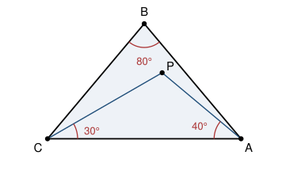

## Statement

$ABC$ est un triangle isocèle en $B$, c'est-à-dire $BA = BC$, et son angle au sommet mesure

$$\widehat{ABC} = 80^\circ .$$

À l'intérieur de ce triangle, on place un point $P$ tel que

$$\widehat{PAC} = 40^\circ \qquad \text{et} \qquad \widehat{PCA} = 30^\circ .$$

Calculer la mesure de l'angle $\widehat{BPC}$.

## Hints

1. Commence par calculer tous les angles qui viennent tout seuls : les deux angles à la base
   du triangle isocèle, puis $\widehat{PAB}$, $\widehat{PCB}$, et enfin $\widehat{APC}$ dans
   le triangle $APC$.
2. Avec ces angles-là on tourne en rond. Quand une chasse aux angles bloque, c'est qu'il
   manque un point sur la figure. Le $80^\circ$ de l'énoncé demande à être complété : que se
   passerait-il si on ajoutait un $60^\circ$ à côté de lui ?
3. Construis le point $D$ tel que le triangle $ABD$ soit équilatéral, $D$ étant de l'autre côté
   de la droite $(AB)$ que $C$. Compare alors les longueurs $DA$, $DB$ et $BC$.
4. Le triangle $BCD$ est isocèle en $B$ et tu connais son angle au sommet $\widehat{DBC}$.
   Calcule $\widehat{BCD}$, puis compare ce que tu trouves à $\widehat{BCP}$.
5. Tu sais maintenant que $C$, $P$ et $D$ sont alignés. Montre que le triangle $ADP$ est
   isocèle en $D$, puis sers-t'en pour montrer que le triangle $BDP$ l'est aussi.

## Solution

La réponse est $\widehat{BPC} = 100^\circ$.

### Les angles que l'on obtient tout de suite

Le triangle $ABC$ est isocèle en $B$ et son angle au sommet vaut $80^\circ$, donc ses deux
angles à la base valent

$$\widehat{BAC} = \widehat{BCA} = \frac{180^\circ - 80^\circ}{2} = 50^\circ .$$

Le point $P$ est à l'intérieur du triangle, donc la demi-droite $[AP)$ est située entre
$[AB)$ et $[AC)$, et de même pour $[CP)$. On en déduit

$$\widehat{PAB} = 50^\circ - 40^\circ = 10^\circ , \qquad \widehat{PCB} = 50^\circ - 30^\circ = 20^\circ .$$

Enfin, la somme des angles du triangle $APC$ donne

$$\widehat{APC} = 180^\circ - 40^\circ - 30^\circ = 110^\circ .$$

À ce stade on connaît beaucoup d'angles, mais aucun ne touche le point $B$ et le point $P$ en
même temps. Il faut enrichir la figure.

### Le point que l'on ajoute

On construit le point $D$ tel que le triangle $ABD$ soit équilatéral, en plaçant $D$ de l'autre
côté de la droite $(AB)$ que $C$. Ce point vérifie

$$DA = DB = AB = BC .$$

Trois longueurs égales : c'est de là que va venir toute la suite.

### Étape 1 : les points $C$, $P$ et $D$ sont alignés

Le triangle $BCD$ vérifie $BD = BC$, il est donc isocèle en $B$. Son angle au sommet vaut

$$\widehat{DBC} = \widehat{DBA} + \widehat{ABC} = 60^\circ + 80^\circ = 140^\circ ,$$

donc ses deux angles à la base valent

$$\widehat{BCD} = \widehat{BDC} = \frac{180^\circ - 140^\circ}{2} = 20^\circ .$$

Or on a déjà calculé $\widehat{BCP} = 20^\circ$. Les demi-droites $[CD)$ et $[CP)$ font donc le
même angle avec $[CB)$, et elles sont du même côté de la droite $(BC)$ : elles sont confondues.

Les points $C$, $P$ et $D$ sont donc alignés. De plus $P$ est à l'intérieur du triangle $ABC$
alors que $D$ est de l'autre côté de $(AB)$ : en allant de $C$ vers $D$ on rencontre d'abord
$P$, puis on traverse $(AB)$. Donc **$P$ est entre $C$ et $D$**.

### Étape 2 : le triangle $ADP$ est isocèle en $D$

Les points $D$ et $P$ sont de part et d'autre de la droite $(AB)$, donc

$$\widehat{DAP} = \widehat{DAB} + \widehat{BAP} = 60^\circ + 10^\circ = 70^\circ .$$

Par ailleurs $P$ est entre $C$ et $D$, donc les angles $\widehat{APD}$ et $\widehat{APC}$ sont
supplémentaires :

$$\widehat{APD} = 180^\circ - 110^\circ = 70^\circ .$$

Le triangle $ADP$ a donc deux angles de $70^\circ$ : il est isocèle en $D$, et

$$DP = DA .$$

### Étape 3 : le triangle $BDP$ est isocèle en $D$

En rassemblant, $DP = DA = DB$, donc le triangle $BDP$ est isocèle en $D$. Comme $P$ est sur
la demi-droite $[DC)$, son angle au sommet est

$$\widehat{BDP} = \widehat{BDC} = 20^\circ ,$$

et ses angles à la base valent donc

$$\widehat{DPB} = \frac{180^\circ - 20^\circ}{2} = 80^\circ .$$

### Conclusion

$P$ est entre $C$ et $D$, donc $\widehat{BPC}$ et $\widehat{BPD}$ sont supplémentaires :

$$\boxed{\widehat{BPC} = 180^\circ - 80^\circ = 100^\circ .}$$

## Going further

Maintenant que $\widehat{BPC}$ est connu, on peut finir de remplir la figure. Dans le triangle
$BPC$ on connaît deux angles, $\widehat{BPC} = 100^\circ$ et $\widehat{PCB} = 20^\circ$, donc

$$\widehat{PBC} = 60^\circ , \qquad \text{puis} \qquad \widehat{PBA} = 80^\circ - 60^\circ = 20^\circ .$$

Tous les angles de la figure sont alors des multiples de $10^\circ$. C'est la marque d'une
petite famille de problèmes célèbres, où des données en degrés entiers donnent une réponse en
degrés entiers sans qu'aucun calcul de longueur ne soit possible : seule une construction
auxiliaire, ici le triangle équilatéral, permet de conclure.
