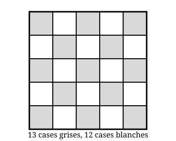

## Statement

1. Sur chacune des $25$ cases d'un plateau $5 \times 5$ est posée une coccinelle. À midi, chaque coccinelle passe sur une case voisine par un côté. Montrer qu'après ce déplacement, au moins une case du plateau est vide.

2. Sur un plateau $5 \times 5$ on a posé $25$ pions, un par case. On enlève tous les pions du plateau, mais on note bien sur quelle case chacun se trouvait. Peut-on reposer les $25$ pions, un par case, de façon que chaque pion soit sur une case voisine par un côté de celle qu'il occupait avant ?

## Hints

1. Essayez d'abord sur un plateau plus petit, par exemple $3 \times 3$. Que se passe-t-il ?
2. Coloriez le plateau comme un damier. Sur quelle couleur arrive une coccinelle qui part d'une case grise ?
3. Comptez les cases grises et les cases blanches du plateau $5 \times 5$. Sont-elles en même nombre ?
4. Toutes les coccinelles qui arrivent sur une case grise viennent forcément d'une case blanche. Combien y a-t-il de cases blanches, et combien de cases grises à remplir ?
5. Pour la question 2, regardez si elle ne se ramène pas exactement à la question 1.

## Solution

**L'idée : colorier le plateau comme un damier.**

Colorions le plateau $5 \times 5$ en damier, en mettant du gris dans les quatre coins.

Comptons les cases de chaque couleur. Sur les cinq lignes, trois commencent et finissent par du gris et contiennent $3$ cases grises et $2$ blanches ; les deux autres contiennent $2$ cases grises et $3$ blanches. Au total :

$$\text{gris} = 3 \times 3 + 2 \times 2 = 13, \qquad \text{blanc} = 3 \times 2 + 2 \times 3 = 12.$$

Il y a donc $13$ cases grises et $12$ cases blanches : **les deux couleurs ne sont pas en même nombre**, et c'est tout le ressort du problème.

**Question 1.**

Deux cases voisines par un côté sont toujours de couleurs différentes. Donc chaque coccinelle **change de couleur** en se déplaçant :

- une coccinelle qui part d'une case grise arrive sur une case blanche ;
- une coccinelle qui part d'une case blanche arrive sur une case grise.

Regardons maintenant les cases grises après le déplacement. Une coccinelle posée sur une case grise après midi vient forcément d'une case blanche. Or il n'y a que $12$ cases blanches, donc seulement $12$ coccinelles partent d'une case blanche.

Ces $12$ coccinelles sont les seules qui peuvent se retrouver sur une case grise. Elles occupent donc au plus $12$ des $13$ cases grises.

Il reste au moins une case grise sans personne dessus.

**Conclusion de la question 1.** Après le déplacement, au moins une case du plateau est vide.

**Question 2.**

Supposons que ce soit possible. On aurait alors $25$ pions, un sur chaque case, chacun ayant bougé vers une case voisine par un côté : c'est exactement la situation de la question 1, avec des pions à la place des coccinelles. Or la question 1 montre qu'au moins une case reste vide, donc les $25$ cases ne peuvent pas être toutes occupées.

**Conclusion de la question 2.** Non, on ne peut pas reposer les pions de cette façon.

**Ce qu'il faut retenir.** Quand un déplacement fait toujours changer de couleur, comparez le nombre de cases de chaque couleur. S'il n'est pas le même, quelque chose devient impossible.

## Going further

1. Que se passe-t-il sur un plateau $4 \times 4$ ? Et sur un plateau $6 \times 6$ ?
2. Pour quelles dimensions $m \times n$ le déplacement de la question 2 est-il possible ?
