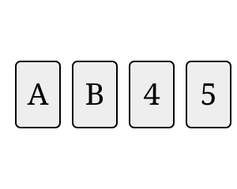

## Statement

Quatre cartes sont posées sur la table. Chaque carte porte une lettre sur une face et un entier naturel sur l'autre face. Voici ce que l'on voit :

On veut savoir si l'affirmation suivante est vraie pour ces quatre cartes :

> « Si une face d'une carte porte un nombre pair, alors l'autre face de cette carte porte une voyelle. »

Quelles cartes faut-il retourner pour le savoir ? Retourne le moins de cartes possible, et explique pour chaque carte pourquoi tu la retournes ou pourquoi tu ne la retournes pas.

## Hints

1. Une affirmation de la forme « si ..., alors ... » est plus facile à étudier à l'envers : quand est-elle **fausse** ?
2. Elle est fausse dès qu'on trouve une carte avec un nombre pair sur une face et une consonne sur l'autre. Une telle carte s'appelle un contre-exemple. Retourner une carte ne sert donc que si cette carte pourrait être un contre-exemple.
3. Regarde la carte $5$ : sa face cachée porte une lettre, donc le seul nombre de cette carte est $5$, qui est impair. Cette carte peut-elle être un contre-exemple ?
4. Même travail pour la carte $A$ : sa face cachée porte un nombre. Si ce nombre est pair, l'autre face porte-t-elle une voyelle ?

## Solution

**L'idée : chercher quand l'affirmation serait fausse.**

L'affirmation est du type « si $P$, alors $Q$ ». Une telle affirmation est fausse dans un seul cas : quand $P$ est vrai et $Q$ est faux. Ici :

> l'affirmation est fausse exactement s'il existe une carte portant un nombre pair sur une face et une consonne sur l'autre face.

Une telle carte s'appelle un **contre-exemple**. Retourner une carte n'a donc d'intérêt que si cette carte risque d'être un contre-exemple.

**Examinons les quatre cartes.**

*Carte $A$.* Sa face cachée porte un nombre.
- Si ce nombre est impair, la carte n'a aucun nombre pair : ce n'est pas un contre-exemple.
- Si ce nombre est pair, alors l'autre face porte $A$, qui est une voyelle : ce n'est pas non plus un contre-exemple.

Dans les deux cas tout va bien, donc **il est inutile de retourner la carte $A$**.

*Carte $B$.* Sa face cachée porte un nombre. Si ce nombre est pair, on a un nombre pair d'un côté et la consonne $B$ de l'autre : c'est un contre-exemple, et l'affirmation est fausse. **Il faut retourner la carte $B$.**

*Carte $4$.* Sa face cachée porte une lettre. Le nombre $4$ est pair. Si la lettre cachée est une consonne, c'est un contre-exemple. **Il faut retourner la carte $4$.**

*Carte $5$.* Sa face cachée porte une lettre, donc le seul nombre écrit sur cette carte est $5$, qui est impair. Cette carte ne porte aucun nombre pair, elle ne peut donc jamais être un contre-exemple. **Il est inutile de retourner la carte $5$**, quelle que soit la lettre cachée.

**Conclusion.** Il faut retourner exactement deux cartes : la carte $B$ et la carte $4$. Si aucune des deux ne donne un contre-exemple, l'affirmation est vraie ; sinon elle est fausse.

**Ce qu'il faut retenir.** « Si $P$ alors $Q$ » ne dit rien du tout lorsque $P$ est faux. C'est pour cela que les cartes $A$ et $5$ ne servent à rien : la carte $5$ ne déclenche pas la condition « nombre pair », et la carte $A$ ne peut pas la contredire.

## Going further

1. Mêmes quatre cartes, mais on veut cette fois vérifier : « Si une face porte une voyelle, alors l'autre face porte un nombre pair. » Quelles cartes faut-il retourner ?
2. Les deux affirmations de l'énoncé et de la question 1 disent-elles la même chose ? Trouve un jeu de cartes pour lequel l'une est vraie et l'autre fausse.
3. On veut vérifier : « Une face porte un nombre pair si et seulement si l'autre face porte une voyelle. » Combien de cartes faut-il retourner ?
