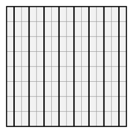

## Statement

Une feuille de papier quadrillée, carrée, de $8$ cases sur $8$, est pliée plusieurs fois de suite, toujours le long des lignes du quadrillage. À la fin on obtient un petit carré de $1$ case sur $1$ case.

On donne alors un seul coup de ciseaux dans ce petit carré, le long du segment qui joint les milieux de deux de ses côtés opposés.

On déplie. En combien de morceaux la feuille se retrouve-t-elle ?

## Hints

1. Fais l'expérience avec une feuille de $2$ cases sur $2$, puis de $4$ sur $4$. Compte les morceaux. Le résultat dépend-il de la manière de plier ?
2. Chaque pli est une symétrie axiale dont l'axe est une droite du quadrillage, donc une droite horizontale ou une droite verticale. Que devient un segment vertical dans une telle symétrie ?
3. Reviens à la feuille de départ et, dans chacune des $64$ petites cases, trace le segment qui joint les milieux de son côté du haut et de son côté du bas. Quand on plie, où atterrissent tous ces segments ?

## Solution

**Réponse : toujours $9$ morceaux, quelle que soit la façon de plier.**

Pour fixer les idées, supposons que la coupe du petit carré soit verticale, c'est-à-dire qu'elle joigne le milieu de son côté du haut au milieu de son côté du bas. Si elle est horizontale, on refait exactement le même raisonnement en échangeant les mots « horizontal » et « vertical ».

**Étape 1. Les plis ne font jamais tourner le papier d'un quart de tour.**

Chaque pli est une symétrie axiale dont l'axe est une ligne du quadrillage : cet axe est donc horizontal ou vertical. Une symétrie d'axe horizontal ou vertical transforme un segment vertical en un segment vertical, et un segment horizontal en un segment horizontal.

Comme tous les plis sont de ce type, on peut les enchaîner autant qu'on veut : ce qui était vertical sur la feuille de départ reste vertical à l'arrivée. C'est la propriété qui ne change pas, et c'est elle qui va tout donner.

**Étape 2. On repère à l'avance par où les ciseaux vont passer.**

Sur la feuille de départ, traçons dans chacune des $64$ petites cases le segment qui joint les milieux de son côté du haut et de son côté du bas. Appelons-les les *segments milieux*.

Quand la feuille est pliée, chaque petite case vient se poser exactement sur le petit carré final : le pliage suit les lignes du quadrillage, donc les cases se superposent case sur case.

Regardons une case en particulier. Elle arrive sur le petit carré sans avoir tourné d'un quart de tour, d'après l'étape 1. Son segment milieu, qui est vertical, arrive donc sur le segment vertical du petit carré, c'est-à-dire **exactement sur la coupe**.

Et inversement, un point de la feuille qui n'est sur aucun segment milieu n'arrive pas sur la coupe.

Autrement dit : les ciseaux coupent le papier exactement le long des $64$ segments milieux, et nulle part ailleurs.

**Étape 3. On compte les morceaux.**

Dans une même colonne de cases, les $8$ segments milieux se placent bout à bout et forment un trait vertical qui traverse la feuille de haut en bas. Il y a $8$ colonnes, donc $8$ traits verticaux complets.

Huit traits qui traversent le carré de part en part le découpent en $9$ bandes verticales : deux bandes fines sur les bords, larges d'une demi-case, et $7$ bandes larges d'une case entre elles.

**Conclusion.**

Quelle que soit la suite de plis choisie, la feuille se retrouve toujours découpée en $9$ morceaux.

## Going further

1. Même question pour une feuille carrée de $n$ cases sur $n$, pliée jusqu'à obtenir un carré de $1$ case sur $1$.
2. Même question pour une feuille rectangulaire de $8$ cases sur $5$, pliée jusqu'au carré de $1$ case sur $1$. Attention, la réponse dépend maintenant du sens de la coupe.
3. Et si on coupe le petit carré final le long d'une de ses diagonales ? Sur la feuille de départ, chaque case est alors coupée selon l'une de ses deux diagonales. Peux-tu dire laquelle, case par case ?
