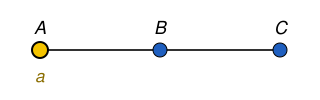
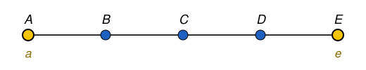
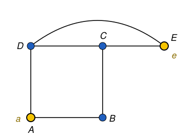
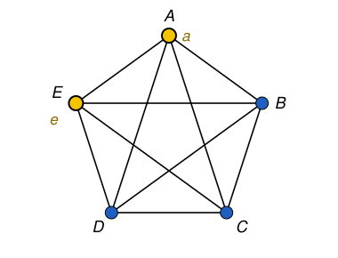

## Statement

On considère un ensemble fini de points du plan. Certaines paires de points sont reliées par des
traits, de sorte qu'en suivant les traits on peut aller de n'importe quel point à n'importe quel
autre (les croisements de traits ne comptent pas, et un point n'est jamais relié à lui-même).
Deux points reliés par un trait sont dits *voisins*.

Chaque point est colorié soit en jaune, soit en bleu. À chaque point jaune, Gustav a attribué un
nombre réel de son choix. Maryam voudrait attribuer un nombre réel à chaque point bleu (pas
forcément le même pour tous) de façon à satisfaire la propriété suivante :

> **(P)** Le nombre attribué à tout point bleu est la moyenne des nombres attribués à ses
> voisins.

Sur les figures, les points jaunes sont des ronds clairs cerclés de noir, les points bleus des
ronds foncés, et le nombre choisi par Gustav est écrit à côté de chaque point jaune.

1. Les points sont $A$, $B$, $C$ ; $A$ est voisin de $B$, et $B$ est voisin de $C$. Seul $A$ est
   jaune, et Gustav lui a attribué le nombre $a$.

   

   Quels nombres Maryam doit-elle attribuer à $B$ et à $C$ pour satisfaire (P) ?

2. Dans les trois questions suivantes, les points sont $A$, $B$, $C$, $D$, $E$. Les points $A$ et
   $E$ sont les seuls points jaunes ; Gustav leur a attribué les nombres $a$ et $e$. Pour chacun
   des schémas suivants, quels nombres Maryam doit-elle attribuer à $B$, $C$ et $D$ ?

   a) Les traits sont $A$–$B$, $B$–$C$, $C$–$D$ et $D$–$E$ :

   

   b) Les traits sont $A$–$B$, $B$–$C$, $C$–$D$, $D$–$A$, $C$–$E$ et $D$–$E$ :

   

   c) Chaque point est relié à chacun des quatre autres :

   

3. Soit $n \geqslant 1$ un entier. On prend maintenant $n + 2$ points $P_0, P_1, \ldots, P_{n+1}$,
   chacun voisin de tous les autres. Les points $P_0$ et $P_{n+1}$ sont les seuls points jaunes,
   et Gustav leur a attribué les nombres $a$ et $b$. Quels nombres Maryam doit-elle attribuer à
   $P_1, \ldots, P_n$ ?

## Hints

1. **Question 1.** Combien le point $C$ a-t-il de voisins ? Que dit alors (P) pour $C$ ?
2. **Question 2 a.** L'égalité $b = \frac{a + c}{2}$ s'écrit aussi $b - a = c - b$. Que dire
   des écarts entre deux points consécutifs ?
3. **Question 2 b.** Écrire une équation pour chacun des points $B$, $C$, $D$, puis exprimer
   $b$ en fonction de $c$ et substituer. Pour vérifier le résultat, essayer $a = e$ : que
   doivent valoir $b$, $c$ et $d$ ?
4. **Question 2 c.** Soustraire l'équation de $B$ et celle de $C$ : que trouve-t-on sur
   $b - c$ ?
5. **Question 3.** Noter $T$ la somme des nombres attribués aux $n$ points bleus, et écrire
   l'équation d'un point bleu à l'aide de $T$.

## Solution

On note $b$, $c$, $d$ les nombres que Maryam attribue à $B$, $C$, $D$.

**1.** Le point $C$ a un seul voisin, $B$ : la propriété (P) pour $C$ donne $c = b$. Le point
$B$ a deux voisins, $A$ et $C$ : $b = \frac{a + c}{2} = \frac{a + b}{2}$, d'où $2b = a + b$,
soit $b = a$. Réciproquement, $b = c = a$ convient.

**Conclusion :** Maryam doit attribuer $a$ à $B$ et à $C$.

**2.** a) Chaque point bleu a deux voisins, celui de gauche et celui de droite :
$$2b = a + c, \qquad 2c = b + d, \qquad 2d = c + e.$$
Ces égalités s'écrivent $b - a = c - b$, $c - b = d - c$, $d - c = e - d$. Les quatre écarts
successifs sont donc égaux à un même nombre $r$, et $e - a = 4r$. Ainsi
$r = \frac{e - a}{4}$ et
$$b = \frac{3a + e}{4}, \qquad c = \frac{a + e}{2}, \qquad d = \frac{a + 3e}{4}.$$
Réciproquement, ces nombres vérifient les trois égalités. C'est la seule solution.

b) Le point $B$ a pour voisins $A$ et $C$ ; le point $C$ a pour voisins $B$, $D$, $E$ ; le point
$D$ a pour voisins $A$, $C$, $E$. La propriété (P) s'écrit
$$2b = a + c, \qquad 3c = b + d + e, \qquad 3d = a + c + e.$$
La première donne $b = \frac{a + c}{2}$. En reportant dans la deuxième et en multipliant par
$2$ : $6c = a + c + 2d + 2e$, soit $5c = a + 2d + 2e$. La troisième donne
$c = 3d - a - e$ ; en reportant :
$$15d - 5a - 5e = a + 2d + 2e, \qquad \text{donc} \qquad 13d = 6a + 7e.$$
On en déduit successivement
$$d = \frac{6a + 7e}{13}, \qquad c = 3d - a - e = \frac{5a + 8e}{13}, \qquad b = \frac{a + c}{2} = \frac{9a + 4e}{13}.$$
Toutes les étapes sont des équivalences, donc c'est l'unique solution.

*Vérification* avec $a = 0$ et $e = 13$ : $b = 4$, $c = 8$, $d = 7$. On a bien
$4 = \frac{0 + 8}{2}$, $8 = \frac{4 + 7 + 13}{3}$ et $7 = \frac{0 + 8 + 13}{3}$.

c) Chaque point bleu a quatre voisins :
$$4b = a + c + d + e, \qquad 4c = a + b + d + e, \qquad 4d = a + b + c + e.$$
En soustrayant les deux premières, $4b - 4c = c - b$, soit $5(b - c) = 0$, donc $b = c$. De même
$c = d$. Notons $x$ cette valeur commune : $4x = a + 2x + e$, donc $x = \frac{a + e}{2}$.
Réciproquement, $b = c = d = \frac{a + e}{2}$ convient.

**Conclusion :** Maryam attribue $\frac{a + e}{2}$ aux trois points bleus.

**3.** Ici, $b$ désigne le nombre choisi par Gustav pour $P_{n+1}$. Notons $x_i$ le nombre attribué à $P_i$ et $T = x_1 + x_2 + \cdots + x_n$. Chaque point
bleu $P_i$ a $n + 1$ voisins : $P_0$, $P_{n+1}$ et les $n - 1$ autres points bleus. La propriété
(P) s'écrit
$$(n + 1)\, x_i = a + b + (T - x_i), \qquad \text{soit} \qquad (n + 2)\, x_i = a + b + T.$$
Le membre de droite ne dépend pas de $i$ : tous les $x_i$ sont égaux à un même nombre $x$. Alors
$T = nx$, et $(n + 2)x = a + b + nx$, donc $x = \frac{a + b}{2}$. Réciproquement, si tous les
points bleus reçoivent $\frac{a + b}{2}$, la moyenne des voisins de chacun vaut
$\frac{a + b + (n-1)\frac{a+b}{2}}{n+1} = \frac{(n+1)\frac{a+b}{2}}{n+1} = \frac{a + b}{2}$.

**Conclusion :** Maryam doit attribuer $\frac{a + b}{2}$ à chacun des points $P_1, \ldots, P_n$.

**Bilan.** Dans chacun de ces exemples, Maryam a une et une seule façon de satisfaire (P), et
les nombres qu'elle attribue sont tous compris entre les nombres choisis par Gustav.

## Going further

- Dans la suite du sujet, on montrait que c'est toujours le cas : pour n'importe quel schéma et
  n'importe quels choix de Gustav, Maryam a exactement une solution (voir les exercices 40644
  pour l'existence et 40645 pour l'unicité).
- Dans le schéma 2 a), si $a = 0$ et $e = 1$, le nombre attribué à un point est la probabilité
  qu'un pion qui se déplace au hasard vers un voisin, à chaque pas, atteigne $E$ avant $A$.
  Pouvez-vous expliquer pourquoi cette probabilité vérifie (P) ?
