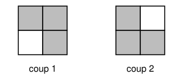

## Statement

Soit $m \geq 2$ et $n \geq 2$ deux entiers. Morgane a placé une pièce dans chacune des $mn$ cases d'une grille de $m$ lignes et $n$ colonnes. Au départ, toutes les pièces montrent leur côté pile.

Chaque minute, Morgane choisit un carré de $2 \times 2$ cases de la grille, et elle retourne trois des quatre pièces de ce carré : celle en haut à gauche, celle en bas à droite, et, au choix, celle en haut à droite ou celle en bas à gauche. La quatrième pièce du carré n'est pas retournée.

Pour quels couples $(m, n)$ Morgane peut-elle, en un nombre fini de minutes, faire en sorte que toutes les pièces montrent leur côté face ?

## Hints

1. Essayez les petites grilles : $2 \times 2$, $2 \times 3$, $3 \times 3$.
2. Une pièce retournée deux fois revient à son état de départ. À la fin, une pièce montre face si et seulement si elle a été retournée un nombre impair de fois.
3. Si la grille se découpe en rectangles $2 \times 3$, $3 \times 2$ et $3 \times 3$, Morgane peut les traiter un par un.
4. Numérotez les lignes de haut en bas et les colonnes de gauche à droite, et coloriez la case de la ligne $i$ et de la colonne $j$ selon le reste de $i + j$ dans la division par $3$. Combien de pièces de chaque couleur un coup retourne-t-il ?

## Solution

La réponse : Morgane réussit **si et seulement si $3$ divise $m$ ou $n$.**

On numérote les lignes de $1$ à $m$ de haut en bas, les colonnes de $1$ à $n$ de gauche à droite, et on note $(i, j)$ la case de la ligne $i$ et de la colonne $j$. Une pièce montre face à la fin si et seulement si elle a été retournée un nombre impair de fois.

### Trois petites grilles

**Grille $2 \times 3$.** Deux coups suffisent :

- dans le carré des colonnes $1$ et $2$, on retourne $(1, 1)$, $(2, 2)$ et la pièce en bas à gauche $(2, 1)$ ;
- dans le carré des colonnes $2$ et $3$, on retourne $(1, 2)$, $(2, 3)$ et la pièce en haut à droite $(1, 3)$.

Chacune des six pièces est retournée une fois.

**Grille $3 \times 2$.** Deux coups suffisent aussi :

- dans le carré des lignes $1$ et $2$, on retourne $(1, 1)$, $(2, 2)$ et la pièce en haut à droite $(1, 2)$ ;
- dans le carré des lignes $2$ et $3$, on retourne $(2, 1)$, $(3, 2)$ et la pièce en bas à gauche $(3, 1)$.

**Grille $3 \times 3$.** Cinq coups suffisent. On désigne chaque carré $2 \times 2$ par sa case en haut à gauche.

1. Carré $(1, 1)$, avec la pièce en haut à droite : on retourne $(1, 1)$, $(1, 2)$, $(2, 2)$.
2. Carré $(1, 2)$, avec la pièce en haut à droite : on retourne $(1, 2)$, $(1, 3)$, $(2, 3)$.
3. Carré $(1, 2)$, avec la pièce en bas à gauche : on retourne $(1, 2)$, $(2, 2)$, $(2, 3)$.
4. Carré $(2, 1)$, avec la pièce en bas à gauche : on retourne $(2, 1)$, $(3, 1)$, $(3, 2)$.
5. Carré $(2, 2)$, avec la pièce en haut à droite : on retourne $(2, 2)$, $(2, 3)$, $(3, 3)$.

Voici combien de fois chaque pièce est retournée :

| | col. 1 | col. 2 | col. 3 |
|---|---|---|---|
| ligne 1 | 1 | 3 | 1 |
| ligne 2 | 1 | 3 | 3 |
| ligne 3 | 1 | 1 | 1 |

Tous ces nombres sont impairs : toutes les pièces finissent côté face.

### Si 3 divise m ou n, Morgane réussit

Un coup joué dans un rectangle de la grille ne touche que des pièces de ce rectangle. Si la grille se découpe en rectangles $2 \times 3$, $3 \times 2$ et $3 \times 3$, Morgane les traite donc un par un, avec les coups ci-dessus.

Supposons que $3$ divise $m$.

- Si $n$ est pair, on découpe la grille en rectangles $3 \times 2$ (trois lignes, deux colonnes).
- Si $n$ est impair, alors $n \geq 3$ et $n - 3$ est pair. On découpe les trois premières colonnes en rectangles $3 \times 3$, et les $n - 3$ autres en rectangles $3 \times 2$.

Si $3$ divise $n$, on fait de même en échangeant les rôles des lignes et des colonnes, avec des rectangles $2 \times 3$ et $3 \times 3$.

### Le coloriage

On colorie la case $(i, j)$ avec la couleur $0$, $1$ ou $2$, selon le reste de $i + j$ dans la division par $3$.

Dans le carré dont la case en haut à gauche est $(i, j)$, les pièces retournées sont :

- celle en haut à gauche, $(i, j)$, de somme $i + j$ ;
- celle en haut à droite $(i, j + 1)$ ou celle en bas à gauche $(i + 1, j)$, de somme $i + j + 1$ ;
- celle en bas à droite, $(i + 1, j + 1)$, de somme $i + j + 2$.

Ces trois sommes sont trois entiers consécutifs, donc leurs restes dans la division par $3$ sont $0$, $1$ et $2$ dans un certain ordre. **Chaque coup retourne exactement une pièce de chaque couleur.**

### Un invariant

Notons $F_0$, $F_1$ et $F_2$ les nombres de pièces côté face de couleur $0$, $1$ et $2$. Au départ, ils valent tous $0$. À chaque coup, chacun d'eux augmente ou diminue de $1$ : ils changent donc tous les trois de parité en même temps. Par conséquent, **à tout moment, $F_0$, $F_1$ et $F_2$ ont la même parité.**

Si toutes les pièces finissent côté face, alors $F_0$, $F_1$ et $F_2$ sont les nombres $N_0$, $N_1$ et $N_2$ de cases de chaque couleur. Il faut donc que $N_0$, $N_1$ et $N_2$ aient la même parité.

### Si 3 ne divise ni m ni n, Morgane échoue

Dans une colonne, trois cases consécutives ont des sommes $i + j$ consécutives, donc les trois couleurs. Ainsi, trois lignes consécutives entières contiennent autant de cases de chaque couleur. De même, dans une ligne, trois cases consécutives ont les trois couleurs.

Écrivons $m = 3q + r$ et $n = 3q' + r'$, avec $r$ et $r'$ égaux à $1$ ou $2$, puisque $3$ ne divise ni $m$ ni $n$. On découpe la grille :

- les $3q$ premières lignes contiennent autant de cases de chaque couleur ;
- dans les $r$ dernières lignes, les $3q'$ premières colonnes aussi ;
- il reste un petit rectangle de $r$ lignes et $r'$ colonnes, en bas à droite.

Les deux premiers morceaux ajoutent le même nombre à $N_0$, à $N_1$ et à $N_2$, ce qui ne change pas la question de savoir s'ils ont la même parité. Il suffit de regarder le petit rectangle. Ses cases sont les $(3q + a, 3q' + b)$, avec $1 \leq a \leq r$ et $1 \leq b \leq r'$, et leur couleur est le reste de $a + b$ dans la division par $3$.

- Rectangle $1 \times 1$ : la seule somme est $2$. Une case de couleur $2$, aucune des autres.
- Rectangle $1 \times 2$ ou $2 \times 1$ : les sommes sont $2$ et $3$. Une case de couleur $2$, une de couleur $0$, aucune de couleur $1$.
- Rectangle $2 \times 2$ : les sommes sont $2$, $3$, $3$ et $4$. Deux cases de couleur $0$, une de couleur $1$, une de couleur $2$.

Dans chaque cas, les trois nombres n'ont pas tous la même parité. Donc $N_0$, $N_1$ et $N_2$ n'ont pas tous la même parité, et d'après l'invariant, **Morgane ne peut pas réussir.**

### Conclusion

**Morgane peut retourner toutes les pièces côté face si et seulement si $3$ divise $m$ ou $3$ divise $n$.**

## Going further

1. Montrez que, dans la grille $3 \times 3$, Morgane ne peut pas réussir en moins de cinq coups. (Elle ne gagne rien à jouer deux fois le même coup. Regardez les pièces des coins $(1, 3)$ et $(3, 1)$.)
2. Supposons maintenant que Morgane ait le droit de retourner n'importe quelles trois des quatre pièces d'un carré $2 \times 2$. Montrez qu'elle réussit alors sur toutes les grilles. (Dans une grille $2 \times 2$, jouez les quatre coups possibles : combien de fois chaque pièce est-elle retournée ?)
