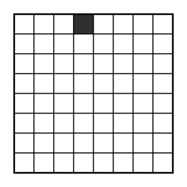
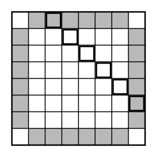

## Statement

Sur chacune des $64$ cases d'un échiquier $8 \times 8$ est posée une lampe, allumée ou éteinte.

Une **opération** consiste à choisir l'un des ensembles de cases suivants et à changer l'état de **toutes** ses lampes à la fois (les allumées s'éteignent, les éteintes s'allument) :

- une ligne entière ;
- une colonne entière ;
- une diagonale entière, dans l'un ou l'autre sens, y compris les diagonales courtes, jusqu'aux diagonales réduites à une seule case (les quatre coins).

Au départ, **toutes** les lampes sont allumées, sauf celle de la quatrième case de la première ligne, qui est éteinte.

Peut-on, par une suite d'opérations, éteindre toutes les lampes ?

## Hints

1. Cherchez une quantité qui ne change jamais, quelle que soit l'opération effectuée : un invariant.
2. Comptez les lampes éteintes. Au départ il y en a une, à l'arrivée il y en aurait $64$. Est-ce que la parité de ce nombre est conservée ? Testez sur une ligne, puis sur une diagonale de $3$ cases.
3. Le nombre total de lampes éteintes ne convient pas. Il faut donc ne compter les lampes éteintes que sur un **sous-ensemble bien choisi** de cases : celui sur lequel chaque opération agit un nombre **pair** de fois.
4. Regardez le bord de l'échiquier. Que font les diagonales quand elles arrivent sur le bord ? Et les quatre coins, faut-il les garder ?

## Solution

**Réponse : non, c'est impossible.**

**Le bon ensemble de cases.**

Considérons les cases du **bord** de l'échiquier **privées des quatre coins**. Il y en a $6$ sur chacun des quatre côtés, soit

$$4 \times 6 = 24 \ \text{cases}.$$

Appelons-les les *cases marquées*, et posons

$$I = \text{nombre de lampes éteintes situées sur une case marquée.}$$

Nous allons montrer que **la parité de $I$ ne change jamais**.

**Chaque opération touche un nombre pair de cases marquées.**

Une opération change l'état de toutes les lampes d'un ensemble de cases. Elle change donc la parité de $I$ autant de fois qu'elle rencontre de cases marquées. Vérifions que ce nombre est toujours **pair**.

- *Une ligne du haut ou du bas* (première ou huitième ligne) : elle contient $2$ coins et $6$ cases marquées. Nombre de cases marquées : $6$, pair. ✔
- *Une autre ligne* : elle touche le bord seulement à ses deux extrémités, qui sont deux cases marquées ; ses six cases du milieu sont intérieures. Nombre : $2$, pair. ✔
- *Les colonnes* : exactement pareil, par symétrie. ✔
- *Une diagonale* : ses deux extrémités sont sur le bord, et toutes ses autres cases sont à l'intérieur de l'échiquier. Chaque extrémité est donc soit un coin (non marqué), soit une case marquée. Selon les cas, une diagonale rencontre donc $0$, $1$ ou $2$ cases marquées — sauf qu'en réalité le cas « $1$ » ne se produit jamais. Détaillons :
  - une des deux grandes diagonales : ses deux extrémités sont des coins, et toutes les autres cases sont intérieures. Nombre de cases marquées : $0$. ✔
  - une diagonale réduite à un coin : nombre de cases marquées : $0$. ✔
  - toute autre diagonale : ses deux extrémités sont sur le bord sans être des coins, donc marquées toutes les deux. Nombre : $2$. ✔

Dans tous les cas, le nombre de cases marquées touchées est pair, donc **la parité de $I$ est conservée**.

**Conclusion.**

Au départ, une seule lampe est éteinte : celle de la quatrième case de la première ligne. Cette case est sur le bord, et ce n'est pas un coin : elle est donc marquée. Ainsi

$$I_{\text{départ}} = 1, \qquad \text{qui est impair.}$$

Si toutes les lampes étaient éteintes, les $24$ cases marquées porteraient une lampe éteinte :

$$I_{\text{arrivée}} = 24, \qquad \text{qui est pair.}$$

La parité de $I$ devrait donc changer, ce qui est impossible.

**Il est donc impossible d'éteindre toutes les lampes.**

## Going further

**Pourquoi retirer les coins ?** Si on les gardait, une diagonale réduite à un coin toucherait exactement une case de l'ensemble, et la parité changerait : l'invariant serait perdu. C'est précisément pour neutraliser les diagonales d'une seule case qu'il faut écarter les quatre coins. C'est là toute la finesse de l'exercice.

**Le même invariant sous une autre forme.** Beaucoup préfèrent écrire ceci : on attribue la valeur $+1$ à une lampe allumée et $-1$ à une lampe éteinte, et on considère le **produit** des valeurs des $24$ cases marquées. Chaque opération multiplie ce produit par $(-1)^{\text{pair}} = 1$, donc le produit ne change pas. Au départ il vaut $-1$, à l'arrivée il vaudrait $(-1)^{24} = +1$. Même conclusion.

**Une question pour continuer.** Si l'on éteignait au départ la lampe d'un **coin** au lieu de celle de la quatrième case, que se passerait-il ? Et si on éteignait une lampe **intérieure** ?
