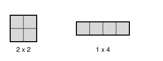

## Statement

Une salle rectangulaire est entièrement carrelée, sans trou ni chevauchement, avec deux sortes de carreaux : des carrés $2 \times 2$ et des barres $1 \times 4$. Les barres peuvent être posées horizontalement ou verticalement.

Un jour, un carreau se casse. Le magasin n'a plus de carreaux de ce type-là, mais il en reste de l'autre type.

Démontrer qu'il est impossible de recarreler la salle, même en déplaçant tous les autres carreaux.

## Hints

1. La question revient à ceci : si une salle peut être carrelée avec $p$ carrés et $q$ barres, peut-elle aussi l'être avec $p-1$ carrés et $q+1$ barres ? Il faut trouver quelque chose qui ne change pas.
2. Numérotez les lignes et les colonnes de la salle à partir de $1$, et marquez certaines cases. Cherchez un marquage que chaque carré $2\times2$ rencontre un nombre **impair** de fois et chaque barre $1\times4$ un nombre **pair** de fois.
3. Essayez de marquer les cases dont le numéro de ligne **et** le numéro de colonne sont tous les deux pairs.
4. Comptez, pour chaque forme de carreau, combien de cases marquées elle recouvre. Pour la barre, regardez quatre colonnes consécutives : combien portent un numéro pair ?
5. Le nombre total de cases marquées ne dépend pas du carrelage choisi. Qu'en déduisez-vous sur la parité du nombre de carrés ?

## Solution

**Le marquage.**

Numérotons les lignes de la salle $1, 2, 3, \ldots$ du haut vers le bas, et les colonnes $1, 2, 3, \ldots$ de gauche à droite.

**Marquons les cases dont le numéro de ligne et le numéro de colonne sont tous les deux pairs**, c'est-à-dire les cases $(2,2)$, $(2,4)$, $(4,2)$, $(4,4)$, et ainsi de suite. Notons $M$ le nombre total de cases marquées dans la salle. Ce nombre ne dépend que de la salle, pas du carrelage.

**Combien de cases marquées un carré $2\times2$ recouvre-t-il ?**

Un tel carreau occupe deux lignes consécutives, $r$ et $r+1$, et deux colonnes consécutives, $c$ et $c+1$.

Parmi deux entiers consécutifs, exactement un est pair. Donc exactement une des deux lignes est paire, et exactement une des deux colonnes est paire. La case marquée est celle qui est à l'intersection de ces deux-là, et c'est la seule.

> Un carré $2 \times 2$ recouvre **exactement $1$** case marquée.

**Combien de cases marquées une barre $1\times4$ recouvre-t-elle ?**

Prenons une barre horizontale : elle occupe une seule ligne $r$ et quatre colonnes consécutives $c$, $c+1$, $c+2$, $c+3$.

- Si $r$ est impair, aucune de ses cases n'est marquée : il en faut $0$.
- Si $r$ est pair, les cases marquées sont celles dont la colonne est paire. Parmi quatre colonnes consécutives, il y en a exactement deux de numéro pair. Il en faut donc $2$.

Le raisonnement est identique pour une barre verticale, en échangeant les rôles des lignes et des colonnes.

> Une barre $1 \times 4$ recouvre **$0$ ou $2$** cases marquées, donc toujours un nombre **pair**.

**L'invariant.**

Considérons un carrelage quelconque de la salle, avec $p$ carrés et $q$ barres. Chaque case marquée est recouverte par exactement un carreau, donc en additionnant les contributions :

$$M = \underbrace{(\text{contribution des carrés})}_{= \,p} + \underbrace{(\text{contribution des barres})}_{\text{nombre pair}} .$$

En regardant cette égalité modulo $2$ :

$$M \equiv p \pmod{2} .$$

Autrement dit : **la parité du nombre de carrés $2 \times 2$ est la même dans tous les carrelages de la salle**, puisqu'elle est imposée par $M$, qui ne dépend que de la salle.

**Conclusion.**

Le carrelage de départ utilise $p$ carrés. Un carrelage obtenu après remplacement utiliserait soit $p - 1$ carrés (si le carreau cassé était un carré), soit $p + 1$ carrés (si c'était une barre). Dans les deux cas la parité de $p$ changerait, ce qui contredit ce que nous venons d'établir.

**Il est donc impossible de recarreler la salle.** $\blacksquare$

## Going further

Remarquons que la démonstration ne suppose rien sur les dimensions de la salle, ni même qu'elle soit rectangulaire : elle vaut pour n'importe quelle forme découpée en cases, tant qu'on peut la carreler.

**Pourquoi ce marquage-là ?** On cherche un ensemble de cases que le carré rencontre un nombre impair de fois et la barre un nombre pair de fois. Un marquage qui se répète toutes les deux cases dans chaque direction fait apparaître naturellement la différence entre « deux consécutifs » (un pair) et « quatre consécutifs » (deux pairs). C'est la période $2$ qui sépare les deux formes, parce que $4$ est un multiple de $2$ alors que $2$ ne l'est pas deux fois.

**Une variante à essayer.** Mêmes questions avec des carreaux $2\times2$ et des barres $1\times 3$. Le marquage précédent ne marche plus : une barre $1\times3$ posée sur une ligne paire couvre une ou deux cases marquées selon sa position. Et de fait la conclusion tombe, car un rectangle $2 \times 6$ se carrelle aussi bien avec trois carrés qu'avec quatre barres.
