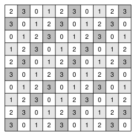

## Statement

Joséphine dispose d'un damier $10 \times 10$ et de pièces rectangulaires de dimensions $4 \times 1$, qu'elle peut poser horizontalement ou verticalement.

Peut-elle paver son damier avec ces pièces, c'est-à-dire le recouvrir entièrement sans chevauchement ni dépassement ?

## Hints

1. Compte d'abord : le nombre de cases est-il compatible avec des pièces de $4$ cases ?
2. Le compte ne suffit donc pas. Il faut un coloriage. Un coloriage en deux couleurs ne dira rien ici : combien de couleurs faut-il pour qu'une pièce $4 \times 1$ soit forcée d'en voir chacune une fois ?
3. Numérote la case de la ligne $\ell$ et de la colonne $c$ par le reste de $\ell + c$ dans la division par $4$. Quels numéros voit une pièce horizontale ? Une pièce verticale ?
4. Si chaque pièce voit exactement une case de chaque numéro, que doit-on avoir sur le nombre total de cases de chaque numéro ?
5. Compte les cases de numéro $1$ et celles de numéro $3$.

## Solution

**Le compte des cases ne suffit pas.** Le damier a $100$ cases et chaque pièce en couvre $4$. Comme $100 = 4 \times 25$, il faudrait exactement $25$ pièces : rien n'est interdit à ce stade.

**Le coloriage en diagonale.** Numérotons les lignes et les colonnes de $1$ à $10$, et écrivons dans la case de la ligne $\ell$ et de la colonne $c$ le reste de $\ell + c$ dans la division par $4$, c'est-à-dire un numéro parmi $0$, $1$, $2$, $3$.

**Ce que voit une pièce.** Une pièce horizontale occupe quatre cases d'une même ligne $\ell$, dans des colonnes consécutives $c, c+1, c+2, c+3$. Leurs numéros sont les restes de

$$\ell + c, \quad \ell + c + 1, \quad \ell + c + 2, \quad \ell + c + 3$$

dans la division par $4$ : ce sont quatre entiers consécutifs, donc leurs restes sont $0$, $1$, $2$ et $3$, chacun une fois exactement.

Pour une pièce verticale, c'est $\ell$ qui prend quatre valeurs consécutives, et le même raisonnement s'applique.

**Toute pièce couvre donc exactement une case de chaque numéro.**

**La conséquence.** Si Joséphine réussissait avec ses $25$ pièces, elle couvrirait exactement $25$ cases de numéro $0$, $25$ de numéro $1$, $25$ de numéro $2$ et $25$ de numéro $3$. Il faudrait donc qu'il y ait **autant de cases de chaque numéro** sur le damier.

**Le comptage.** Regardons combien de lignes portent chaque reste : pour $\ell = 1, 2, \ldots, 10$, les restes modulo $4$ sont

$$1, 2, 3, 0, 1, 2, 3, 0, 1, 2 .$$

Il y a donc $3$ lignes de reste $1$, $3$ lignes de reste $2$, mais seulement $2$ lignes de reste $0$ et $2$ lignes de reste $3$. Et il en va exactement de même pour les colonnes.

Le numéro d'une case est le reste de la somme des deux. En combinant les restes de ligne et de colonne, on trouve

$$25 \text{ cases de numéro } 0, \qquad 24 \text{ cases de numéro } 1,$$

$$25 \text{ cases de numéro } 2, \qquad 26 \text{ cases de numéro } 3 .$$

*(On vérifie : $25 + 24 + 25 + 26 = 100$. Sur la figure, les cases de numéro $1$ sont en gris clair et celles de numéro $3$ en gris foncé : il y en a bien deux de plus en foncé.)*

**Conclusion.** Il y a $26$ cases de numéro $3$ et seulement $24$ cases de numéro $1$ : ces nombres ne sont pas égaux, donc **Joséphine ne peut pas paver son damier**.

## Going further

Le principe à retenir : pour une pièce $n \times 1$, le bon coloriage compte les cases modulo $n$ en diagonale, parce que la pièce est alors forcée de voir chaque couleur exactement une fois, qu'elle soit posée horizontalement ou verticalement.

Et si le damier était $8 \times 8$ ? Refais le comptage : les $8$ lignes se répartissent en $2$ de chaque reste, et de même pour les colonnes. Les quatre numéros sont alors également représentés, l'obstruction disparaît, et le pavage existe bel et bien — il suffit de poser $16$ pièces horizontales.
