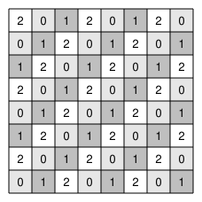

## Statement

Kahina dispose d'un échiquier $8 \times 8$ dont **toutes les cases sont blanches**.

Elle s'autorise, autant de fois qu'elle le veut, l'opération suivante : choisir un rectangle $3 \times 1$ ou $1 \times 3$ de l'échiquier et **inverser** la couleur de ses trois cases (le blanc devient noir, et le noir devient blanc).

Peut-elle faire en sorte que l'échiquier devienne entièrement noir ?

## Hints

1. Un coloriage en deux couleurs ne servira à rien ici, puisque les couleurs changent tout le temps. Il faut plutôt étiqueter les cases une fois pour toutes, et suivre un compte.
2. Numérote la case de la ligne $\ell$ et de la colonne $c$ par le reste de $\ell + c$ dans la division par $3$. Quels numéros porte un rectangle $3 \times 1$ ? Et un rectangle $1 \times 3$ ?
3. Pour chaque numéro $k$, suis la quantité « nombre de cases noires portant le numéro $k$ ». Que devient sa parité après une opération ?
4. Au départ, ces trois quantités sont toutes nulles. Qu'est-ce que cela impose sur leurs parités à tout instant ?
5. Compte combien il y a de cases de chaque numéro sur l'échiquier.

## Solution

**L'étiquetage.** Numérotons les lignes et les colonnes de $1$ à $8$, et écrivons dans la case de la ligne $\ell$ et de la colonne $c$ le reste de $\ell + c$ dans la division par $3$, c'est-à-dire $0$, $1$ ou $2$. Ces numéros sont fixés une fois pour toutes : ils ne changent jamais, contrairement aux couleurs.

**Ce que touche une opération.** Un rectangle $1 \times 3$ occupe trois cases d'une même ligne $\ell$, dans des colonnes consécutives $c, c+1, c+2$. Leurs numéros sont les restes de $\ell+c$, $\ell+c+1$, $\ell+c+2$ modulo $3$ : trois entiers consécutifs, donc les trois restes $0$, $1$, $2$, chacun une fois. Même chose pour un rectangle $3 \times 1$.

**Toute opération inverse donc exactement une case de chaque numéro.**

**Les trois quantités à suivre.** Pour $k = 0, 1, 2$, notons $N_k$ le nombre de cases **noires** portant le numéro $k$.

Une opération inverse une case de numéro $k$ : soit elle était blanche et devient noire, et $N_k$ augmente de $1$ ; soit elle était noire et devient blanche, et $N_k$ diminue de $1$. Dans les deux cas, **la parité de $N_k$ change**.

Comme chaque opération inverse une case de chacun des trois numéros, **les trois parités de $N_0$, $N_1$ et $N_2$ changent en même temps** à chaque coup.

Au départ tout est blanc, donc $N_0 = N_1 = N_2 = 0$ : les trois quantités sont paires. Après une opération, les trois sont impaires ; après deux, les trois sont paires, et ainsi de suite. À tout instant, **$N_0$, $N_1$ et $N_2$ ont toutes les trois la même parité**.

**Le comptage.** Pour $\ell = 1, \ldots, 8$, les restes de $\ell$ modulo $3$ sont

$$1, 2, 0, 1, 2, 0, 1, 2 ,$$

soit $3$ lignes de reste $1$, $3$ lignes de reste $2$ et seulement $2$ lignes de reste $0$. Idem pour les colonnes. En combinant, on trouve sur l'échiquier

$$22 \text{ cases de numéro } 0, \qquad 21 \text{ cases de numéro } 1, \qquad 21 \text{ cases de numéro } 2 .$$

*(Vérification : $22 + 21 + 21 = 64$.)*

**Conclusion.** Si l'échiquier devenait entièrement noir, on aurait $N_0 = 22$, qui est **pair**, et $N_1 = 21$, qui est **impair**. Ces deux nombres n'ont pas la même parité, ce qui contredit l'invariant.

**Kahina ne pourra jamais noircir entièrement son échiquier.**

## Going further

Remarque la différence avec les problèmes de pavage : ici les pièces peuvent se chevaucher et être rejouées, donc compter les cases ne sert à rien. C'est la **parité** de chaque compteur qui fait le travail, et non sa valeur.

Et sur un échiquier $9 \times 9$ ? Les trois numéros y seraient également représentés, avec $27$ cases chacun : l'obstruction disparaît. Kahina peut-elle alors tout noircir ?
