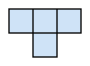
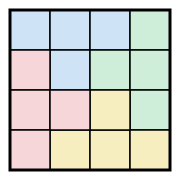

## Statement

Le **tétramino en T** est la pièce formée de trois cases alignées et d'une quatrième case collée au milieu :

On veut paver une grille $n \times n$ avec de telles pièces : elles suivent le quadrillage, on peut les tourner dans tous les sens, elles ne se chevauchent pas et ne dépassent pas de la grille, et elles recouvrent toute la grille.

Montrer que c'est possible **si et seulement si** $n$ est un multiple de $4$.

## Hints

1. Un « si et seulement si » demande deux démonstrations indépendantes : si $4$ divise $n$ alors le pavage existe, et si le pavage existe alors $4$ divise $n$. Commence par celle que tu trouves la plus facile.
2. Pour construire un pavage quand $4$ divise $n$, découpe la grille en blocs $4 \times 4$ et débrouille-toi avec un seul bloc.
3. Pour le sens difficile, commence par compter les cases : combien de pièces faut-il ? Qu'en déduis-tu sur $n$ ?
4. Colorie la grille comme un échiquier. Combien de cases blanches un tétramino en T recouvre-t-il ? Il y a deux réponses possibles, selon la position de la pièce.
5. Note $B$ le nombre de pièces qui couvrent trois cases blanches et $N$ celles qui en couvrent une seule. Écris deux équations, une pour les cases blanches, une pour les noires.

## Solution

**Réponse : le pavage existe exactement quand $n$ est un multiple de $4$.**

### Sens facile : si $4$ divise $n$, le pavage existe

Un bloc $4 \times 4$ se pave avec quatre tétraminos en T, disposés en moulinet :

Si $n$ est un multiple de $4$, la grille $n \times n$ se découpe en blocs $4 \times 4$ : il y en a $\dfrac{n}{4} \times \dfrac{n}{4}$. On pave chaque bloc de la même façon, et la grille entière est pavée.

### Sens difficile : si le pavage existe, alors $4$ divise $n$

**Premier pas : $n$ est pair.**

Chaque pièce couvre $4$ cases et la grille en a $n^2$. Si un pavage existe, le nombre de pièces vaut $\dfrac{n^2}{4}$, donc $4$ divise $n^2$.

Si $n$ était impair, $n^2$ le serait aussi et ne serait pas divisible par $4$. Donc $n$ est pair.

**Deuxième pas : le coloriage en échiquier.**

Colorions la grille comme un échiquier : deux cases voisines par un côté ont toujours des couleurs différentes. Comme $n$ est pair, il y a autant de cases blanches que de noires, soit $\dfrac{n^2}{2}$ de chaque.

Regardons maintenant une pièce posée sur la grille. Le tétramino en T est formé de trois cases alignées et d'une quatrième collée au milieu. Sur un échiquier :

- les trois cases alignées sont alternées, donc de couleurs blanc-noir-blanc, ou noir-blanc-noir : deux d'une couleur et une de l'autre ;
- la quatrième case est voisine de la case centrale, donc de la couleur des deux cases extrêmes.

Au total, chaque pièce recouvre **trois cases d'une couleur et une seule de l'autre**. Il y a donc deux sortes de pièces :

- celles qui recouvrent $3$ blanches et $1$ noire ; notons $B$ leur nombre ;
- celles qui recouvrent $1$ blanche et $3$ noires ; notons $N$ leur nombre.

**Troisième pas : on compte chaque couleur.**

Comptons les cases blanches recouvertes, de deux façons :

$$3B + N = \frac{n^2}{2} .$$

Et les cases noires :

$$B + 3N = \frac{n^2}{2} .$$

En soustrayant ces deux égalités :

$$2B - 2N = 0, \qquad \text{donc} \qquad B = N .$$

**Quatrième pas : on conclut.**

Le nombre total de pièces vaut $B + N = 2B$, donc il est **pair**. Comme chaque pièce couvre $4$ cases,

$$n^2 = 4 \times (B+N) = 4 \times 2B = 8B .$$

Ainsi $8$ divise $n^2$. Écrivons $n = 2m$ (on sait que $n$ est pair) : alors $n^2 = 4m^2$, et $8 \mid 4m^2$ signifie $2 \mid m^2$, donc $m$ est pair. Donc $n = 2m$ est un multiple de $4$.

### Conclusion

$$\boxed{\text{La grille } n \times n \text{ se pave par des tétraminos en T si et seulement si } 4 \text{ divise } n .}$$

Le plus petit cas possible est $n = 4$. Ensuite $n = 8$, $n = 12$, et ainsi de suite. En particulier une grille $10 \times 10$, dont le nombre de cases est pourtant un multiple de $4$, ne se pave pas.

*Ce qu'il faut retenir.* Le comptage des cases donne une première condition, mais elle est trop faible : elle laisse passer $n = 6$ et $n = 10$. C'est le coloriage qui apporte l'information supplémentaire, en révélant que les pièces vont nécessairement **par paires**. Un coloriage bien choisi ne sert presque jamais à finir un exercice de pavage : il sert à ajouter une contrainte que le simple comptage ne voit pas.

## Going further

1. L'exercice $0812$ de cette collection traite le cas particulier $n = 10$ à un niveau plus élémentaire. Compare les deux démonstrations.

2. Une grille $n \times n$ se pave-t-elle par des tétraminos en **L** (trois cases alignées et la quatrième collée à une extrémité) ? Commence par $n=4$ et $n=6$.

3. Et un rectangle $a \times b$ avec des tétraminos en T ? Trouve une condition nécessaire par le même raisonnement, puis cherche des constructions. *Par exemple, un rectangle $4 \times 6$ se pave-t-il ?*
