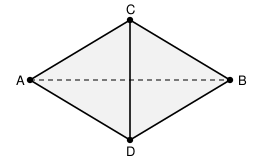

## Statement

On colorie **tous** les points du plan, chacun avec l'une de trois couleurs disponibles. Aucune règle : on peut colorier comme on veut.

Montrer qu'on trouvera toujours deux points de la même couleur situés exactement à la distance $1$ l'un de l'autre.

## Hints

1. Raisonne par l'absurde : suppose que **deux points quelconques à distance $1$ sont toujours de couleurs différentes**, et cherche une contradiction.
2. Cherche une figure où beaucoup de paires de points sont à distance $1$. Le losange formé de deux triangles équilatéraux de côté $1$ collés le long d'un côté est le bon candidat.
3. Dans ce losange $ACBD$ (avec $CD = 1$ et les triangles $ACD$ et $BCD$ équilatéraux de côté $1$), calcule la longueur $AB$.
4. Montre que, sous l'hypothèse absurde, $A$ et $B$ sont forcément de la **même** couleur. Que vaut alors la distance $AB$ ?
5. Tu en déduis que deux points quelconques à distance $\sqrt{3}$ ont la même couleur. Prends un cercle de rayon $\sqrt{3}$ : de quelle couleur est-il ? Peux-tu y trouver deux points à distance $1$ ?

## Solution

**L'hypothèse absurde.**

Supposons, par l'absurde, que le coloriage soit tel que **deux points quelconques distants de $1$ ne sont jamais de la même couleur**.

**Étape 1 : deux points à distance $\sqrt{3}$ ont la même couleur.**

Prenons deux points $C$ et $D$ tels que $CD = 1$, et construisons les deux points $A$ et $B$ de part et d'autre de la droite $(CD)$ tels que les triangles $ACD$ et $BCD$ soient équilatéraux de côté $1$.

Sur cette figure, **cinq** paires de points sont à distance $1$ :
$$CD, \quad AC, \quad AD, \quad BC, \quad BD .$$

D'après l'hypothèse absurde, les couleurs de $A$, $C$ et $D$ sont deux à deux différentes : ce sont donc les trois couleurs, chacune une fois. De même pour $B$, $C$ et $D$.

Dans les deux cas, $C$ et $D$ occupent deux couleurs, et il ne reste qu'une couleur disponible : celle de $A$ et celle de $B$ sont donc **la même**.

Calculons maintenant $AB$. Notons $I$ le milieu de $[CD]$. Dans le triangle équilatéral $ACD$ de côté $1$, la hauteur $[AI]$ mesure $\dfrac{\sqrt{3}}{2}$ (par Pythagore : $AI^2 = 1^2 - \left(\tfrac12\right)^2 = \tfrac34$). De même pour $BI$. Les points $A$, $I$, $B$ sont alignés, donc
$$AB = 2 \times \frac{\sqrt{3}}{2} = \sqrt{3} .$$

On vient donc de montrer : **deux points quelconques situés à distance $\sqrt{3}$ ont la même couleur.** (La construction se fait de la même façon autour de n'importe quelle paire de points à distance $\sqrt 3$.)

**Étape 2 : un cercle entièrement d'une seule couleur.**

Fixons un point $O$ du plan et considérons le cercle $\Gamma$ de centre $O$ et de rayon $\sqrt{3}$.

Chaque point de $\Gamma$ est à distance $\sqrt{3}$ de $O$, donc, d'après l'étape 1, il a la même couleur que $O$. Le cercle $\Gamma$ est donc **entièrement d'une seule couleur**, celle de $O$.

**Étape 3 : la contradiction.**

Sur ce cercle de rayon $\sqrt{3}$, donc de diamètre $2\sqrt{3} \approx 3{,}46$, on peut tracer une corde de longueur $1$ : il suffit de prendre un point $P$ de $\Gamma$ et le point $Q$ de $\Gamma$ tel que $PQ = 1$, ce qui est possible car $1$ est bien compris entre $0$ et le diamètre.

Les points $P$ et $Q$ sont à distance $1$ et de la même couleur. C'est exactement ce que l'hypothèse absurde interdisait.

**Conclusion.** L'hypothèse était fausse : quel que soit le coloriage du plan en trois couleurs, il existe deux points de la même couleur à distance $1$.

## Going further

1. Le résultat est-il encore vrai avec **deux** couleurs ? Donne une démonstration plus courte.
2. Où l'argument utilise-t-il vraiment qu'il n'y a que trois couleurs ? (Avec quatre couleurs la réponse reste « oui, deux points de même couleur à distance 1 existent toujours », mais c'est un résultat très difficile, démontré seulement en 2018 par Aubrey de Grey.)
3. La distance $1$ n'a rien de spécial : montre que pour toute longueur $d > 0$, il existe deux points de la même couleur à distance $d$.
