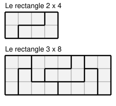

## Statement

Un **L** est la pièce de Tetris formée de quatre cases : trois cases alignées, plus une quatrième collée perpendiculairement à l'une des extrémités. On a le droit de la tourner et de la retourner comme on veut.

On veut paver entièrement un rectangle de $m \times n$ cases, avec $m > 1$ et $n > 1$, en utilisant uniquement des L, sans trou ni chevauchement.

Montrer que si un tel pavage existe, alors $mn$ est un multiple de $8$.

## Hints

1. Une première condition est immédiate : chaque L couvre $4$ cases. Que peut-on en déduire sur $mn$ ?
2. Il reste donc à éliminer le cas où $mn$ est multiple de $4$ mais pas de $8$. Que vaut alors le nombre de pièces ?
3. Montre que dans ce cas, l'une au moins des deux dimensions est paire. Regarde la puissance de $2$ contenue dans $m$ et dans $n$.
4. Quitte à tourner le rectangle d'un quart de tour, suppose que le nombre de **lignes** est pair, et colorie les lignes alternativement en noir et en blanc : des bandes, pas un damier.
5. Combien de cases de chaque couleur un L recouvre-t-il ? Examine les deux positions possibles, couchée et debout.

## Solution

**Étape 1. Le nombre de cases.**

Chaque L couvre exactement $4$ cases, et les pièces ne se chevauchent pas. Donc $mn$ est un multiple de $4$, et le nombre de pièces vaut

$$k = \frac{mn}{4}.$$

Il reste à écarter le cas où $mn$ est multiple de $4$ mais pas de $8$. Dans ce cas, $k = \dfrac{mn}{4}$ est **impair**. C'est ce que nous allons supposer, pour aboutir à une contradiction.

**Étape 2. L'une des deux dimensions est paire.**

Écrivons $m = 2^{\alpha} m'$ et $n = 2^{\beta} n'$ avec $m'$ et $n'$ impairs. Alors $mn = 2^{\alpha+\beta} m'n'$, et dire que $mn$ est multiple de $4$ mais pas de $8$ revient à dire

$$\alpha + \beta = 2.$$

Trois possibilités : $(\alpha, \beta) = (2,0)$, $(1,1)$ ou $(0,2)$. Dans chacune, $\alpha \geqslant 1$ ou $\beta \geqslant 1$ : l'une au moins des deux dimensions est paire.

Quitte à faire pivoter le rectangle d'un quart de tour, supposons que le **nombre de lignes $m$ est pair**.

**Étape 3. On colorie en bandes horizontales.**

Colorions la ligne $1$ en noir, la ligne $2$ en blanc, la ligne $3$ en noir, et ainsi de suite : chaque ligne est d'une seule couleur, et deux lignes voisines sont de couleurs différentes.

Comme $m$ est pair, il y a autant de lignes noires que de lignes blanches, donc

$$\text{cases noires} = \text{cases blanches} = \frac{mn}{2}.$$

**Étape 4. Chaque L couvre 3 cases d'une couleur et 1 de l'autre.**

Deux positions sont possibles pour un L.

*Couché.* Les trois cases alignées sont dans une même ligne, donc de la même couleur ; la quatrième est dans une ligne voisine, donc de l'autre couleur. Bilan : $3$ d'une couleur, $1$ de l'autre.

*Debout.* Les trois cases alignées occupent trois lignes consécutives, disons $i$, $i+1$, $i+2$. Les lignes $i$ et $i+2$ sont de la même couleur, la ligne $i+1$ de l'autre : cela fait déjà $2$ d'une couleur et $1$ de l'autre. La quatrième case est collée à l'une des **extrémités** de la barre, donc dans la ligne $i$ ou dans la ligne $i+2$ : elle est de la couleur majoritaire. Bilan : $3$ d'une couleur, $1$ de l'autre.

Dans tous les cas, un L couvre $3$ cases d'une couleur et $1$ de l'autre.

**Étape 5. La contradiction.**

Pour chaque pièce, calculons (cases noires couvertes) $-$ (cases blanches couvertes). D'après l'étape 4, ce nombre vaut $3 - 1 = 2$ ou $1 - 3 = -2$. Notons $p$ le nombre de pièces qui donnent $+2$ et $q$ celles qui donnent $-2$, de sorte que

$$p + q = k.$$

En additionnant sur toutes les pièces, on obtient la différence totale entre cases noires et cases blanches du rectangle :

$$2p - 2q \;=\; \text{noires} - \text{blanches} \;=\; 0 \qquad \text{(étape 3)}.$$

Donc $p = q$, et par conséquent $k = p + q = 2p$ est **pair**.

Or on avait supposé $k$ impair. C'est absurde.

**Conclusion.** Le cas « $mn$ multiple de $4$ mais pas de $8$ » est impossible. Comme $mn$ doit être multiple de $4$, il est en fait multiple de $8$.

## Going further

La réciproque est vraie : dès que $m, n > 1$ et que $8$ divise $mn$, le pavage existe. Il suffit de savoir paver deux rectangles élémentaires, et de découper le grand rectangle en morceaux de ces deux types.

Voyons pourquoi ces deux briques suffisent. Avec $8 \mid mn$ et $m, n > 1$, quitte à échanger les rôles il y a deux cas.

- **Une dimension est multiple de $4$ et l'autre est paire**, disons $4 \mid n$ et $m$ pair. On découpe alors tout le rectangle en blocs $2 \times 4$.
- **Une dimension est multiple de $8$ et l'autre est impaire**, disons $8 \mid n$ et $m$ impair, $m \geqslant 3$. On pave les trois premières lignes avec des blocs $3 \times 8$, puis il reste $m - 3$ lignes, un nombre pair, qu'on pave avec des blocs $2 \times 4$.

Reste à vérifier qu'il n'y a pas d'autre cas. Si $8 \mid mn$ et qu'aucune des deux dimensions n'est multiple de $4$, alors chacune contient au plus un facteur $2$, donc $mn$ en contient au plus deux : impossible. Donc l'une au moins est multiple de $4$, et l'on retombe sur les deux cas ci-dessus.

Noter enfin que la condition $m, n > 1$ est indispensable : un rectangle $1 \times 8$ a bien $8$ cases, mais aucun L n'y rentre.
