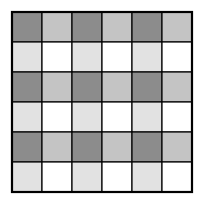

## Statement

Un pion est posé sur une case d'un échiquier $6 \times 6$.

À chaque coup, il se déplace en ligne droite, horizontalement ou verticalement, et la longueur de ses déplacements alterne : le premier coup le fait avancer de $1$ case, le deuxième de $2$ cases, le troisième de $1$ case, le quatrième de $2$ cases, et ainsi de suite. Le pion ne doit jamais sortir de l'échiquier.

Peut-on choisir la case de départ de façon que le pion, en $35$ coups, passe exactement une fois par chacune des $36$ cases ?

## Hints

1. On demande de décider si c'est possible. Si tu n'arrives pas à construire un parcours après plusieurs essais, cherche plutôt à démontrer que c'est impossible.
2. Numérote les lignes et les colonnes de $1$ à $6$, et range les cases en quatre familles selon la **parité** du numéro de ligne et celle du numéro de colonne. Combien de cases dans chaque famille ?
3. Qu'arrive-t-il à la famille d'une case quand le pion fait un coup de $2$ cases ? Et quand il fait un coup de $1$ case ?
4. Numérote les coups de $1$ à $35$. Lesquels sont des coups de $2$ cases ? Chaque case du parcours est-elle touchée par un tel coup ? Regarde de près la toute première et la toute dernière case.
5. À l'intérieur d'une famille, les coups de $2$ cases forment donc des paires de cases. Mais combien y a-t-il de cases dans une famille ?

## Solution

La réponse est **non** : aucune case de départ ne convient.

### Étape 1. Mettre en place le vocabulaire

Un parcours réussi visiterait les $36$ cases une fois chacune, en $35$ coups. Numérotons les cases visitées de $0$ (la case de départ) à $35$ (la case d'arrivée), et les coups de $1$ à $35$, le coup $k$ menant de la case $k-1$ à la case $k$.

D'après l'énoncé, les coups de rang **impair** ($1, 3, 5, \ldots, 35$) font avancer de $1$ case, et les coups de rang **pair** ($2, 4, \ldots, 34$) font avancer de $2$ cases. Il y a donc $18$ coups de $1$ case et $17$ coups de $2$ cases.

### Étape 2. Les quatre familles

Numérotons les lignes de $1$ à $6$ et les colonnes de $1$ à $6$. Rangeons chaque case selon la parité de son numéro de ligne et celle de son numéro de colonne. Cela fait quatre familles :

$$(\text{impair}, \text{impair}), \quad (\text{impair}, \text{pair}), \quad (\text{pair}, \text{impair}), \quad (\text{pair}, \text{pair}).$$

Il y a trois numéros impairs ($1, 3, 5$) et trois numéros pairs ($2, 4, 6$), donc **chaque famille contient exactement $3 \times 3 = 9$ cases**. Sur la figure, les quatre familles sont représentées par quatre teintes.

Le point important est que $9$ est un nombre **impair**.

### Étape 3. Un coup de 2 cases ne change pas de famille

Un coup de $2$ cases horizontal change le numéro de colonne de $\pm 2$ et ne touche pas au numéro de ligne. Les deux parités sont donc conservées. Un coup de $2$ cases vertical fait de même avec la ligne.

> **Les deux cases reliées par un coup de $2$ cases appartiennent à la même famille.**

(Un coup de $1$ case, lui, change exactement une des deux parités, donc change de famille ; nous n'en aurons pas besoin.)

### Étape 4. Quelles cases sont touchées par un coup de 2 cases ?

Prenons une case du parcours, à la position $k$.

- Si $1 \leqslant k \leqslant 34$, elle est reliée au reste du parcours par deux coups, le coup $k$ et le coup $k+1$. Ces deux rangs sont consécutifs, donc l'un est pair et l'autre impair : **la case est touchée par exactement un coup de $2$ cases.**
- Si $k = 0$, la case n'est touchée que par le coup $1$, qui est de rang impair, donc de $1$ case.
- Si $k = 35$, la case n'est touchée que par le coup $35$, lui aussi de rang impair, donc de $1$ case.

> **Seules la case de départ et la case d'arrivée ne sont touchées par aucun coup de $2$ cases. Les $34$ autres sont touchées par exactement un.**

### Étape 5. Compter dans une famille

Fixons une famille $F$, qui compte $9$ cases.

D'après l'étape 3, tout coup de $2$ cases ayant une extrémité dans $F$ a ses **deux** extrémités dans $F$. D'après l'étape 4, chaque case de $F$ est touchée par au plus un coup de $2$ cases.

Les coups de $2$ cases regroupent donc les cases concernées de $F$ **deux par deux**. Le nombre de cases de $F$ touchées par un coup de $2$ cases est donc pair.

Comme $F$ compte $9$ cases, le nombre de cases de $F$ **non** touchées est impair. Or, d'après l'étape 4, ces cases-là ne peuvent être que la case de départ ou la case d'arrivée.

> **Chaque famille contient donc un nombre impair de ces deux cases, c'est-à-dire exactement une des deux.**

### Étape 6. La contradiction

Il y a quatre familles, et chacune devrait contenir soit la case de départ, soit la case d'arrivée. Cela fait quatre cases distinctes, puisque les familles sont disjointes.

Mais il n'y a que **deux** cases concernées, le départ et l'arrivée.

C'est impossible. Aucun parcours de ce type n'existe, quelle que soit la case de départ.

## Going further

Ce qui fait marcher la démonstration, c'est que $9$ est impair. Sur un échiquier $8 \times 8$, chaque famille compterait $16$ cases, et l'argument tomberait à plat : il faudrait autre chose.

La figure porte quatre teintes, mais on peut aussi ne retenir qu'une seule famille à la fois et refaire le raisonnement quatre fois, en décalant le coloriage d'une case vers la droite, vers le bas, ou les deux. C'est la même chose dite autrement.

Notons enfin le rôle exact de l'alternance des longueurs. Si tous les coups étaient de $2$ cases, chaque case serait touchée par un coup de $2$ cases sauf le départ et l'arrivée, et le raisonnement donnerait la même contradiction. Si tous les coups étaient de $1$ case, il n'y aurait aucune contradiction : un parcours en serpentin visite bien les $36$ cases.
