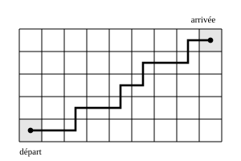

## Statement

Un quadrillage rectangulaire a $5$ rangées et $9$ colonnes de cases. Un pion est posé sur la case en bas à gauche et veut atteindre la case en haut à droite. À chaque coup, il passe dans une case voisine, soit vers le haut, soit vers la droite.

Combien de chemins différents le pion peut-il suivre ?

## Hints

1. Sur le dessin, comptez les coups vers le haut du chemin tracé, puis les coups vers la droite. Recommencez avec un autre chemin de votre choix. Que remarquez-vous ?
2. Un chemin est donc une suite de $12$ coups, dont exactement $4$ vers le haut. Écrivez-le comme un mot : la lettre $H$ pour un coup vers le haut, la lettre $D$ pour un coup vers la droite.
3. Deux chemins différents donnent deux mots différents, et tout mot de $12$ lettres écrit avec $4$ lettres $H$ et $8$ lettres $D$ correspond à un chemin. Il suffit donc de compter ces mots.
4. Choisir un tel mot, c'est choisir les $4$ places des lettres $H$ parmi les $12$ places. Commencez par compter comme si les quatre lettres $H$ étaient numérotées, puis corrigez.

## Solution

**L'idée : coder un chemin par un mot.**

Le pion part de la colonne $1$ et doit arriver dans la colonne $9$ : il fait donc $8$ coups vers la droite. Il part de la rangée $1$ et doit arriver dans la rangée $5$ : il fait donc $4$ coups vers le haut. Et cela ne dépend pas du chemin, puisque le pion ne revient jamais en arrière.

Chaque chemin est donc une suite de $12$ coups, dont $4$ vers le haut et $8$ vers la droite. Écrivons cette suite comme un mot de $12$ lettres, avec $H$ pour « haut » et $D$ pour « droite ». Le chemin dessiné ci-dessus s'écrit par exemple
$$D\,D\,H\,D\,D\,H\,D\,H\,D\,D\,H\,D.$$

Cette écriture range les chemins et les mots deux par deux :

- deux chemins différents donnent deux mots différents, car au premier coup où ils se séparent les lettres diffèrent ;
- tout mot de $12$ lettres formé de $4$ lettres $H$ et de $8$ lettres $D$ se lit comme un chemin, et ce chemin reste bien dans le quadrillage, puisqu'il monte $4$ fois en tout et va $8$ fois à droite.

Compter les chemins revient donc à compter ces mots.

**Compter les mots.**

Un mot est déterminé par les places qu'occupent les $4$ lettres $H$ parmi les $12$ places.

Faisons d'abord semblant que les quatre lettres $H$ sont numérotées $H_1$, $H_2$, $H_3$, $H_4$. La première a $12$ places possibles, la deuxième $11$ places restantes, la troisième $10$, la quatrième $9$, soit
$$12 \times 11 \times 10 \times 9 = 11\,880$$
façons de les placer.

Mais les lettres $H$ sont en réalité toutes pareilles. Un même mot a donc été compté autant de fois qu'il y a de façons de numéroter ses quatre lettres $H$, c'est-à-dire $4! = 4 \times 3 \times 2 \times 1 = 24$ fois. Il faut diviser :
$$\frac{11\,880}{24} = 495.$$

**Conclusion.** Le pion dispose de $495$ chemins différents.

(Ce nombre, « le nombre de façons de choisir $4$ objets parmi $12$ », se note aussi $\binom{12}{4}$.)

## Going further

1. Reprenez le calcul pour un quadrillage de $m$ rangées et $n$ colonnes. Combien de coups le pion fait-il en tout ? Combien de chemins y a-t-il ?
2. Sur le quadrillage $5 \times 9$, combien de chemins passent par la case du coin en bas à droite ? Et combien évitent cette case ?
