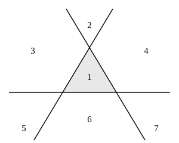

## Statement

On trace $n$ droites dans le plan. Elles sont placées « le plus généralement possible » :

- deux d'entre elles ne sont jamais parallèles ;
- trois d'entre elles ne passent jamais par un même point.

Ces droites découpent le plan en plusieurs morceaux. La figure montre ce qui se passe pour $n = 3$ : on obtient $7$ morceaux.

1. Faire un dessin pour $n = 1$, puis pour $n = 2$, puis pour $n = 4$, et compter les morceaux à chaque fois.
2. En combien de morceaux $n$ droites découpent-elles le plan ? Justifier la réponse.

## Hints

1. Commence par $n = 0$ : sans aucune droite, le plan est en un seul morceau. Puis ajoute les droites une par une et note à chaque fois de combien le nombre de morceaux augmente.
2. Tu devrais trouver $1$, $2$, $4$, $7$, $11$. Regarde les écarts entre deux nombres consécutifs : $1$, $2$, $3$, $4$. Que vaudra l'écart suivant ?
3. Il reste à comprendre **pourquoi** cet écart augmente de $1$ à chaque fois. On vient de tracer $k$ droites et on en ajoute une nouvelle : en combien de points la nouvelle droite coupe-t-elle les anciennes ?
4. Ces points de croisement découpent la nouvelle droite en plusieurs morceaux. Chacun de ces morceaux traverse une région du plan et la coupe en deux. Combien de régions nouvelles cela fait-il ?
5. À la fin tu dois calculer $1 + 1 + 2 + 3 + \dots + n$. Souviens-toi de la somme des $n$ premiers entiers.

## Solution

**On compte les petits cas.**

| nombre de droites | $0$ | $1$ | $2$ | $3$ | $4$ |
|---|---|---|---|---|---|
| nombre de morceaux | $1$ | $2$ | $4$ | $7$ | $11$ |

Les écarts d'une colonne à la suivante sont $1$, $2$, $3$, $4$. On devine donc que **la $k+1$-ième droite ajoute $k+1$ morceaux**. Montrons-le.

**L'idée : ajouter une droite et regarder ce qu'elle coupe.**

Supposons que $k$ droites soient déjà tracées et ajoutons-en une nouvelle, appelons-la $d$.

*Combien de points de croisement y a-t-il sur $d$ ?*

$d$ n'est parallèle à aucune des $k$ anciennes droites, donc elle coupe chacune d'elles. Cela fait $k$ points de croisement. De plus, ces $k$ points sont deux à deux distincts : si deux d'entre eux étaient confondus, trois droites passeraient par un même point, ce qui est interdit.

Il y a donc exactement $k$ points de croisement sur $d$.

*Combien de morceaux nouveaux cela crée-t-il ?*

Ces $k$ points découpent la droite $d$ en $k+1$ morceaux : $k-1$ segments entre deux points consécutifs, plus les deux demi-droites des extrémités.

Chacun de ces $k+1$ morceaux de $d$ traverse une des régions déjà existantes et la sépare en deux : la région gagne une unité. Et deux morceaux différents de $d$ sont dans deux régions différentes, car pour passer d'un morceau au suivant il faut traverser une ancienne droite, donc changer de région.

Donc **ajouter la $(k+1)$-ième droite augmente le nombre de morceaux de exactement $k+1$.**

**On additionne.**

Notons $R(n)$ le nombre de morceaux obtenus avec $n$ droites. On part de $R(0) = 1$ (le plan tout entier) et on ajoute les droites une par une :

- la $1^{\text{re}}$ droite ajoute $1$ morceau ($k = 0$) ;
- la $2^{\text{e}}$ droite ajoute $2$ morceaux ($k = 1$) ;
- la $3^{\text{e}}$ droite ajoute $3$ morceaux ;
- ...
- la $n^{\text{e}}$ droite ajoute $n$ morceaux.

D'où
$$R(n) = 1 + (1 + 2 + 3 + \dots + n).$$

La somme des $n$ premiers entiers vaut $\dfrac{n(n+1)}{2}$ (on regroupe les termes deux par deux : $1+n$, $2+(n-1)$, etc., chaque paire valant $n+1$). Donc

$$\boxed{R(n) = 1 + \frac{n(n+1)}{2}}$$

**Vérification.** $R(0) = 1$, $R(1) = 1+1 = 2$, $R(2) = 1+3 = 4$, $R(3) = 1+6 = 7$, $R(4) = 1+10 = 11$. Tout colle avec le tableau.

**Réponse : $n$ droites placées ainsi découpent le plan en $1 + \dfrac{n(n+1)}{2}$ morceaux. Pour $n = 10$, par exemple, cela fait $56$ morceaux.**

## Going further

1. Parmi ces $1 + \dfrac{n(n+1)}{2}$ morceaux, combien sont bornés (c'est-à-dire tiennent dans un disque assez grand) ?
2. Que devient le compte si on autorise deux droites à être parallèles ? Et si on autorise trois droites à passer par un même point ? Dans chaque cas, le nombre de morceaux augmente-t-il ou diminue-t-il ?
3. La même question avec $n$ cercles, deux quelconques se coupant en deux points et trois n'ayant jamais de point commun : en combien de morceaux découpent-ils le plan ?
