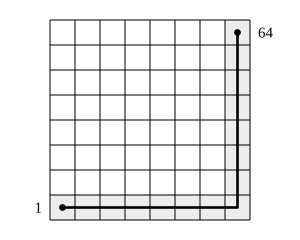

## Statement

Dans les $64$ cases d'un échiquier $8 \times 8$, on écrit les nombres $1, 2, 3, \ldots, 64$, un par case, chacun une fois et une seule, et dans l'ordre que l'on veut.

Deux cases sont dites **voisines** lorsqu'elles ont un côté commun.

Montrer qu'il existe forcément deux cases voisines dont les nombres diffèrent d'au moins $5$.

## Hints

1. C'est un énoncé du type « il existe forcément... ». Suppose le contraire : deux cases voisines quelconques diffèrent toujours d'au plus $4$. Il faut aboutir à une absurdité.
2. Les deux nombres les plus intéressants sont les deux extrêmes : $1$ et $64$. Repère leurs cases.
3. Va de la case du $1$ à la case du $64$ en te déplaçant seulement d'une case à une case voisine. Combien de déplacements te faut-il au maximum, si tu avances d'abord horizontalement puis verticalement ?
4. À chaque déplacement, de combien le nombre inscrit peut-il varier ? Et sur tout le trajet, de combien varie-t-il en tout ?
5. Compare cette variation totale possible avec $64 - 1$.

## Solution

**L'idée : raisonner par l'absurde, et relier la case du $1$ à celle du $64$ par un chemin court.**

Supposons le contraire de ce qu'on veut montrer :

> *(hypothèse absurde)* deux cases voisines quelconques portent toujours des nombres qui diffèrent d'au plus $4$.

**Étape 1. Un chemin de la case du $1$ à la case du $64$.**

Appelons $A$ la case qui porte le nombre $1$ et $B$ celle qui porte le nombre $64$.

Pour aller de $A$ à $B$, on se déplace d'abord horizontalement, le long de la ligne de $A$, jusqu'à arriver dans la colonne de $B$ ; puis verticalement, le long de cette colonne, jusqu'à $B$. Chaque déplacement fait passer d'une case à une case voisine.

Combien de déplacements cela fait-il ?

- Les deux cases sont sur des colonnes numérotées de $1$ à $8$, donc la partie horizontale demande au plus $8 - 1 = 7$ déplacements.
- De même, la partie verticale demande au plus $7$ déplacements.

Le chemin comporte donc **au plus $14$ déplacements**. (La figure montre le cas le plus long, où $A$ et $B$ sont dans deux coins opposés.)

**Étape 2. On majore la variation du nombre le long du chemin.**

Notons $n_0 = 1$ le nombre de la case de départ, puis $n_1, n_2, \ldots, n_p$ les nombres rencontrés le long du chemin, avec $n_p = 64$ et $p \leqslant 14$.

Deux cases consécutives du chemin sont voisines. D'après l'hypothèse absurde,
$$|n_1 - n_0| \leqslant 4, \quad |n_2 - n_1| \leqslant 4, \quad \ldots, \quad |n_p - n_{p-1}| \leqslant 4 .$$

Or la différence totale s'obtient en additionnant toutes ces variations :
$$n_p - n_0 = (n_1 - n_0) + (n_2 - n_1) + \dots + (n_p - n_{p-1}).$$

Une somme est toujours inférieure ou égale, en valeur absolue, à la somme des valeurs absolues. Donc
$$|n_p - n_0| \;\leqslant\; |n_1 - n_0| + |n_2 - n_1| + \dots + |n_p - n_{p-1}| \;\leqslant\; \underbrace{4 + 4 + \dots + 4}_{p \text{ termes}} = 4p .$$

Comme $p \leqslant 14$, on obtient
$$|n_p - n_0| \leqslant 4 \times 14 = 56 .$$

**Étape 3. La contradiction.**

Mais on sait exactement combien vaut cette différence :
$$|n_p - n_0| = |64 - 1| = 63 .$$

On aboutit donc à $63 \leqslant 56$, ce qui est faux.

L'hypothèse absurde est donc à rejeter.

**Conclusion : quelle que soit la façon d'écrire les nombres $1$ à $64$ dans les cases, il existe toujours deux cases voisines dont les nombres diffèrent d'au moins $5$.**

## Going further

1. Le même raisonnement sur un échiquier $n \times n$ contenant les nombres $1$ à $n^2$ : quel écart est-on sûr de trouver entre deux cases voisines ?
2. Sur l'échiquier $8 \times 8$, peut-on toujours trouver deux cases voisines dont les nombres diffèrent d'au moins $6$ ? Essaie de construire un remplissage où tous les écarts entre cases voisines restent petits, en écrivant les nombres ligne par ligne, ou bien en serpentin.
3. Le raisonnement du chemin donne la borne $5$. Le remplissage ligne par ligne donne des écarts allant jusqu'à $8$. Quel est, à ton avis, le plus petit écart maximal que l'on puisse obtenir ?
