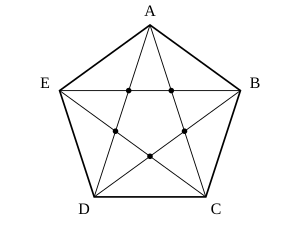

## Statement

Dans un polygone convexe à $n$ côtés, on trace **toutes** les diagonales. Il se trouve qu'aucun point n'appartient à trois diagonales à la fois : les diagonales ne se croisent que deux par deux.

1. Commencer par le pentagone de la figure : combien de points de croisement compte-t-on ?
2. Combien y a-t-il, en tout, de points de croisement de diagonales à l'intérieur d'un polygone convexe à $n$ côtés ?

## Hints

1. Ne cherche pas à compter les points un par un le long de chaque diagonale : c'est possible, mais très lourd. Cherche plutôt à **associer** à chaque point de croisement un objet plus simple à compter.
2. Un point de croisement est sur exactement deux diagonales. Combien d'extrémités ces deux diagonales ont-elles en tout ? Ces extrémités peuvent-elles coïncider ?
3. Dans l'autre sens : prends quatre sommets du polygone au hasard. Combien de points de croisement fabriquent-ils ? Fais le dessin, tu verras qu'il n'y a qu'une seule façon de tracer deux diagonales qui se croisent.
4. Il ne reste plus qu'à compter les façons de choisir quatre sommets parmi $n$, l'ordre ne comptant pas.

## Solution

**1. Le pentagone.**

Un pentagone convexe a cinq diagonales. En les traçant on obtient l'étoile à cinq branches de la figure, et on compte **5 points de croisement** : ce sont les sommets du petit pentagone intérieur.

**2. L'idée : à chaque point de croisement, associer quatre sommets.**

Prenons un point de croisement $P$. Par hypothèse, il appartient à exactement deux diagonales. Ces deux diagonales ont en tout **quatre extrémités**, et ces quatre sommets sont bien distincts : deux diagonales qui partagent une extrémité se rencontrent en ce sommet, pas à l'intérieur du polygone.

À chaque point de croisement on associe donc un **groupe de quatre sommets** du polygone.

**Dans l'autre sens.**

Partons maintenant de quatre sommets quelconques du polygone. Notons-les $A$, $B$, $C$, $D$ dans l'ordre où on les rencontre en parcourant le contour. Comme le polygone est convexe, ils forment un quadrilatère convexe.

Il y a trois façons d'apparier ces quatre points :

- $[AB]$ et $[CD]$ : ce sont deux côtés opposés du quadrilatère, ils ne se croisent pas ;
- $[AD]$ et $[BC]$ : de même, ils ne se croisent pas ;
- $[AC]$ et $[BD]$ : ce sont les deux diagonales du quadrilatère, et elles se croisent en **un** point, à l'intérieur.

À chaque groupe de quatre sommets correspond donc **exactement un** point de croisement.

**La correspondance est parfaite.**

Les deux constructions sont inverses l'une de l'autre : partant d'un point de croisement on obtient quatre sommets, et partant de ces quatre sommets on retombe sur ce même point. Aucun point n'est oublié, aucun n'est compté deux fois. (C'est précisément ici que sert l'hypothèse « jamais trois diagonales en un même point » : sans elle, un point pourrait correspondre à plusieurs groupes de quatre sommets.)

Il y a donc **autant de points de croisement que de façons de choisir quatre sommets parmi $n$**.

**Le compte.**

Choisissons quatre sommets en tenant compte de l'ordre : cela fait $n(n-1)(n-2)(n-3)$ possibilités. Mais un même groupe de quatre sommets est ainsi compté une fois pour chacune de ses $4 \times 3 \times 2 \times 1 = 24$ façons d'être rangé. Le nombre cherché est donc

$$\binom{n}{4} = \frac{n(n-1)(n-2)(n-3)}{24}.$$

**Vérifications.**

- Pour $n = 5$ : $\dfrac{5 \times 4 \times 3 \times 2}{24} = \dfrac{120}{24} = 5$. On retrouve bien les cinq points de la figure.
- Pour $n = 6$ : $\dfrac{6 \times 5 \times 4 \times 3}{24} = \dfrac{360}{24} = 15$.

**Attention à l'hypothèse.** La condition « aucun point n'appartient à trois diagonales » n'est pas un détail. Dans un hexagone **régulier**, les trois grandes diagonales passent toutes par le centre : au lieu de fournir trois points de croisement distincts, elles n'en donnent qu'un. On ne compte alors que $15 - 3 + 1 = 13$ points, et non $15$.

**Conclusion.** Sous l'hypothèse de l'énoncé, les diagonales d'un polygone convexe à $n$ côtés se croisent en

$$\frac{n(n-1)(n-2)(n-3)}{24} \text{ points.}$$

## Going further

1. Combien de diagonales possède un polygone convexe à $n$ côtés ?
2. Toujours sous la même hypothèse, en combien de morceaux les diagonales découpent-elles l'intérieur du polygone ? Commence par $n = 4$, puis $n = 5$, puis $n = 6$.
