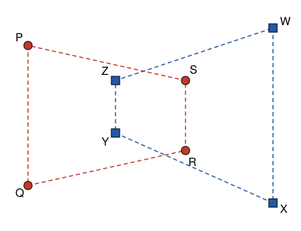

## Statement

On place $n$ points dans le plan, de façon que trois d'entre eux ne soient jamais alignés. Chaque
point est colorié en rouge ou en bleu. On suppose que :

- à l'intérieur de chaque triangle dont les trois sommets sont rouges, il y a **exactement un**
  point bleu ;
- à l'intérieur de chaque triangle dont les trois sommets sont bleus, il y a **exactement un**
  point rouge.

Quelle est la plus grande valeur possible de $n$ ?

## Hints

1. Un point bleu peut-il se trouver à l'intérieur d'un triangle dont les sommets sont bleus ?
   Découpe ce triangle en trois petits triangles bleus.
2. Imagine un élastique tendu autour de tous les points bleus. Quels points bleus touchent
   l'élastique ?
3. Combien de points rouges peuvent se trouver à l'intérieur du polygone formé par l'élastique
   bleu ?
4. Découpe ce polygone en triangles en traçant les diagonales qui partent d'un même sommet.
   Combien de triangles obtient-on s'il a $k$ sommets ?

## Solution

La réponse est $n = 8$.

**Étape 1. Aucun point bleu n'est à l'intérieur d'un triangle bleu.**

Supposons qu'un point bleu $D$ soit à l'intérieur d'un triangle $ABC$ dont les sommets sont bleus.
Les trois triangles $ABD$, $BCD$ et $CAD$ ont leurs sommets bleus, donc chacun contient un point
rouge. Ces trois triangles ne se chevauchent pas et sont tous dans le triangle $ABC$. Un point
rouge ne peut pas être sur l'un des segments $[DA]$, $[DB]$, $[DC]$, car il serait aligné avec
deux autres points. On trouve donc trois points rouges différents à l'intérieur de $ABC$, alors
qu'il doit y en avoir exactement un. C'est impossible.

De la même façon, aucun point rouge n'est à l'intérieur d'un triangle rouge.

**Étape 2. Les points bleus sont les sommets d'un polygone convexe.**

Tendons un élastique autour de tous les points bleus, comme autour de clous. Il dessine un polygone
convexe, dont les sommets sont certains des points bleus. Supposons qu'un point bleu ne soit pas un
sommet : il est à l'intérieur du polygone. En traçant les diagonales qui partent d'un sommet, on
découpe le polygone en triangles bleus. Notre point n'est pas sur une diagonale (il serait aligné
avec deux sommets), donc il est à l'intérieur d'un de ces triangles bleus, ce que l'étape 1
interdit.

Ainsi **tous** les points bleus sont des sommets du polygone bleu. De même, tous les points rouges
sont des sommets du polygone rouge.

**Étape 3. Au plus deux points rouges dans le polygone bleu.**

Supposons que trois points rouges soient à l'intérieur du polygone bleu. Le triangle rouge qu'ils
forment est alors entièrement dans le polygone, puisque celui-ci est convexe, et il doit contenir
un point bleu à l'intérieur. Mais un point à l'intérieur d'un triangle est entouré de tous les
côtés par ce triangle, donc par le polygone. Or chaque point bleu est un sommet du polygone, un
« coin » autour duquel le polygone n'occupe qu'un angle plus petit qu'un angle plat. C'est
impossible. Il y a donc au plus deux points rouges à l'intérieur du polygone bleu.

**Étape 4. Au plus quatre points de chaque couleur.**

Soit $k$ le nombre de points bleus, et supposons $k \geqslant 3$. Les diagonales qui partent d'un
même sommet découpent le polygone bleu en $k - 2$ triangles bleus qui ne se chevauchent pas. Chacun
contient un point rouge, et ces points rouges sont différents et à l'intérieur du polygone. D'après
l'étape 3, on a donc $k - 2 \leqslant 2$, c'est-à-dire $k \leqslant 4$. C'est vrai aussi si
$k \leqslant 2$.

De même, il y a au plus $4$ points rouges. Donc $n \leqslant 8$.

**Étape 5. Un exemple avec $8$ points.**

Dans un repère, prenons les points rouges $P(0\,;\,8)$, $Q(0\,;\,0)$, $R(9\,;\,2)$, $S(9\,;\,6)$ et
les points bleus $W(14\,;\,9)$, $X(14\,;\,-1)$, $Y(5\,;\,3)$, $Z(5\,;\,6)$. Trois d'entre eux ne
sont jamais alignés.

Avec quatre points, on forme quatre triangles. On lit sur la figure le point de l'autre couleur que
contient chacun d'eux :

| Triangle rouge | Point bleu à l'intérieur | Triangle bleu | Point rouge à l'intérieur |
|:---:|:---:|:---:|:---:|
| $PQR$ | $Y$ | $WXY$ | $R$ |
| $PQS$ | $Z$ | $WXZ$ | $S$ |
| $PRS$ | $Z$ | $WYZ$ | $S$ |
| $QRS$ | $Y$ | $XYZ$ | $R$ |

Chaque triangle contient bien un seul point de l'autre couleur.

**Conclusion : la plus grande valeur possible de $n$ est $8$.**
