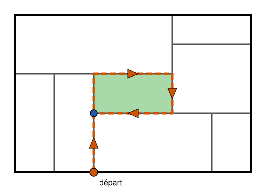

## Statement

La ville de Gotham City a la forme d'un grand rectangle. Des rues rectilignes, parallèles aux
bords de la ville, la découpent en pâtés de maisons qui sont tous des rectangles.

On appelle **rue** un segment de rue tracé d'un bout à l'autre, sans s'arrêter aux croisements.
On suppose qu'il y a au moins une rue, et qu'**aucune rue ne traverse la ville de part en part** :
aucune rue ne va d'un bord de la ville jusqu'au bord opposé.

Montrer qu'il existe un pâté de maisons qui ne touche pas le bord de la ville.

## Hints

1. Une rue peut-elle s'arrêter au milieu d'un pâté de maisons ? Où se trouvent les deux bouts
   d'une rue ?
2. Chaque rue a au moins un bout qui n'est pas sur le bord de la ville. Que trouve-t-on à cet
   endroit ?
3. Promène-toi dans la ville : suis une rue jusqu'à un bout qui n'est pas sur le bord, puis
   continue sur la rue où tu arrives. Peux-tu atteindre le bord de la ville ?
4. Il n'y a qu'un nombre fini de rues. Que finit-il par se passer pendant la promenade ?

## Solution

**Étape 1. Les bouts des rues.**

Une rue ne peut pas s'arrêter au milieu d'un pâté de maisons, sinon ce pâté ne serait pas un
rectangle : elle entrerait dedans comme une impasse. Chaque bout d'une rue est donc soit sur le
bord de la ville, soit sur une autre rue.

Comme aucune rue ne traverse la ville de part en part, chaque rue a au moins un bout qui n'est pas
sur le bord. Appelons-le le **bout intérieur** de la rue. Si les deux bouts conviennent, on en
choisit un une fois pour toutes. D'après ce qui précède, le bout intérieur d'une rue est toujours
situé sur une autre rue.

**Étape 2. La promenade de Batman.**

Batman part d'une rue quelconque, il y en a au moins une. Il la suit jusqu'à son bout intérieur.
Ce point est sur une autre rue : Batman prend cette nouvelle rue et la suit jusqu'à **son** bout
intérieur. Il arrive ainsi sur une troisième rue, qu'il suit jusqu'à son bout intérieur, et ainsi
de suite, sans jamais s'arrêter.

Après sa première rue, Batman ne touche jamais le bord de la ville. En effet, sur chaque rue, il
marche d'un point qui n'est pas sur le bord (le bout intérieur de la rue précédente) jusqu'à un
autre point qui n'est pas sur le bord (le bout intérieur de cette rue). Le morceau de rue entre
les deux ne touche donc pas le bord non plus, puisqu'une rue parallèle à un côté ne peut toucher le
bord qu'à ses bouts.

**Étape 3. Batman repasse par un point déjà visité.**

Il n'y a qu'un nombre fini de rues, et Batman en change sans arrêt. Il finit donc par reprendre une
rue qu'il a déjà suivie, et il arrive alors une deuxième fois au bout intérieur de cette rue.

Considérons le **premier** moment où Batman arrive en un point $M$ par lequel il est déjà passé.
Entre son premier passage en $M$ et ce moment, il a parcouru une boucle fermée qui ne se recoupe
pas, puisque c'est la première fois qu'il revient sur ses pas. Cette boucle suit des rues et ne
touche pas le bord de la ville.

**Étape 4. Un pâté à l'intérieur de la boucle.**

La boucle entoure une zone de la ville. Comme elle passe uniquement par des rues, elle ne coupe
aucun pâté de maisons en deux : chaque pâté est soit entièrement dans la zone, soit entièrement
hors de la zone. La zone n'est pas vide, donc elle contient au moins un pâté de maisons.

Le bord de la ville est hors de la zone, puisque la boucle ne le touche pas. Un pâté situé dans la
zone ne touche donc pas le bord de la ville.

**Conclusion : il existe un pâté de maisons qui ne touche pas le bord de la ville, par exemple
n'importe quel pâté situé à l'intérieur de la boucle de Batman.**
