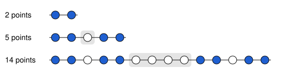

## Statement

On place $\dfrac{3^{100} + 1}{2}$ points sur une droite, régulièrement espacés : deux points voisins
sont toujours à la même distance l'un de l'autre.

Montrer qu'on peut en colorier $2^{100}$ en bleu de sorte qu'aucun point bleu ne soit à la même
distance de deux autres points bleus.

## Hints

1. Sur une droite, un point $B$ est à la même distance de deux autres points $A$ et $C$ exactement
   quand $B$ est le milieu du segment $[AC]$. Il s'agit donc d'éviter trois points bleus dont l'un
   est au milieu des deux autres.
2. Remplace $100$ par $1$, $2$, $3$ : il faut colorier $2$ points bleus parmi $2$, puis $4$ parmi $5$,
   puis $8$ parmi $14$. Trouve ces coloriages à la main.
3. Quand on passe d'une étape à la suivante, le nombre de points bleus double. Essaie de mettre deux
   copies du coloriage précédent l'une à côté de l'autre.
4. Entre les deux copies, laisse une zone sans aucun point bleu, assez large pour qu'un point bleu
   de gauche et un point bleu de droite aient toujours leur milieu dans cette zone.

## Solution

Numérotons les points $0, 1, 2, \ldots$ de gauche à droite. Comme ils sont régulièrement espacés,
la distance entre les points $a$ et $b$ est proportionnelle à $|a - b|$. Sur une droite, un point $b$
est à la même distance de deux **autres** points $a$ et $c$ seulement s'ils sont de part et d'autre
de lui, et alors $b$ est le milieu de $[ac]$ :

$$b - a = c - b, \qquad \text{c'est-à-dire} \qquad a + c = 2b .$$

Appelons **bon** un coloriage où aucun point bleu n'est le milieu de deux autres points bleus.

### L'étape qui double

Supposons qu'on ait un bon coloriage de $m$ points, avec $k$ points bleus. Fabriquons une rangée de
$3m - 1$ points, coupée en trois blocs :

- le **bloc de gauche**, les points $0$ à $m - 1$, colorié comme le coloriage de départ ;
- le **bloc du milieu**, les $m - 1$ points de $m$ à $2m - 2$, sans aucun point bleu ;
- le **bloc de droite**, les points $2m - 1$ à $3m - 2$, colorié lui aussi comme le coloriage de
  départ, décalé de $2m - 1$ places vers la droite.

Il y a bien $m + (m - 1) + m = 3m - 1$ points, dont $2k$ bleus.

**Ce nouveau coloriage est bon.** Prenons trois points bleus $a < b < c$, et supposons que
$a + c = 2b$. Il n'y a pas de point bleu dans le bloc du milieu, donc chacun des trois est dans le
bloc de gauche ou dans celui de droite.

- **Si $a$ et $c$ sont dans le même bloc**, alors $b$, qui est entre eux, l'est aussi. Les trois
  points sont dans une copie du coloriage de départ, et un décalage ne change pas les milieux : c'est
  impossible, puisque le coloriage de départ est bon.
- **Si $a$ est à gauche et $c$ à droite**, alors $0 \leqslant a \leqslant m - 1$ et
  $2m - 1 \leqslant c \leqslant 3m - 2$. En additionnant,

  $$2m - 1 \leqslant a + c \leqslant 4m - 3, \qquad \text{donc} \qquad m - \tfrac{1}{2} \leqslant b \leqslant 2m - \tfrac{3}{2} .$$

  Comme $b$ est entier, $m \leqslant b \leqslant 2m - 2$ : le point $b$ est dans le bloc du milieu,
  qui n'a aucun point bleu. C'est impossible.

Dans tous les cas on aboutit à une contradiction : le nouveau coloriage est bon.

### On répète l'étape

On part d'un seul point, colorié en bleu : c'est un bon coloriage, avec $m = 1$ point et $k = 1$
point bleu. Ensuite on applique l'étape qui double encore et encore. Voici les trois premières
étapes ; le bloc du milieu, sans point bleu, est grisé.

**Le nombre de points bleus** double à chaque étape. Après $t$ étapes, il vaut $2^t$.

**Le nombre de points** passe de $m$ à $3m - 1$. Montrons qu'après $t$ étapes, il vaut
$\dfrac{3^t + 1}{2}$. C'est vrai au départ ($t = 0$), car $\dfrac{3^0 + 1}{2} = 1$. Et si c'est vrai
après $t$ étapes, alors après l'étape suivante il y a

$$3 \times \frac{3^t + 1}{2} - 1 = \frac{3^{t+1} + 3 - 2}{2} = \frac{3^{t+1} + 1}{2}$$

points, ce qui est la même formule pour $t + 1$. On trouve ainsi $2$ points après une étape, $5$ après
deux, $14$ après trois, comme sur la figure.

**Conclusion.** Après $100$ étapes, on obtient un bon coloriage de $\dfrac{3^{100} + 1}{2}$ points
régulièrement espacés, dont $2^{100}$ sont bleus : aucun point bleu n'est à la même distance de deux
autres points bleus.

## Going further

Écrivons les numéros des points bleus **en base 3**, c'est-à-dire avec les seuls chiffres $0$, $1$ et
$2$, comme on écrit les nombres en base 10 avec les chiffres de $0$ à $9$. Après trois étapes, les
points bleus sont

$$0,\ 1,\ 3,\ 4,\ 9,\ 10,\ 12,\ 13, \qquad \text{qui s'écrivent} \qquad 0,\ 1,\ 10,\ 11,\ 100,\ 101,\ 110,\ 111 .$$

Ce sont exactement les nombres qui s'écrivent en base 3 **sans chiffre 2**. Décaler la copie de
droite de $2m - 1 = 3^t$ places revient en effet à écrire un chiffre $1$ devant.

On peut alors tout redémontrer d'un coup. Si $a$ et $c$ s'écrivent sans chiffre $2$, quand on calcule
$a + c$ en base 3, chaque colonne donne $0$, $1$ ou $2$, sans aucune retenue. Et si $b$ s'écrit sans
chiffre $2$, le nombre $2b$ s'écrit avec des $0$ et des $2$, là encore sans retenue. Si $a + c = 2b$,
on compare colonne par colonne : un $2$ ne peut venir que de $1 + 1$ et un $0$ que de $0 + 0$, donc
$a$ et $c$ ont les mêmes chiffres. Ainsi $a = c$, et $a$, $c$ ne sont pas deux points différents.
